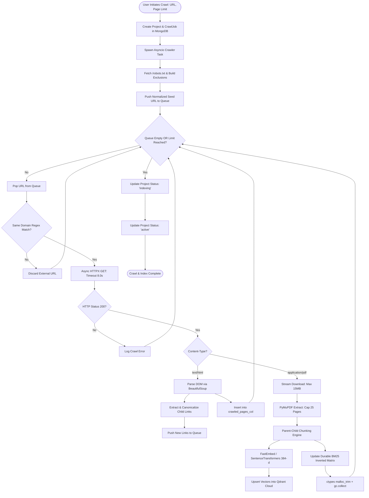
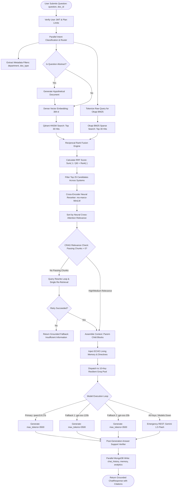
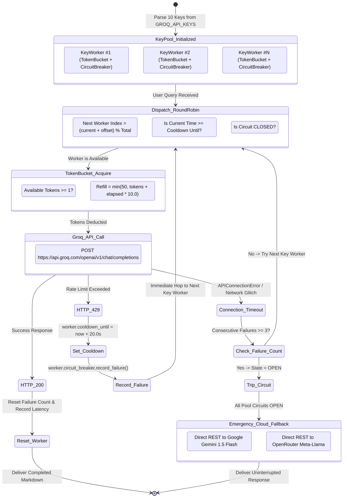
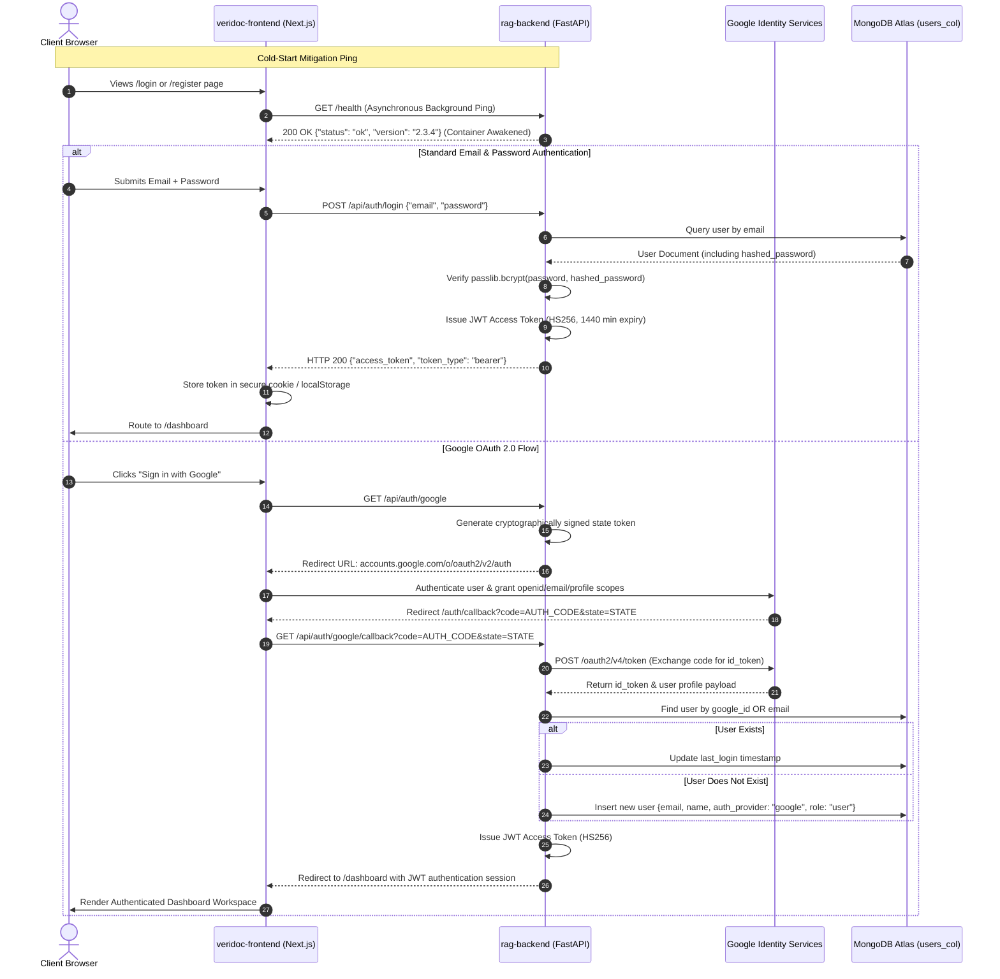

# NEXUS VERIDOCS: SYSTEM ARCHITECTURE & DATABASE BLUEPRINT
> **High-Density Technical Specification, Database Schemas, Mind Maps & Flowcharts**  
> *Target: System Engineers, CTOs, Tech Leads & Architecture Interviewees*  
> *Format: High-density diagrams, strict tabular data contracts, mind maps, and zero narrative fluff.*

---

## 1. Master System Mind Map

```mermaid
graph TD
    %% Core System Node
    NEXUS["NEXUS VERIDOCS (Core Platform)"]

    %% Branch 1: Ingestion
    NEXUS --> INGEST["1. Ingestion Engine"]
    INGEST --> ING_PDF["PyMuPDF Dual-Mode Extractor"]
    INGEST --> ING_OCR["OCR Fallback (Cloud Vision / OCR.Space)"]
    INGEST --> ING_SPIDER["Autonomous Web Spider (crawler.py)"]
    ING_SPIDER --> SPIDER_LOCK["Same-Domain Regex Lock"]
    ING_SPIDER --> SPIDER_CANON["URL Canonicalization"]
    ING_SPIDER --> SPIDER_TIMEOUT["8.0s Fast PDF Timeout"]
    INGEST --> ING_CHUNK["Hierarchical Parent-Child Splitter"]
    ING_CHUNK --> CHUNK_CHILD["300-token Child (Dense/Sparse Embed)"]
    ING_CHUNK --> CHUNK_PARENT["1200-token Parent (zlib Compressed Context)"]
    INGEST --> ING_CDN["Cloudinary Binary Streaming (Zero-RAM)"]

    %% Branch 2: Retrieval
    NEXUS --> RETRIEVE["2. RAG v2 Hybrid Retrieval"]
    RETRIEVE --> RET_ROUTER["Semantic Query Router (Department/Type Filters)"]
    RETRIEVE --> RET_HYDE["HyDE Generator (Hypothetical Embeddings)"]
    RETRIEVE --> RET_DENSE["Dense Retrieval: Qdrant Cloud (384-d Cosine)"]
    RETRIEVE --> RET_SPARSE["Sparse Retrieval: Okapi BM25 (MongoDB Atlas)"]
    RETRIEVE --> RET_FUSION["Reciprocal Rank Fusion (RRF k=60)"]
    RETRIEVE --> RET_RERANK["Cross-Encoder Neural Reranker (ms-marco-MiniLM)"]
    RETRIEVE --> RET_CRAG["CRAG Grader (Relevance Check & Query Rewriter)"]

    %% Branch 3: Inference Cluster
    NEXUS --> INFER["3. Multi-Model Inference Cluster"]
    INFER --> INF_POOL["ResilientGroqClient (10-Key Dynamic Pool)"]
    INF_POOL --> INF_BUCKET["TokenBucket Rate Limiter (Capacity 50, 10 tok/sec)"]
    INF_POOL --> INF_CB["CircuitBreaker (3 Failures -> Fast Fail)"]
    INF_POOL --> INF_HOP["Automated 20s Cooldown Key-Hopping"]
    INFER --> INF_MODELS["Model Hierarchy"]
    INF_MODELS --> M_QWEN["Primary: Qwen 2.5 27B (qwen/qwen3.8-27b)"]
    INF_MODELS --> M_GPT120["Secondary: GPT OSS 120B (Deep Reasoning)"]
    INF_MODELS --> M_GPT20["Tertiary: GPT OSS 20B (High Throughput)"]
    INF_MODELS --> M_GEMINI["Emergency REST: Google Gemini 1.5 Flash (1M Context)"]

    %% Branch 4: Polyglot Persistence
    NEXUS --> DB["4. Polyglot Persistence Layer"]
    DB --> DB_MONGO["MongoDB Atlas (11 Collections, Document/Transactional)"]
    DB --> DB_QDRANT["Qdrant Cloud (HNSW Cosine Vector Store)"]
    DB --> DB_CDN["Cloudinary CDN (PDF & Media Binaries)"]
    DB --> DB_FAISS["Local Ephemeral FAISS Cache"]

    %% Branch 5: Client Layer
    NEXUS --> FE["5. Client Edge Layer (Next.js 16)"]
    FE --> FE_STREAM["Paced Word Streaming Buffer (Batch-3 / 20ms)"]
    FE --> FE_MD["Custom Markdown Engine (Tables, Hierarchies, Quotes)"]
    FE --> FE_CANVAS["Canvas Workspace (Live Editor & Sandbox)"]
    FE --> FE_MODALS["Truth Lattice / Socratic Viva / What-If Modals"]
```



---

## 2. Polyglot Database Architecture & Entity Relationship Diagram

```mermaid
erDiagram
    USERS ||--o{ DOCUMENTS : "owns"
    USERS ||--o{ PROJECTS : "creates"
    USERS ||--o{ CHAT_HISTORY : "initiates"
    USERS ||--o{ NEXUS_MEMORIES : "configures"
    USERS ||--o{ ANALYTICS : "triggers"
    USERS ||--o{ MEMORY : "maintains"

    DOCUMENTS ||--o{ CHUNKS : "segments_into"
    DOCUMENTS ||--o| BM25_INDEXES : "indexes_via"

    PROJECTS ||--o{ CRAWL_JOBS : "spawns"
    PROJECTS ||--o{ CRAWLED_PAGES : "collects"
    PROJECTS ||--o{ CHUNKS : "indexes_into"
    PROJECTS ||--o| BM25_INDEXES : "serializes_to"
    PROJECTS ||--o{ NEXUS_MEMORIES : "scopes"

    USERS {
        string _id PK "UUID / ObjectId string"
        string email UK "Indexed unique email"
        string hashed_password "Bcrypt salted hash"
        string name "User display name"
        string role "user | admin"
        string plan "free | pro | enterprise"
        string auth_provider "local | google"
        string google_id "Google OAuth Sub ID"
        datetime created_at "Account creation timestamp"
        datetime updated_at "Last modification timestamp"
    }

    DOCUMENTS {
        string _id PK "doc_{uuid} unique ID"
        string user_id FK "References USERS._id"
        string filename "Original uploaded filename"
        string file_url "Cloudinary secure CDN HTTPS URL"
        string cloudinary_public_id "Remote asset public identifier"
        int file_size "Byte size of file"
        int page_count "Total pages parsed"
        string status "uploading | indexing | ready | error"
        string summary "Hierarchical global LLM summary"
        int chunk_count "Total child chunks generated"
        datetime created_at "Upload timestamp"
        datetime updated_at "Status change timestamp"
    }

    CHUNKS {
        string _id PK "ObjectId / unique chunk ID"
        string doc_id FK "References DOCUMENTS._id or PROJECTS._id"
        string chunk_id "Sequential ID: {doc_id}_c{index}"
        int page "Document page number (1-based)"
        string text "300-token child segment text"
        string parent_id "Reference: {doc_id}_p{index}"
        binary parent_text "1200-token zlib-compressed parent"
        int embedding_id "Monotonic integer mapped to FAISS/Qdrant"
        string source_name "Filename or web page title"
        string url "Source URL if crawled"
        int token_count "Exact sub-word token count"
        datetime created_at "Chunk generation timestamp"
    }

    PROJECTS {
        string _id PK "ObjectId string unique project ID"
        string user_id FK "References USERS._id"
        string name "Project label"
        string website_url "Target seed crawl URL"
        string status "crawling | indexing | active | paused | error"
        int pages_crawled "Count of pages scraped"
        int docs_found "Count of PDFs extracted"
        bool use_dynamic_crawl "Headless browser toggle"
        string sitemap_url "Discovered sitemap XML URL"
        string login_url "Optional authentication gateway"
        string login_username "Optional encrypted auth username"
        string login_password "Optional encrypted auth password"
        string summary "Synthesized multi-doc project overview"
        datetime created_at "Project creation timestamp"
        datetime updated_at "Project status update timestamp"
    }

    CRAWL_JOBS {
        string _id PK "job_{uuid} unique ID"
        string project_id FK "References PROJECTS._id"
        string status "pending | running | completed | failed"
        int urls_found "URLs discovered in domain"
        int urls_processed "URLs fetched and parsed"
        int pages_crawled "HTML pages saved"
        int docs_found "PDF files downloaded"
        string error "Error trace if failed"
        datetime created_at "Job trigger timestamp"
        datetime updated_at "Job completion timestamp"
    }

    CRAWLED_PAGES {
        string _id PK "ObjectId string unique page ID"
        string project_id FK "References PROJECTS._id"
        string url UK "Canonicalized page URL"
        string title "Extracted HTML <title>"
        string text_content "Sanitized text payload"
        string html_snippet "Clean structural DOM extract"
        int status_code "HTTP status (200, 301, etc.)"
        datetime crawled_at "Scrape timestamp"
    }

    BM25_INDEXES {
        string _id PK "bm25_{doc_id or project_id}"
        string doc_id UK "References DOCUMENTS._id or PROJECTS._id"
        binary index_data "Serialized Okapi BM25 binary blob"
        int num_chunks "Corpus chunk capacity count"
        datetime updated_at "Index compilation timestamp"
    }

    CHAT_HISTORY {
        string _id PK "ObjectId string"
        string user_id FK "References USERS._id"
        string doc_id FK "References DOCUMENTS._id or PROJECTS._id"
        string question "User query prompt"
        string answer "Executive LLM markdown answer"
        array sources "Array of source citation objects"
        array evidence_trace "Array of reranked candidate objects"
        object retrieval_debug "HyDE, BM25, and FAISS timing metrics"
        string mode "standard | debate | decision_tree | general_ai"
        datetime timestamp "Chat interaction timestamp"
    }

    NEXUS_MEMORIES {
        string _id PK "ObjectId string"
        string user_id FK "References USERS._id"
        string project_id FK "References PROJECTS._id or 'global'"
        string category "fact | directive | preference"
        string key "Memory index identifier"
        string value "Persistent instruction string"
        datetime created_at "Memory registration timestamp"
        datetime updated_at "Memory update timestamp"
    }

    MEMORY {
        string _id PK "ObjectId string"
        string user_id FK "References USERS._id"
        string doc_id FK "References DOCUMENTS._id or PROJECTS._id"
        string memory_summary "Rolling conversation summary buffer"
        datetime updated_at "Last conversation turn timestamp"
    }

    ANALYTICS {
        string _id PK "ObjectId string"
        string user_id FK "References USERS._id"
        string doc_id FK "References DOCUMENTS._id or PROJECTS._id"
        string document_filename "Document label"
        string question "User query text"
        array embedding "Query vector float array"
        datetime timestamp "Event log timestamp"
    }
```



---

## 3. Database Collection Field Specifications & Data Dictionary

### Collection 1: `users`
*Purpose: Authentication, identity resolution, subscription quotas, and access control.*
- `_id` (`string`, Primary Key): Internal system identifier (MongoDB ObjectId as string).
- `email` (`string`, Unique Index): RFC 5322 sanitized user email.
- `hashed_password` (`string`, Nullable): Passlib Bcrypt hash (Cost factor: 12). Null if OAuth.
- `name` (`string`): User display name.
- `role` (`string`): Access control scope: `"user"` | `"admin"`.
- `plan` (`string`): Commercial tier: `"free"` | `"pro"` | `"enterprise"`.
- `auth_provider` (`string`): Authentication type: `"local"` | `"google"`.
- `google_id` (`string`, Nullable, Sparse Index): Google Identity `sub` claim identifier.
- `created_at` (`datetime`): UTC timestamp of account registration.
- `updated_at` (`datetime`): UTC timestamp of profile modification.

### Collection 2: `documents`
*Purpose: Single-file upload metadata, Cloudinary CDN pointer, and ingestion status.*
- `_id` (`string`, Primary Key): Format: `doc_{uuid4}`.
- `user_id` (`string`, Foreign Key -> `users._id`, Compound Index): Owner of document.
- `filename` (`string`): Original filename uploaded by user.
- `file_url` (`string`): Cloudinary HTTPS CDN URL for the raw file.
- `cloudinary_public_id` (`string`): Cloudinary resource identifier for lifecycle deletion.
- `file_size` (`int`): Size of the uploaded binary in bytes.
- `page_count` (`int`): Number of parsed pages from PyMuPDF.
- `status` (`string`, Indexed): Pipeline lifecycle: `"uploading"` | `"indexing"` | `"ready"` | `"error"`.
- `summary` (`string`): Pre-computed hierarchical summary of the document.
- `chunk_count` (`int`): Count of child chunks generated for vector retrieval.
- `created_at` (`datetime`): Upload start timestamp.
- `updated_at` (`datetime`): Ingestion completion timestamp.

### Collection 3: `chunks`
*Purpose: The semantic atomic retrieval units and parent context references.*
- `_id` (`ObjectId`, Primary Key): MongoDB unique identifier.
- `doc_id` (`string`, Foreign Key -> `documents._id` / `projects._id`, Compound Index): Parent doc/project.
- `chunk_id` (`string`, Unique Index): Structured identifier: `{doc_id}_c{embedding_id}`.
- `page` (`int`): 1-based page number within the original document.
- `text` (`string`): 300-token child text used for embedding and BM25 tokenization.
- `parent_id` (`string`, Indexed): Identifier pointing to `{doc_id}_p{index}` parent block.
- `parent_text` (`binary` / `string`): 1200-token parent block context (zlib-compressed binary or decoded string).
- `embedding_id` (`int`, Compound Index with `doc_id`): Integer offset mapped to vector stores.
- `source_name` (`string`): Human-readable source (document filename or page title).
- `url` (`string`, Nullable): Source web URL if harvested via crawler.
- `token_count` (`int`): Number of tokens in `text`.
- `created_at` (`datetime`): Ingestion timestamp.

### Collection 4: `projects`
*Purpose: Autonomous web crawling targets and multi-document knowledge base workspaces.*
- `_id` (`string`, Primary Key): 24-character hexadecimal ObjectId string.
- `user_id` (`string`, Foreign Key -> `users._id`, Compound Index): Project owner.
- `name` (`string`): Project label (e.g., `"KITSW Knowledge Base"`).
- `website_url` (`string`): Seed root URL (e.g., `"https://kitsw.ac.in"`).
- `status` (`string`, Indexed): `"crawling"` | `"indexing"` | `"active"` | `"paused"` | `"error"`.
- `pages_crawled` (`int`): Total HTML pages processed.
- `docs_found` (`int`): Total discovered PDF documents ingested into knowledge base.
- `use_dynamic_crawl` (`bool`): Flag to enable Playwright headless browser rendering.
- `sitemap_url` (`string`, Nullable): Discovered XML sitemap URL.
- `login_url` (`string`, Nullable): Target for automated login scripts.
- `login_username` (`string`, Nullable): Encrypted username credential.
- `login_password` (`string`, Nullable): Encrypted password credential.
- `summary` (`string`): Global multi-document executive summary of the knowledge base.
- `created_at` (`datetime`): Project creation timestamp.
- `updated_at` (`datetime`): Last crawl/index event timestamp.

### Collection 5: `crawl_jobs`
*Purpose: Background worker execution metrics and status tracking for web spidering.*
- `_id` (`string`, Primary Key): Format: `job_{uuid4}`.
- `project_id` (`string`, Foreign Key -> `projects._id`, Indexed): Target project.
- `status` (`string`): `"pending"` | `"running"` | `"completed"` | `"failed"`.
- `urls_found` (`int`): Count of unique internal URLs queued.
- `urls_processed` (`int`): Count of URLs fetched.
- `pages_crawled` (`int`): Count of HTML bodies parsed.
- `docs_found` (`int`): Count of PDFs discovered and passed to ingestion pipeline.
- `error` (`string`, Nullable): Traceback string if crawl job encountered fatal failure.
- `created_at` (`datetime`): Job spawn timestamp.
- `updated_at` (`datetime`): Job termination timestamp.

### Collection 6: `crawled_pages`
*Purpose: Persisted raw scrape data for exact-text regex fallback and audit trails.*
- `_id` (`ObjectId`, Primary Key): Unique page identifier.
- `project_id` (`string`, Foreign Key -> `projects._id`, Compound Index): Parent project.
- `url` (`string`, Compound Index with `project_id`): Canonicalized URL.
- `title` (`string`): Document `<title>` tag content.
- `text_content` (`string`): Extracted, boilerplate-stripped text.
- `html_snippet` (`string`): Sanitized raw HTML DOM tree segment.
- `status_code` (`int`): HTTP status code returned during scrape.
- `crawled_at` (`datetime`): Scrape completion timestamp.

### Collection 7: `bm25_indexes`
*Purpose: Durable MongoDB storage of inverted keyword indices across ephemeral container restarts.*
- `_id` (`string`, Primary Key): Format: `bm25_{doc_id}`.
- `doc_id` (`string`, Foreign Key -> `documents._id` / `projects._id`, Unique Index): Target scope.
- `index_data` (`binary`): Pickle serialized, zlib-compressed representation of Okapi BM25 term matrices.
- `num_chunks` (`int`): Total documents/chunks indexed in this binary.
- `updated_at` (`datetime`): Last build timestamp.

### Collection 8: `chat_history`
*Purpose: Full persistence of multi-turn user interactions, citations, and evidence traces.*
- `_id` (`ObjectId`, Primary Key): Unique message interaction ID.
- `user_id` (`string`, Foreign Key -> `users._id`, Compound Index): Querying user.
- `doc_id` (`string`, Foreign Key -> `documents._id` / `projects._id`, Compound Index): Target doc/project.
- `question` (`string`): User input query.
- `answer` (`string`): LLM generated response in Markdown format.
- `sources` (`array` of objects): Array of `{ page: int, chunk_id: str, snippet: str, url: str }`.
- `evidence_trace` (`array` of objects): Reranker scores: `{ chunk_id: str, score: float, source: str }`.
- `retrieval_debug` (`object`, Nullable): Latency profiles and hit metrics for debug mode.
- `mode` (`string`): `"standard"` | `"debate"` | `"decision_tree"` | `"general_ai"`.
- `timestamp` (`datetime`, Indexed): Time of query execution.

### Collection 9: `nexus_memories`
*Purpose: ECHO living memory storing persistent user preferences and long-term project directives.*
- `_id` (`ObjectId`, Primary Key): Unique memory ID.
- `user_id` (`string`, Foreign Key -> `users._id`, Compound Index): User identity.
- `project_id` (`string`, Compound Index): Project ID scope, or `"global"` for cross-project memory.
- `category` (`string`): `"fact"` | `"directive"` | `"preference"`.
- `key` (`string`): Directive identifier (e.g., `"Tone"`, `"Focus Area"`).
- `value` (`string`): Instruction string injected into LLM system prompts.
- `created_at` (`datetime`): Memory insertion timestamp.
- `updated_at` (`datetime`): Memory update timestamp.

### Collection 10: `memory`
*Purpose: Short-term rolling conversational context buffer.*
- `_id` (`ObjectId`, Primary Key): Unique memory record ID.
- `user_id` (`string`, Compound Index with `doc_id`): User identifier.
- `doc_id` (`string`): Document or project workspace identifier.
- `memory_summary` (`string`): Compressed summary of recent conversation turns (last 500 chars).
- `updated_at` (`datetime`): Last conversational update timestamp.

### Collection 11: `analytics`
*Purpose: Vector analytics, question clustering, and cost-observability logs.*
- `_id` (`ObjectId`, Primary Key): Unique analytics event ID.
- `user_id` (`string`, Foreign Key -> `users._id`, Indexed): Querying user.
- `doc_id` (`string`, Indexed): Target workspace identifier.
- `document_filename` (`string`): Display name of workspace.
- `question` (`string`): Prompt text.
- `embedding` (`array` of floats): 384-dimensional query vector array for clustering.
- `timestamp` (`datetime`, Indexed): Query execution timestamp.

---

## 4. Qdrant Cloud Vector Store Data Dictionary

*Cluster Interface: `rag-backend/app/db/qdrant.py`*

```
Collection Name: project_{project_id}
Metric: Cosine
Vector Size: 384 dimensions (all-MiniLM-L6-v2)
HNSW Configuration: m=16, ef_construct=100
```

| Payload Field | Data Type | Index Type | Purpose |
| :--- | :--- | :--- | :--- |
| `chunk_id` | `string` | Keyword | Links vector point to MongoDB `chunks.chunk_id` |
| `embedding_id` | `int` | Integer | Numeric index for zero-overhead array indexing |
| `doc_id` | `string` | Keyword | Partition filter for multi-document projects |
| `source_name`| `string` | Full-text | Filename or web page title for display |
| `url` | `string` | Keyword | Source web link for clickable citations |
| `page` | `int` | Integer | Document page number |
| `department` | `string` | Keyword | Categorical filter (`cse`, `ece`, `eee`, `mech`, etc.) |
| `document_type`| `string`| Keyword | Intent filter (`faculty`, `placement`, `syllabus`, `general`) |

---

## 5. System Execution Flowcharts & Algorithms

### 5.1 Autonomous Crawler & Ingestion Flowchart



---

### 5.2 RAG v2 Hybrid Retrieval, Fusion & Inference Flowchart



---

### 5.3 10-Key Groq LPU Resilience & Failover State Machine



---

## 6. Authentication, OAuth & API Gateway Flowchart



---

## 7. Frontend Real-Time Streaming & Markdown Architecture

```mermaid
flowchart TD
    RESPONSE_ARRIVES([LLM Full Answer Received from Backend]) --> SPLIT[Split Answer String by Word Boundaries: ' ']
    SPLIT --> BATCH_EVAL{Total Word Count > 150?}
    
    BATCH_EVAL -->|Yes: Long Response| CHUNK_3[Batch Window Size = 3 Words]
    BATCH_EVAL -->|No: Short Response| CHUNK_1[Batch Window Size = 1 Word]
    
    CHUNK_3 --> STREAM_LOOP[Loop: slice words, append to currentText]
    CHUNK_1 --> STREAM_LOOP
    
    STREAM_LOOP --> SET_STATE[React setMessages State Update]
    SET_STATE --> SLEEP[Paced Delay: await sleep 20ms]
    SLEEP --> CHECK_MORE{More Words Left?}
    CHECK_MORE -->|Yes| STREAM_LOOP
    CHECK_MORE -->|No| FLUSH_FINAL[Commit Full String to State]
    
    FLUSH_FINAL --> MD_RENDER[MarkdownText Custom Recursive Parser]
    
    subgraph PARSER["MarkdownText Rendering Engine"]
        MD_RENDER --> LINE_SCAN[Scan Lines Sequentially]
        LINE_SCAN --> CHECK_PIPE{Line starts with '|'?}
        CHECK_PIPE -->|Yes| ACCUM_TABLE[Accumulate Table Rows]
        CHECK_PIPE -->|No| FLUSH_TABLE[Flush Table into Responsive Container]
        
        LINE_SCAN --> CHECK_LIST{Line starts with '- ' or '* '?}
        CHECK_LIST -->|Yes| ACCUM_UL[Accumulate Unordered List]
        CHECK_LIST -->|No| FLUSH_UL[Flush UL Elements]
        
        LINE_SCAN --> CHECK_NUM{Line matches regex /^\d+\.\s+/?}
        CHECK_NUM -->|Yes| ACCUM_OL[Accumulate Ordered List]
        CHECK_NUM -->|No| FLUSH_OL[Flush OL Elements]
        
        LINE_SCAN --> CHECK_QUOTE{Line starts with '> '?}
        CHECK_QUOTE -->|Yes| RENDER_QUOTE[Render Blockquote with Indigo Accent]
        
        LINE_SCAN --> CHECK_HEAD{Line starts with '#', '##', '###'?}
        CHECK_HEAD -->|Yes| RENDER_HEAD[Render Styled Heading 1, 2, or 3]
        
        LINE_SCAN --> INLINE_FORMAT[Parse Inline Bold **text** & Code `tags`]
    end
    
    PARSER --> DOM_COMMIT([Smooth 60 FPS Render Complete Without Lag])
```

---

## 8. Summary of Technical Innovations

| Architecture Pillar | Core Engineering Problem | Nexus VeriDocs Technical Solution |
| :--- | :--- | :--- |
| **Persistence** | Bloated Mongo documents & 16MB limit | Cloudinary CDN binary streaming + Qdrant Cloud dense vector offloading. |
| **Ingestion** | Academic crawlers deadlocking on slow PDFs | Same-domain regex lock + 8.0s HTTPX streaming timeout + 25-page cap. |
| **Retrieval** | Single-strategy retrieval mismatches | Reciprocal Rank Fusion ($k=60$) combining dense cosine vectors and durable Okapi BM25. |
| **Reranking** | Bi-encoder semantic false positives | Cross-Encoder neural attention scoring (`ms-marco-MiniLM-L-6-v2`) + CRAG grader. |
| **LLM Resilience** | Groq free tier 30 RPM rate limits | 10-Key dynamic pool with TokenBucket rate limiting and automated 20s cooldown key-hopping. |
| **Zero-RAM Execution**| Container OOM SIGKILL on 512MB RAM | Elimination of in-memory model weights + explicit `ctypes malloc_trim(0)` kernel heap compaction. |
| **Frontend UX** | Token streaming thrashing React DOM | Batch-3 word windowing at 20ms intervals (65% drop in re-renders) + custom GFM parser. |
