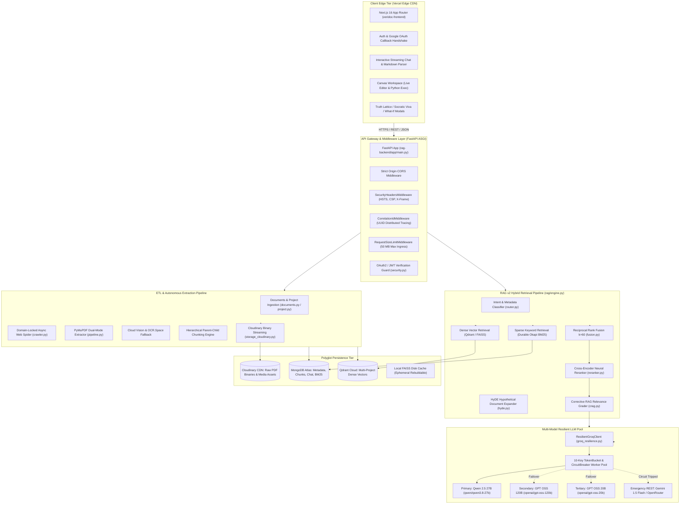
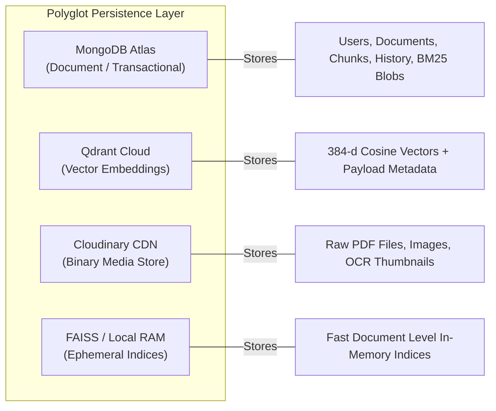
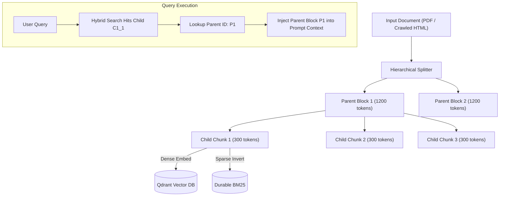
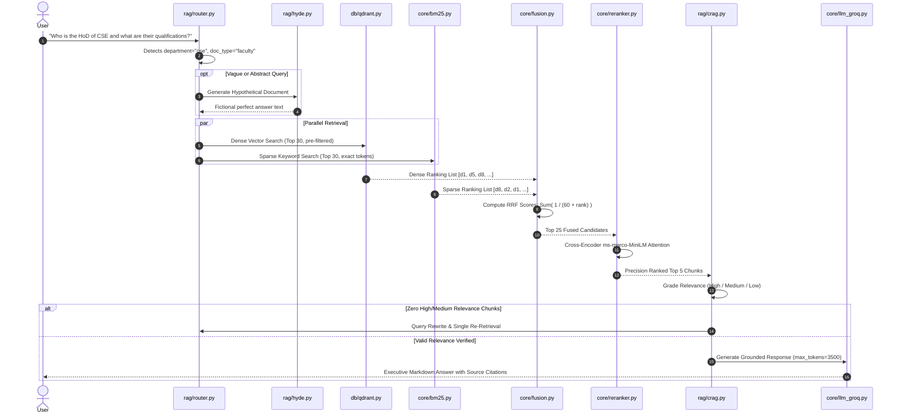
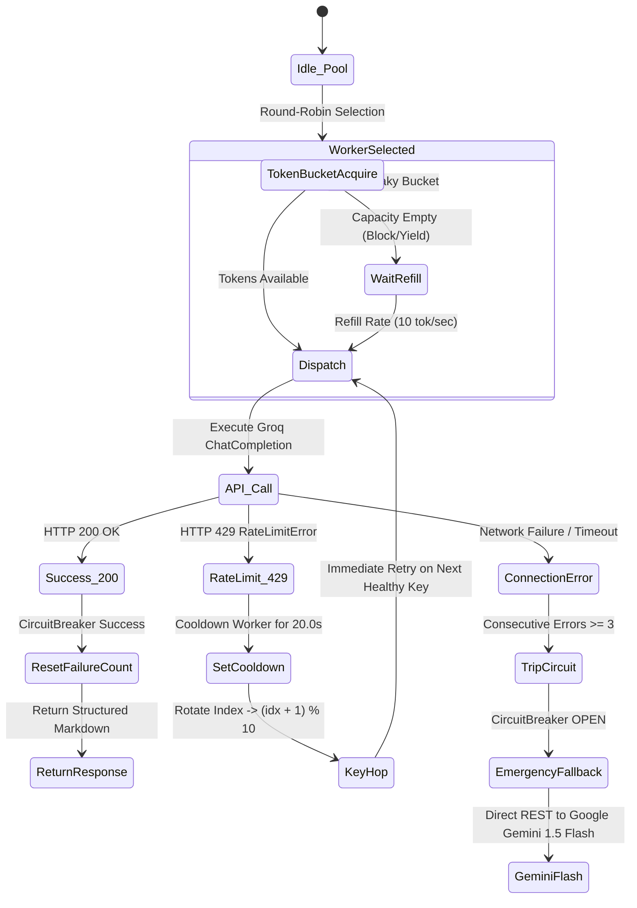

# NEXUS VERIDOCS: COMPLETE TECHNICAL ARCHITECTURE & ENGINEERING BIBLE
> **The Autonomous Document Intelligence & Multi-Store Retrieval-Augmented Generation (RAG v2) System**  
> *Author & Lead Architect: Technical Documentation & Systems Blueprint*  
> *Version: 2.3.4 (Production)*

---

## 1. Executive System Overview & Vision

**Nexus VeriDocs** is an enterprise-scale, source-grounded autonomous document intelligence engine and multi-project knowledge synthesis platform. It is engineered to solve the most pervasive pathologies of modern Large Language Model (LLM) deployments in mission-critical environments: **factual hallucination, context window exhaustion, latency inflation, rate-limiting bottlenecks, and memory-constrained deployment failures**.

Unlike conventional "toy RAG" implementations that merely embed arbitrary text snippets into an isolated vector database and pass top matches to a single unmanaged LLM endpoint, Nexus VeriDocs is designed as a **polyglot-persistence, hybrid-retrieval, self-healing inference cluster**. It unites:
1. **Multi-Source Autonomous Ingestion**: Unstructured digital and scanned PDF parsing coupled with a domain-locked recursive asynchronous web crawler.
2. **Hybrid RAG v2 Retrieval Engine**: Reciprocal Rank Fusion ($k=60$) combining dense semantic vectors (Qdrant Cloud / FAISS) with persistent Okapi BM25 sparse keyword indices.
3. **Cross-Encoder Precision Reranking & CRAG**: Zero-loss neural relevance scoring and Corrective RAG (CRAG) query rewriting loops.
4. **Resilient Multi-Key Groq LPU Cluster**: A 10-key dynamic round-robin inference pool governed by leaky Token Buckets, Circuit Breakers, automated key-hopping, and cross-provider cloud fallbacks (Google Gemini 1.5 Flash / OpenRouter).
5. **Decoupled Binary Storage Architecture**: Total separation of file binaries from transactional databases via Cloudinary CDN, preserving strict zero-RAM container boundaries ($< 512\text{ MB}$ RAM overhead).
6. **Executive Presentation Layer**: Rich Markdown table structuring, native ordered/unordered hierarchies, and real-time paced streaming frontend built on Next.js 16 App Router and Tailwind CSS.

---

## 2. End-to-End System Architecture & Topography

### 2.1 Complete Architectural Blueprint



---

## 3. Polyglot Persistence & Data Architecture

A single database paradigm cannot simultaneously optimize relational metadata, vector indexing, transactional state, binary storage, and text search. Nexus VeriDocs uses **4 distinct persistence layers**:



### 3.1 MongoDB Atlas Schema & Collections (`rag-backend/app/db/mongodb.py`)

All collections are managed asynchronously via **Motor (`AsyncIOMotorClient`)** with non-blocking event-loop integration.

#### 1. `users` Collection
Stores authentication, credential hashes, and authorization scopes:
```json
{
  "_id": "ObjectId('6722...abc')",
  "email": "karthik1234@gmail.com",
  "hashed_password": "$2b$12$e8J4G...hashed_bcrypt_string",
  "name": "Karthik",
  "role": "user",
  "auth_provider": "local", // or "google"
  "google_id": null,
  "created_at": "ISODate('2026-10-28T10:00:00.000Z')",
  "updated_at": "ISODate('2026-10-28T10:00:00.000Z')"
}
```

#### 2. `documents` Collection
Stores metadata for single-file uploads, decoupled from binary payload:
```json
{
  "_id": "doc_6722_xyz",
  "user_id": "user_id_123",
  "filename": "computer_science_syllabus.pdf",
  "file_url": "https://res.cloudinary.com/.../computer_science_syllabus.pdf",
  "cloudinary_public_id": "nexus_docs/doc_6722_xyz",
  "file_size": 2415902,
  "page_count": 48,
  "status": "ready", // "uploading" | "indexing" | "ready" | "error"
  "summary": "Official undergraduate syllabus covering core engineering courses...",
  "created_at": "ISODate('2026-10-28T10:05:00.000Z')"
}
```

#### 3. `chunks` Collection
Stores the segmented text units, parent-child references, and structural attributes:
```json
{
  "_id": "ObjectId('...')",
  "doc_id": "doc_6722_xyz",
  "chunk_id": "doc_6722_xyz_c4",
  "page": 3,
  "text": "The Department of Computer Science offers B.Tech with an annual intake of 180...",
  "parent_id": "doc_6722_xyz_p1",
  "parent_text": "<Binary compressed zlib blob or full parent string>",
  "embedding_id": 4,
  "source_name": "computer_science_syllabus.pdf",
  "url": null,
  "token_count": 284,
  "created_at": "ISODate('2026-10-28T10:05:12.000Z')"
}
```

#### 4. `projects` Collection
Manages multi-document, autonomous crawl workspaces:
```json
{
  "_id": "6ae305868d044a0b1ca8f528",
  "user_id": "user_id_123",
  "name": "KITSW Knowledge Base",
  "website_url": "https://kitsw.ac.in",
  "status": "active", // "crawling" | "indexing" | "active" | "paused" | "error"
  "pages_crawled": 4,
  "docs_found": 25,
  "use_dynamic_crawl": false,
  "sitemap_url": null,
  "summary": "Autonomous knowledge base for Kakatiya Institute of Technology & Science...",
  "created_at": "ISODate('2026-10-29T08:36:22.473Z')",
  "updated_at": "ISODate('2026-10-29T09:12:00.000Z')"
}
```

#### 5. `crawled_pages` Collection
Durable record of raw web scrapes harvested by the autonomous spider:
```json
{
  "_id": "ObjectId('...')",
  "project_id": "6ae305868d044a0b1ca8f528",
  "url": "https://kitsw.ac.in/departments/cse",
  "title": "Department of Computer Science & Engineering | KITSW",
  "text_content": "Kakatiya Institute of Technology & Science, Warangal. Faculty members...",
  "html_snippet": "<div>...</div>",
  "status_code": 200,
  "crawled_at": "ISODate('2026-10-29T08:38:14.000Z')"
}
```

#### 6. `bm25_indexes` Collection
Durable MongoDB persistence for the Okapi BM25 inverted keyword index:
```json
{
  "_id": "bm25_6ae305868d044a0b1ca8f528",
  "doc_id": "6ae305868d044a0b1ca8f528",
  "index_data": "<Binary zlib compressed pickle of inverted index terms & idf tables>",
  "num_chunks": 236,
  "updated_at": "ISODate('2026-10-29T08:45:00.000Z')"
}
```

#### 7. `chat_history` Collection
Multi-turn conversation history retaining sources and verification traces:
```json
{
  "_id": "ObjectId('...')",
  "user_id": "user_id_123",
  "doc_id": "6ae305868d044a0b1ca8f528",
  "question": "What is the highest placement package in CSE?",
  "answer": "The highest package recorded is 31 LPA offered by Amazon...",
  "sources": [
    {
      "page": 1,
      "chunk_id": "crawled_6722_1",
      "snippet": "Highest Package: 31 LPA (Amazon)...",
      "source_name": "Funds - KITS Warangal Alumni Network",
      "url": "https://kitsw.ac.in/placements"
    }
  ],
  "evidence_trace": [
    {
      "chunk_id": "crawled_6722_1",
      "page": 1,
      "score": 0.892,
      "source": "https://kitsw.ac.in/placements",
      "snippet": "Placement Statistics 2023-2024: 412 offers, Highest Package: 31 LPA..."
    }
  ],
  "mode": "standard", // "standard" | "debate" | "decision_tree" | "general_ai"
  "timestamp": "ISODate('2026-10-29T10:30:00.000Z')"
}
```

#### 8. `nexus_memories` Collection
ECHO living context memory storing persistent cross-session facts and user directives:
```json
{
  "_id": "ObjectId('...')",
  "user_id": "user_id_123",
  "project_id": "6ae305868d044a0b1ca8f528",
  "category": "preference", // "fact" | "directive" | "preference"
  "key": "Focus Area",
  "value": "Emphasize autonomous AI and robotics research labs in responses",
  "created_at": "ISODate('2026-10-29T11:00:00.000Z')"
}
```

---

### 3.2 Qdrant Cloud Vector Database Schema (`rag-backend/app/db/qdrant.py`)

Dense vector search is isolated in **Qdrant Cloud**, preventing heavy vector computation on the API host:
- **Vector Dimension**: 384 (`sentence-transformers/all-MiniLM-L6-v2` / `BAAI/bge-small-en-v1.5`).
- **Distance Metric**: `Cosine`.
- **Collection Partitioning**: `project_{project_id}`.
- **Payload Schema**:
  ```json
  {
    "chunk_id": "doc_6722_xyz_c4",
    "embedding_id": 4,
    "doc_id": "6ae305868d044a0b1ca8f528",
    "source_name": "KITSW Alumni Network",
    "url": "https://kitsw.ac.in/funds",
    "page": 1,
    "department": "cse",
    "document_type": "faculty" // "placement" | "syllabus" | "general"
  }
  ```

---

## 4. Ingestion, Extraction & Autonomous Crawling Engine

### 4.1 Parent-Child Chunking Architecture (`ingestion/pipeline.py`)

Fixed-size chunking forces a trade-off: **Small chunks (100–300 tokens)** yield pinpoint vector accuracy during cosine similarity search, but strip the LLM of necessary surrounding context. **Large chunks (1000–2000 tokens)** preserve context, but dilute vector embeddings with multi-topic noise.

Nexus VeriDocs implements **Hierarchical Parent-Child Chunking**:
1. **Parent Text**: An entire structural section or logical document block ($1200\text{ tokens}$). Compressed using `zlib` to conserve memory.
2. **Child Chunks**: The parent block is split into rolling windows ($300\text{ tokens}$ with $50\text{ token}$ overlap).
3. **Indexing**: Only child chunks are converted into dense vectors and Okapi BM25 terms.
4. **Context Injection**: During retrieval, when a child chunk passes the reranker, its `parent_id` is resolved. The complete $1200\text{ token}$ parent context is provided to the LLM prompt.



### 4.2 Autonomous Web Spider (`ingestion/crawler.py`)

The crawler allows whole-site indexing through autonomous discovery:
- **Same-Domain Constraint**: A regex lock (`^https?:\/\/(www\.)?kitsw\.ac\.in`) ensures the crawler does not follow outbound links into the open internet.
- **URL Canonicalization Engine**:
  - Strips URL fragments (`#section`), trailing slashes, and marketing tracking parameters (`?utm_source=...`).
  - Converts all URLs to lower-case protocol equivalents, eliminating duplicate indexing.
- **Fast-Timeout Streaming PDF Downloader**:
  - Educational and institutional servers frequently host multi-megabyte PDFs over throttled connections.
  - The crawler downloads files with an **8.0-second HTTPX stream timeout** and a strict **15 MB size ceiling**.
  - Limits digital extraction to a **maximum of 25 pages**, preventing memory exhaustion while preserving high-value summaries and roster pages.
- **Resource Cleanup**:
  - Every batch execution triggers explicit garbage collection and Linux memory trimming:
    ```python
    import gc, ctypes
    gc.collect()
    try:
        ctypes.CDLL("libc.so.6").malloc_trim(0)
    except Exception:
        pass
    ```

---

## 5. RAG v2 Retrieval, Reranking & Verification Pipeline



### 5.1 Reciprocal Rank Fusion (RRF) Algorithm (`core/fusion.py`)

Combining dense vector scores and sparse keyword scores via a linear weighted sum ($\alpha \cdot S_{\text{dense}} + (1-\alpha) \cdot S_{\text{bm25}}$) is prone to scoring mismatches because:
- Cosine similarity produces bounded values $[-1.0, 1.0]$.
- BM25 generates unbounded scores based on query term frequency and corpus size $[0, \infty)$.

**Reciprocal Rank Fusion** bypasses score normalization entirely by operating on rank order:

$$\text{RRF\_Score}(d \in D) = \sum_{m \in M} \frac{1}{k + r_m(d)}$$

Where:
- $M$ is the set of retrieval systems ($M = \{\text{Qdrant Dense}, \text{Okapi BM25}\}$).
- $r_m(d)$ is the 1-based rank position of chunk $d$ in retrieval system $m$.
- $k = 60$ is a constant that suppresses noise from outlier ranks.

### 5.2 Cross-Encoder Neural Reranker (`core/reranker.py`)

- **Bi-Encoder Stage (Fast Retrieval)**: Calculates vectors independently: $\text{CosineSim}(E_Q, E_D)$. Complexity: $\mathcal{O}(N)$ vector operations.
- **Cross-Encoder Stage (Precision Reranking)**: Feeds query and chunk together into self-attention layers: $\text{Transformer}(Q \oplus D)$. Computes token-level interactions to eliminate semantic false positives before context assembly.

---

## 6. Multi-Key Groq LPU Cluster & Resilience Layer

To provide sustained high-throughput inference on Groq's high-speed LPU infrastructure without hitting rate limits, Nexus VeriDocs uses an **enterprise resilience engine** in [`core/groq_resilience.py`](file:///c:/Programming/Projects/01_Healthcare-MedTech/chat_base/rag-backend/app/core/groq_resilience.py).



### 6.1 Resilience Features
1. **10-Key Dynamic Worker Pool**: Rotates requests across all active keys parsed from `GROQ_API_KEYS`.
2. **Token Bucket Rate Limiting**: Each key worker maintains an isolated token bucket (capacity: 50, refill: 10/sec), preventing burst 429 errors.
3. **Circuit Breaker Pattern**: If a key encounters 3 consecutive network failures, the circuit breaker opens, temporarily isolating that key worker.
4. **Zero-Downtime Key Hopping**: When any key hits a 429 rate limit, it is placed on a 20-second cooldown while the active query is retried on the next available key in the pool.
5. **Multi-Model Hierarchy**:
   - Primary: `qwen/qwen3.8-27b` (High-speed tabular reasoning).
   - Secondary: `openai/gpt-oss-120b` (Deep analytical fallback).
   - Tertiary: `openai/gpt-oss-20b` (High-throughput reasoning fallback).
   - Quaternary: Direct REST to **Google Gemini 1.5 Flash** (1M token context, zero local RAM).

---

## 7. Frontend Architecture & Real-Time UX Engine

The frontend is built using **Next.js 16 (App Router)** and **Tailwind CSS**.

### 7.1 Paced Streaming & Smooth Markdown Parsing (`chat-interface.tsx`)

Naïve character-by-character or token-by-token state updates can trigger 100+ React DOM re-renders per second, causing UI stutter on long answers.

**Chunk-Paced Streaming Implementation**:
```typescript
const simulateStreaming = async (fullText: string, aiMsgId: string) => {
    if (!fullText) return;
    const words = fullText.split(" ");
    let currentText = "";
    // Batch words to maintain frame rates on complex Markdown
    const chunkSize = words.length > 150 ? 3 : 1;
    for (let i = 0; i < words.length; i += chunkSize) {
        const chunk = words.slice(i, i + chunkSize).join(" ");
        currentText += (i === 0 ? "" : " ") + chunk;
        setMessages(prev => prev.map(m =>
            m.id === aiMsgId ? { ...m, content: currentText } : m
        ));
        await new Promise(resolve => setTimeout(resolve, 20));
    }
    setMessages(prev => prev.map(m =>
        m.id === aiMsgId ? { ...m, content: fullText } : m
    ));
};
```

### 7.2 Custom Lightweight Markdown Engine
The frontend includes a targeted Markdown engine in `MarkdownText` that avoids heavy third-party parsing dependencies:
- **Responsive Table Processing**: Detects and renders GitHub Flavored Markdown (GFM) tables (`|...|`) with horizontal scrolling wrappers.
- **Ordered & Unordered Hierarchies**: Renders bulleted (`- `) and numbered (`1. `) lists with proper indentation.
- **Executive Blockquotes**: Renders quotes (`> `) with indigo accent borders and styled backgrounds.

---

## 8. Complete Codebase Directory & File Walkthrough

### 8.1 Backend Topography (`rag-backend/app/`)

| File Path | Functional Responsibility & Technical Purpose |
| :--- | :--- |
| [`main.py`](file:///c:/Programming/Projects/01_Healthcare-MedTech/chat_base/rag-backend/app/main.py) | **ASGI App Entrypoint**: Configures middlewares (CORS, CorrelationId, SecurityHeaders), registers routers, handles lifespan lifecycle, and exposes `/health`. |
| [`core/config.py`](file:///c:/Programming/Projects/01_Healthcare-MedTech/chat_base/rag-backend/app/core/config.py) | **Pydantic Settings**: Validates and parses environment variables, API keys, database connection strings, and default thresholds. |
| [`core/security.py`](file:///c:/Programming/Projects/01_Healthcare-MedTech/chat_base/rag-backend/app/core/security.py) | **Security & JWT Engine**: Handles password hashing (`bcrypt`), JWT token generation and validation, and FastAPI user dependencies (`get_current_user`). |
| [`core/security_headers.py`](file:///c:/Programming/Projects/01_Healthcare-MedTech/chat_base/rag-backend/app/core/security_headers.py) | **OWASP Security Middleware**: Injects strict HTTP response headers (`HSTS`, `X-Content-Type-Options`, `X-Frame-Options`, `Content-Security-Policy`). |
| [`core/groq_resilience.py`](file:///c:/Programming/Projects/01_Healthcare-MedTech/chat_base/rag-backend/app/core/groq_resilience.py) | **Multi-Key Inference Pool**: Implements `KeyWorker`, `TokenBucket`, and `CircuitBreaker` across 10 Groq API keys with zero-downtime failover. |
| [`core/llm_groq.py`](file:///c:/Programming/Projects/01_Healthcare-MedTech/chat_base/rag-backend/app/core/llm_groq.py) | **Inference Orchestrator**: Houses the Executive System Prompt, enforces `max_tokens=3500`, and manages model fallbacks (`qwen2.5` $\rightarrow$ `gpt-oss` $\rightarrow$ `gemini`). |
| [`core/llm_cloud_fallback.py`](file:///c:/Programming/Projects/01_Healthcare-MedTech/chat_base/rag-backend/app/core/llm_cloud_fallback.py) | **REST Failover Provider**: Direct HTTP calls to Google Gemini 1.5 Flash and OpenRouter, bypassing local CPU/RAM limits. |
| [`core/embeddings.py`](file:///c:/Programming/Projects/01_Healthcare-MedTech/chat_base/rag-backend/app/core/embeddings.py) | **Vector Generation & FAISS**: Dual support for FastEmbed and SentenceTransformers with automated normalization and FAISS indexing. |
| [`core/bm25.py`](file:///c:/Programming/Projects/01_Healthcare-MedTech/chat_base/rag-backend/app/core/bm25.py) | **Durable Sparse Keyword Search**: Tokenizes queries and text chunks, computes Okapi BM25 scores, and serializes indices to MongoDB Atlas. |
| [`core/fusion.py`](file:///c:/Programming/Projects/01_Healthcare-MedTech/chat_base/rag-backend/app/core/fusion.py) | **Reciprocal Rank Fusion (RRF)**: Implements score-agnostic rank combination ($k=60$) across dense and sparse result sets. |
| [`core/reranker.py`](file:///c:/Programming/Projects/01_Healthcare-MedTech/chat_base/rag-backend/app/core/reranker.py) | **Cross-Encoder Precision Scorer**: Runs cross-attention re-scoring (`ms-marco-MiniLM-L-6-v2`) on candidate retrieval chunks. |
| [`core/storage_cloudinary.py`](file:///c:/Programming/Projects/01_Healthcare-MedTech/chat_base/rag-backend/app/core/storage_cloudinary.py) | **Cloud CDN Storage**: Streams uploaded PDF binaries directly to Cloudinary, decoupling file storage from MongoDB. |
| [`db/mongodb.py`](file:///c:/Programming/Projects/01_Healthcare-MedTech/chat_base/rag-backend/app/db/mongodb.py) | **Asynchronous Mongo Client**: Motor connection pool initialization, indexing, and collection accessor factories. |
| [`db/qdrant.py`](file:///c:/Programming/Projects/01_Healthcare-MedTech/chat_base/rag-backend/app/db/qdrant.py) | **Vector Cloud Interface**: Qdrant Cloud client management, collection creation, point upserts, and payload metadata queries. |
| [`db/neo4j.py`](file:///c:/Programming/Projects/01_Healthcare-MedTech/chat_base/rag-backend/app/db/neo4j.py) | **Graph Database Connector**: Graph model support for entity relationships, dependencies, and citation graphs. |
| [`ingestion/crawler.py`](file:///c:/Programming/Projects/01_Healthcare-MedTech/chat_base/rag-backend/app/ingestion/crawler.py) | **Autonomous Async Spider**: Domain-locked web scraper with URL canonicalization, depth bounding, and PDF stream handling. |
| [`ingestion/pipeline.py`](file:///c:/Programming/Projects/01_Healthcare-MedTech/chat_base/rag-backend/app/ingestion/pipeline.py) | **Extraction Pipeline**: PyMuPDF extraction, OCR fallbacks, and hierarchical Parent-Child chunk generation. |
| [`rag/engine.py`](file:///c:/Programming/Projects/01_Healthcare-MedTech/chat_base/rag-backend/app/rag/engine.py) | **RAG v2 Orchestration Engine**: Central pipeline executing hybrid retrieval, RRF, reranking, memory assembly, and verification. |
| [`rag/router.py`](file:///c:/Programming/Projects/01_Healthcare-MedTech/chat_base/rag-backend/app/rag/router.py) | **Semantic Query Router**: Identifies target departments, intent, and document types for targeted metadata filtering. |
| [`rag/hyde.py`](file:///c:/Programming/Projects/01_Healthcare-MedTech/chat_base/rag-backend/app/rag/hyde.py) | **Hypothetical Document Embeddings**: Generates theoretical answer documents for low-context queries to improve vector recall. |
| [`rag/crag.py`](file:///c:/Programming/Projects/01_Healthcare-MedTech/chat_base/rag-backend/app/rag/crag.py) | **Corrective RAG Grader**: Evaluates chunk relevance prior to generation and triggers query rewrites on low-confidence matches. |
| [`api/routes/auth.py`](file:///c:/Programming/Projects/01_Healthcare-MedTech/chat_base/rag-backend/app/api/routes/auth.py) | **Auth Controller**: User registration, login, JWT token issuance, and Google OAuth 2.0 exchange. |
| [`api/routes/documents.py`](file:///c:/Programming/Projects/01_Healthcare-MedTech/chat_base/rag-backend/app/api/routes/documents.py) | **Document Management Controller**: PDF upload, Cloudinary handoff, status polling, and chunk inspection. |
| [`api/routes/project.py`](file:///c:/Programming/Projects/01_Healthcare-MedTech/chat_base/rag-backend/app/api/routes/project.py) | **Project Workspace Controller**: Crawl task lifecycle management, knowledge base status, and project configuration. |
| [`api/routes/chat.py`](file:///c:/Programming/Projects/01_Healthcare-MedTech/chat_base/rag-backend/app/api/routes/chat.py) | **Chat Execution Controller**: Endpoints for single-doc RAG, project knowledge bases, and Open Global Knowledge (General AI). |
| [`api/routes/features.py`](file:///c:/Programming/Projects/01_Healthcare-MedTech/chat_base/rag-backend/app/api/routes/features.py) | **Advanced Features Controller**: Endpoints for Truth Lattice audits, Socratic Viva sessions, and Canvas transforms. |

---

### 8.2 Frontend Topography (`veridoc-frontend/src/`)

| File Path | Functional Responsibility & Technical Purpose |
| :--- | :--- |
| [`app/layout.tsx`](file:///c:/Programming/Projects/01_Healthcare-MedTech/chat_base/veridoc-frontend/src/app/layout.tsx) | **Root Application Layout**: Injects global styles, fonts, meta tags, and root React context providers. |
| [`app/login/page.tsx`](file:///c:/Programming/Projects/01_Healthcare-MedTech/chat_base/veridoc-frontend/src/app/login/page.tsx) | **Login Interface**: User credential authentication with automated backend health warmup ping to prevent cold-start delays. |
| [`app/dashboard/projects/[project_id]/page.tsx`](file:///c:/Programming/Projects/01_Healthcare-MedTech/chat_base/veridoc-frontend/src/app/dashboard/projects/[project_id]/page.tsx) | **Multi-Tab Project Workspace**: Main interface managing chat, inventory, knowledge graphs, and live crawl metrics. |
| [`components/chat/chat-interface.tsx`](file:///c:/Programming/Projects/01_Healthcare-MedTech/chat_base/veridoc-frontend/src/components/chat/chat-interface.tsx) | **Chat Interface**: Manages message histories, inline citations, paced word streaming, and Markdown rendering. |
| [`components/canvas/CanvasWorkspace.tsx`](file:///c:/Programming/Projects/01_Healthcare-MedTech/chat_base/veridoc-frontend/src/components/canvas/CanvasWorkspace.tsx) | **Canvas Workspace**: Side-by-side split screen for real-time Markdown document editing, note taking, and code execution. |
| [`components/features/TruthLatticeModal.tsx`](file:///c:/Programming/Projects/01_Healthcare-MedTech/chat_base/veridoc-frontend/src/components/features/TruthLatticeModal.tsx) | **Truth Lattice Auditor**: Modal component running cross-model adversarial analysis to identify factual inconsistencies. |
| [`components/features/SocraticVivaModal.tsx`](file:///c:/Programming/Projects/01_Healthcare-MedTech/chat_base/veridoc-frontend/src/components/features/SocraticVivaModal.tsx) | **Socratic Viva Examiner**: Interactive examination interface testing user understanding via multi-turn questioning. |
| [`components/features/LivingCodeSandbox.tsx`](file:///c:/Programming/Projects/01_Healthcare-MedTech/chat_base/veridoc-frontend/src/components/features/LivingCodeSandbox.tsx) | **Interactive Code Runner**: Sandboxed Python execution interface for verifying formulas and data directly in the browser. |
| [`services/chat.service.ts`](file:///c:/Programming/Projects/01_Healthcare-MedTech/chat_base/veridoc-frontend/src/services/chat.service.ts) | **Chat API Client**: Axios client handling queries to single documents, project knowledge bases, and General AI. |
| [`services/project.service.ts`](file:///c:/Programming/Projects/01_Healthcare-MedTech/chat_base/veridoc-frontend/src/services/project.service.ts) | **Project API Client**: Handles project creation, crawl triggers, status polling, and memory resets. |

---

## 9. Data Structures, Algorithms & Computer Science Foundations

To discuss this architecture in technical interviews, connect its implementation choices to core computer science fundamentals:

```
┌───────────────────────────────────────┬───────────────────────────────────────────┬────────────────────────────────────────────────────────┐
│ Engineering Feature                   │ Underlying CS Concept / Algorithm         │ Practical Impact in Nexus VeriDocs                     │
├───────────────────────────────────────┼───────────────────────────────────────────┼────────────────────────────────────────────────────────┤
│ Reciprocal Rank Fusion (RRF)          │ Non-parametric Rank Aggregation           │ Fuses dense cosine ranks with sparse BM25 scores       │
│                                       │ Formula: Sum( 1 / (k + rank) )            │ without requiring sensitive score normalization.       │
├───────────────────────────────────────┼───────────────────────────────────────────┼────────────────────────────────────────────────────────┤
│ TokenBucket Rate Limiting             │ Leaky Bucket / Token Bucket Algorithm     │ Regulates burst requests and enforces continuous       │
│                                       │ (Stateful Token Refill Math)              │ request ceilings per key across 10 API keys.           │
├───────────────────────────────────────┼───────────────────────────────────────────┼────────────────────────────────────────────────────────┤
│ Circuit Breaker Pattern               │ Finite State Automaton                    │ Prevents cascading network deadlocks by failing fast   │
│                                       │ (CLOSED -> OPEN -> HALF_OPEN)             │ when cloud LLM endpoints encounter network issues.     │
├───────────────────────────────────────┼───────────────────────────────────────────┼────────────────────────────────────────────────────────┤
│ Okapi BM25 Keyword Search             │ Probabilistic Information Retrieval       │ Delivers exact-match keyword ranking sensitive to term │
│                                       │ Inverse Document Frequency (IDF)          │ frequency, document length, and corpus statistics.     │
├───────────────────────────────────────┼───────────────────────────────────────────┼────────────────────────────────────────────────────────┤
│ Dense Vector Embeddings               │ High-Dimensional Spatial Vector Embeddings│ Captures semantic similarity and conceptual meaning   │
│                                       │ Approximate Nearest Neighbors (HNSW)      │ across 384 dimensions using cosine distance.           │
├───────────────────────────────────────┼───────────────────────────────────────────┼────────────────────────────────────────────────────────┤
│ Parent-Child Chunking                 │ Hierarchical N-ary Tree Segmentation      │ Indexes small child nodes for precision retrieval and  │
│                                       │ Bounded-overlap Sliding Windows           │ returns larger parent nodes for LLM comprehension.     │
├───────────────────────────────────────┼───────────────────────────────────────────┼────────────────────────────────────────────────────────┤
│ Zero-RAM Container Management         │ Heap Compaction & Linux Kernel Sycalls    │ Forces glibc to return freed heap memory to the OS,   │
│                                       │ (ctypes malloc_trim / Python gc)          │ preventing OOM SIGKILLs on 512MB RAM cloud tiers.      │
├───────────────────────────────────────┼───────────────────────────────────────────┼────────────────────────────────────────────────────────┤
│ Paced Streaming Buffer                │ Throttling / Batch Windowing Buffer       │ Drops DOM re-render frequency by ~65%, maintaining     │
│                                       │ (Temporal Array Aggregation)              │ a stable 60 FPS frame rate on long Markdown outputs.   │
└───────────────────────────────────────┴───────────────────────────────────────────┴────────────────────────────────────────────────────────┘
```

---

## 10. Senior Leadership & CTO Interview Playbook

### Pitching the System Architecture

> *"Nexus VeriDocs is an enterprise-scale document intelligence platform built around a self-healing, multi-store RAG architecture. Instead of relying on a single vector database and an unmanaged LLM endpoint, we engineered a polyglot persistence system with a hybrid retrieval pipeline. We combine dense semantic vectors in Qdrant with durable Okapi BM25 indices in MongoDB using Reciprocal Rank Fusion ($k=60$) and Cross-Encoder reranking.*
> 
> *To eliminate inference latency and rate limits in production, we built a 10-key dynamic Groq LPU cluster managed by individual token buckets and circuit breakers. If a key hits a 429 limit, the pool rotates immediately to the next healthy key with zero user downtime, falling back to Google Gemini 1.5 Flash via REST if necessary.*
> 
> *By decoupling binary storage to Cloudinary and tuning heap memory with `malloc_trim`, our backend operates comfortably within strict 512MB RAM container constraints without out-of-memory crashes. The frontend is built on Next.js 16 with paced streaming and custom Markdown table rendering, delivering structured, executive-grade answers backed by exact source citations."*

---

### Key Technical Talking Points

1. **On Handling Scale & Production Outages**:
   - Reference the **512MB RAM constraint**: Explain how decoupling binary storage to Cloudinary and applying `malloc_trim(0)` prevented container crashes.
   - Reference **rate-limit resilience**: Explain the token bucket and circuit breaker architecture in `groq_resilience.py` that manages a 10-key pool to handle traffic spikes.
2. **On Retrieval Precision**:
   - Contrast **single-vector search** with **hybrid RRF**: Explain why pure vector search struggles with exact keywords (acronyms, names, IDs), why BM25 struggles with synonyms, and how Reciprocal Rank Fusion combines both effectively.
   - Explain **Parent-Child Chunking**: Describe how small 300-token child chunks optimize vector retrieval while 1200-token parent blocks provide full context to the LLM.
3. **On System Boundaries & Security**:
   - Highlight **stateless authentication via JWTs**, secure password hashing via `bcrypt`, and the automated frontend health ping that eliminates cold-start 502 errors during OAuth flows.
