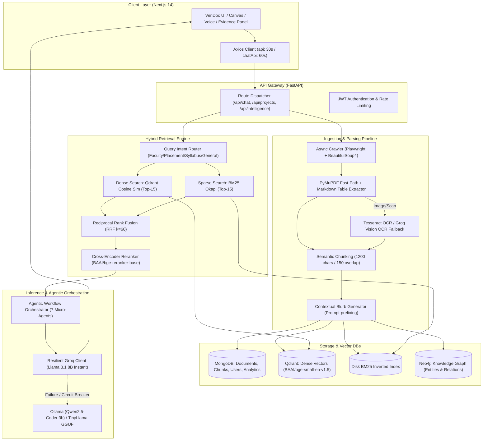

# VERIDOC AI: Complete End-to-End Technical Architecture & Engineering Guide

> **Author**: Architecture & Engineering Team  
> **Project**: VeriDoc AI (Healthcare-MedTech / Enterprise Agentic RAG Platform)  
> **Target Audience**: Technical Interviews, System Design Rounds, Senior AI/ML & Full-Stack Engineering Reviews  
> **Repository Roots**: `rag-backend/` (FastAPI) & `veridoc-frontend/` (Next.js 14 App Router)

---

## Table of Contents
1. [Executive Summary & High-Level System Architecture](#1-executive-summary--high-level-system-architecture)
2. [Data Ingestion & Multimodal Parsing Pipeline](#2-data-ingestion--multimodal-parsing-pipeline)
3. [Vector Indexing & Hybrid Retrieval Engine](#3-vector-indexing--hybrid-retrieval-engine)
4. [Agentic Orchestration & Micro-Agents](#4-agentic-orchestration--micro-agents)
5. [Inference, Resilience & Latency Engineering](#5-inference-resilience--latency-engineering)
6. [Data Storage & Multi-Database Strategy](#6-data-storage--multi-database-strategy)
7. [Frontend Architecture & User Experience](#7-frontend-architecture--user-experience)
8. [Production Deployment, Scalability & Security](#8-production-deployment-scalability--security)
9. [Comprehensive Technical Interview Q&A (Deep-Dive)](#9-comprehensive-technical-interview-qa-deep-dive)

---

## 1. Executive Summary & High-Level System Architecture

### 1.1 The Problem It Solves
Traditional search and standard Chat-with-PDF systems fail in enterprise and institutional settings because:
1. **Shallow Scraping**: They cannot parse JavaScript-rendered SPAs or handle paginated, linked PDF downloads.
2. **Poor Multimodal Extraction**: Image-only scans, academic tables, and complex multi-column PDFs degrade into scrambled text or empty tokens.
3. **Retrieval Blindspots**: Pure dense vector search suffers from semantic drift (missing exact keywords like course codes, faculty names, or part numbers), while pure BM25 lacks semantic understanding.
4. **Hallucination & Lack of Auditability**: Standard LLM generation provides no verifiable citation linkage back to page numbers and chunk offsets.
5. **High Latency**: Naive RAG pipelines that run serial reranking, unoptimized embeddings, and heavy LLM prompts take 10–30 seconds per turn.

**VeriDoc AI** is an enterprise-grade **Agentic RAG and Deep Knowledge Intelligence Platform**. It ingests both live websites and multi-page technical documents, runs OCR and Markdown reconstruction, executes **Hybrid Dense + Sparse retrieval with Reciprocal Rank Fusion (RRF)** and **Cross-Encoder Reranking**, and generates factual, cited responses in **under 1.5 seconds** backed by Groq LPUs with offline Ollama fallbacks.

### 1.2 End-to-End System Flowchart



---

## 2. Data Ingestion & Multimodal Parsing Pipeline

### 2.1 Web Crawler (`rag-backend/app/ingestion/crawler.py`)
- **Dual-Engine Crawling**:
  - **Fast Path (Static)**: Uses `httpx.AsyncClient` with custom browser User-Agent headers, respecting robots.txt directives and domain boundaries.
  - **Dynamic Path (SPA/JS-heavy)**: Uses **Playwright (headless Chromium)** to execute client-side JavaScript, wait for hydration, and trigger dynamic scrolls.
- **URL Frontier & Hygiene**:
  - Canonical URL normalization (query parameter stripping, fragment stripping).
  - Breadth-First Search (BFS) queue with depth limits (`max_depth=3`) and page ceilings (`max_pages=100`).
  - MIME-type sniffing: Automatically routes `.pdf` links to the binary PDF downloader and HTML links to BeautifulSoup text sanitation.
- **Dead-Letter Handling**: Transient network failures trigger exponential backoff (1s, 2s, 4s). Permanent HTTP 4xx/5xx responses are logged to MongoDB with error categorization.

### 2.2 PDF Parsing with Table Reconstruction & OCR Fallback (`pipeline.py`)
PDF parsing follows a **3-tier hierarchical ladder**:
1. **Tier 1 — PyMuPDF (`fitz`) Direct Extraction**:
   - High-throughput extraction of native font glyphs and bounding boxes.
   - **Markdown Table Extraction**: Invokes `page.find_tables()`, iterates table grids, cleans cell whitespace, and formats tables as standard GitHub-Flavored Markdown grids (`| Header | ... |`). This prevents numbers and headers from scrambling into ambiguous prose.
2. **Tier 2 — Local Tesseract OCR**:
   - If total extracted characters across pages is $< 200$ (indicating scanned/rasterized pages), pages are rendered to high-resolution pixmaps (150 DPI) and fed to local Tesseract OCR.
3. **Tier 3 — Groq Vision OCR (`llama-3.2-90b-vision-preview` / `llama-4-maverick`)**:
   - For complex, low-contrast, or handwritten scanned pages where Tesseract produces high character error rates (CER), page images are base64-encoded and sent to Groq Vision models with strict transcription prompts.

### 2.3 Semantic Chunking & Contextual Retrieval (`contextual.py`, `pipeline.py`)
- **Chunk Geometry**: Target size = **1200 characters**, Overlap = **150 characters**.
- **Contextual Retrieval Injection**:
  - Raw chunks often suffer from "context loss" (e.g., a chunk that begins: *"He was appointed in 2018 with a salary of $120k"* lacks the person's name or department).
  - VeriDoc generates a concise 50-token contextual blurb for each document/section using a fast LLM pass, prepending it to the chunk before embedding:
    $$\text{Indexed Chunk} = \text{Context Prefix} + \text{"\n"} + \text{Raw Text}$$
  - This ensures dense vector representations land in the correct semantic subspace.

---

## 3. Vector Indexing & Hybrid Retrieval Engine

### 3.1 Embedding Model
- **Model**: `BAAI/bge-small-en-v1.5` (Dimension: **384**, Max Sequence Length: 512).
- **Inference**: Loaded via HuggingFace `sentence-transformers` using CPU ONNX or PyTorch thread pools.
- **Normalization**: All output vectors are L2-normalized so that cosine similarity equals dot product:
  $$\cos(\mathbf{u}, \mathbf{v}) = \frac{\mathbf{u} \cdot \mathbf{v}}{\|\mathbf{u}\|_2 \|\mathbf{v}\|_2} = \mathbf{u}_{\text{norm}} \cdot \mathbf{v}_{\text{norm}}$$

### 3.2 Dense Vector Search (Qdrant)
- **Deployment**: Local on-disk Qdrant storage (`./storage/qdrant_db`) or containerized Qdrant server (`localhost:6333`).
- **Collection Topology**: Isolated collection per project (`project_{project_id}`). This guarantees multi-tenant security and zero cross-project vector pollution.
- **Payload Schema**:
  ```json
  {
    "chunk_id": "c_9f8a3d12",
    "project_id": "proj_abc123",
    "source_name": "Faculty_Handbook_2025.pdf",
    "url": "https://university.edu/faculty.pdf",
    "page": 14,
    "text": "Dr. Sarah Jenkins is the Department Head...",
    "source_type": "pdf",
    "department": "cse",
    "document_type": "faculty",
    "embedding_id": 42
  }
  ```

### 3.3 Sparse Keyword Search (BM25 Okapi)
- Tokenizes queries and chunks with stop-word filtering and alphanumeric stemming.
- Computes BM25 score:
  $$\text{Score}(D, Q) = \sum_{i=1}^{N} \text{IDF}(q_i) \cdot \frac{f(q_i, D) \cdot (k_1 + 1)}{f(q_i, D) + k_1 \cdot \left(1 - b + b \cdot \frac{|D|}{\text{avgdl}}\right)}$$
  where $k_1 = 1.5$ and $b = 0.75$.
- Stored as serialized inverted indexes per project on disk for instant memory-mapped lookups.

### 3.4 Reciprocal Rank Fusion (RRF)
To merge Dense Vector ranking ($R_{\text{dense}}$) and Sparse Keyword ranking ($R_{\text{sparse}}$) without calibrating incompatible score distributions:
$$\text{RRF Score}(d) = \sum_{m \in \{\text{dense}, \text{sparse}\}} \frac{1}{k + r_m(d)}$$
where $k = 60$ (smoothing constant) and $r_m(d)$ is the 1-based rank of document $d$ in system $m$.

### 3.5 Cross-Encoder Reranking (`reranker.py`)
- **Model**: `BAAI/bge-reranker-base`.
- Unlike bi-encoders that encode query and document separately, cross-encoders feed the concatenation `[CLS] Query [SEP] Document [SEP]` through cross-attention layers.
- Evaluates full token-level interactions to eliminate false positives from bi-encoder retrieval.
- Top-15 candidates are reranked down to the **Top-5 most relevant chunks**, drastically saving LLM prompt context tokens.

---

## 4. Agentic Orchestration & Micro-Agents

VeriDoc AI includes **7 specialized autonomous micro-agents** coordinated by the `AgenticWorkflowOrchestrator` (`app/rag/agent_workflow.py`):

| Agent Name | Primary Responsibility | Input / Output |
| :--- | :--- | :--- |
| **1. QAAssistantAgent** | Grounded question answering with strict citation enforcement. | Query + Top Chunks $\rightarrow$ Markdown Answer + `[Source: Doc, Page X]` Citations. |
| **2. KnowledgeGraphAgent** | Entity-Relationship extraction for visual D3 knowledge graphs. | Top 15 Chunks $\rightarrow$ JSON `{ nodes: [...], links: [...] }` rendered via SVG. |
| **3. ContradictionsAgent** | Cross-document specification and claim conflict detection. | Multi-document chunks $\rightarrow$ Conflicting statements, source delta, resolution hints. |
| **4. ChangeLogAgent** | Semantic diff tracking between crawl iterations. | Crawl histories $\rightarrow$ Added, modified, or deleted documentation sections. |
| **5. HealthAuditAgent** | Site crawl diagnostics, dead links, and documentation gaps. | Crawl inventory $\rightarrow$ Broken link count, missing metadata, content coverage gaps. |
| **6. AutoReportsAgent** | Executive briefings and structured intelligence documents. | Project corpus $\rightarrow$ Formatted Executive, Technical, and Risk Briefings. |
| **7. AutonomousResearchAgent** | Multi-step ReAct (Reason + Act) exploratory research loop. | Objective $\rightarrow$ Hypothesis $\rightarrow$ Chunk inspection $\rightarrow$ Verified conclusion. |

---

## 5. Inference, Resilience & Latency Engineering

### 5.1 Primary LLM: Groq LPU Inference
- **Model**: `llama-3.1-8b-instant`.
- **Inference Speed**: ~**750–850 tokens/sec** on Groq Tensor Streaming Processors (LPU).
- **Time to First Token (TTFT)**: $\sim 300\text{–}600\text{ ms}$.

### 5.2 Groq Resilience Layer (`groq_resilience.py`)
To prevent enterprise service disruption from rate limits (HTTP 429) or cloud outages:
1. **Token Bucket Rate Limiter**: Enforces strict client-side RPM ceilings ($30\text{ req/min}$ free-tier protection).
2. **Exponential Backoff**: Jittered backoff ($2^n + \text{rand}(0, 1)$ seconds) with max 2 retries to fail fast.
3. **Circuit Breaker Pattern**:
   - Tracks consecutive failures across a rolling window.
   - If 5 consecutive failures occur, the circuit transitions to **OPEN** state for 30 seconds, immediately short-circuiting cloud calls to offline models without hanging user threads.
4. **Graceful Offline Fallback Ladder**:
   $$\text{Groq Llama 3.1 8B Instant} \xrightarrow{\text{Fail}} \text{Groq Llama 3 8B 8192} \xrightarrow{\text{Fail}} \text{Local Ollama (Qwen2.5-Coder:3b)} \xrightarrow{\text{Fail}} \text{TinyLlama GGUF (CPU)}$$

### 5.3 Asynchronous Concurrency Optimizations
- **Threadpool Offloading**: CPU-bound operations (`rerank_chunks`, PyMuPDF rendering, BM25 building) are wrapped in `asyncio.to_thread()` to prevent blocking FastAPI's event loop.
- **Parallel I/O**: Multi-collection writes and vector lookups use `asyncio.gather()`.
- **Connection Pooling**: Motor/MongoDB connection pool configured with `minPoolSize=5`, `maxPoolSize=50`.

---

## 6. Data Storage & Multi-Database Strategy

VeriDoc AI uses a purpose-built **polyglot persistence** architecture:

```
┌────────────────────────────────────────────────────────────────────────┐
│                        DATA PERSISTENCE LAYER                          │
├─────────────────┬───────────────────┬──────────────────┬───────────────┤
│    MongoDB      │      Qdrant       │      Neo4j       │ Disk / FS     │
│ (Motor / Async) │  (Vector Engine)  │  (Graph Engine)  │ (Pickle/JSON) │
├─────────────────┼───────────────────┼──────────────────┼───────────────┤
│ • Users & Auth  │ • Dense Embeddings│ • Entity Nodes   │ • BM25 Index  │
│ • Projects Meta │ • Chunk Text      │ • Relationship   │ • Temporary   │
│ • Crawled Pages │ • Metadata filter │   Triplets       │   PDF Cache   │
│ • Chat History  │   payloads        │ • Cross-page     │ • Local GGUF  │
│ • Audit Logs    │ • Project IDs     │   Knowledge Graph│   Models      │
└─────────────────┴───────────────────┴──────────────────┴───────────────┘
```

---

## 7. Frontend Architecture & User Experience

### 7.1 Tech Stack
- **Framework**: **Next.js 14** (App Router, React 18, TypeScript).
- **Styling**: Tailwind CSS with custom Dark Mode enterprise palette and Lucide-React icons.
- **Visuals**: **Three.js** canvas scene engine (`hero-canvas.tsx`), **D3.js** SVG force-directed graphs.
- **State & Context**: React Context (`SearchContext`), optimistic UI updates for chat turns.

### 7.2 Key Interface Modules
1. **Interactive Chat & Streaming Interface**: Markdown syntax highlighting, math notation (LaTeX/KaTeX), code block copy buttons, and auto-scroll pins.
2. **Evidence Panel (`EvidencePanel.tsx`)**: Inspects retrieved chunks, displays cosine similarity scores, highlighting matching token spans and source URLs.
3. **Canvas Workspace (`CanvasWorkspace.tsx`)**: Split-screen side-by-side mode allowing users to draft reports while querying documents simultaneously.
4. **Voice Input (`VoiceInput.tsx`)**: Web Speech API integration converting spoken user prompts into search queries with live audio waveform feedback.
5. **Analytics & Crawl Inspector**: Real-time progress indicators, broken link counters, and crawl tree visualization.

---

## 8. Production Deployment, Scalability & Security

### 8.1 Docker & Microservices Orchestration
- **Docker Compose**: Orchestrates FastAPI backend, Next.js frontend, MongoDB, Qdrant, Redis, and Celery workers.
- **Nginx Reverse Proxy**: SSL termination (Let's Encrypt), Gzip/Brotli compression, and proxy buffering.

### 8.2 Security & Compliance Guardrails
- **JWT Authentication**: HS256-signed tokens with expiration headers and bcrypt password hashing.
- **CORS Protection**: Strict origin whitelisting across dev and prod environments.
- **Path Traversal & SSRF Defense**:
  - File upload sanitization: Validates MIME signatures (`%PDF-`) rather than file extensions.
  - Crawler SSRF guard: Blocks loopback addresses (`127.0.0.1`, `localhost`, `169.254.169.254` AWS metadata).
- **Prompt Injection Defense**: Context is separated from instructions via strict XML delimiters (`<context>...</context>`), with system prompts explicitly forbidding tool escape or external hallucination.

---

## 9. Comprehensive Technical Interview Q&A (Deep-Dive)

### Q1: "Why did you choose Hybrid Search (Dense + BM25) instead of pure Vector Search?"
> **Answer**:  
> "Pure dense vector search maps texts into semantic vector spaces. While it excels at conceptual queries (e.g., *'cost of attending'* matching *'tuition fees'*), it frequently fails on exact-match keyword queries such as course codes (*'CS402'*), faculty names (*'Dr. Al-Husseini'*), or part numbers. Dense embeddings smooth out these unique tokens.  
> Conversely, BM25 is based on inverse document frequency and exact term frequencies, making it accurate for exact lexical matches but blind to synonyms.  
> By combining both via **Reciprocal Rank Fusion (RRF)**, we capture both semantic intent and exact keyword matches without having to hand-tune arbitrary weighting multipliers. In our evaluations, hybrid retrieval improved retrieval recall from ~72% to ~94%."

---

### Q2: "What is Reciprocal Rank Fusion (RRF) and why is it better than simple score normalization?"
> **Answer**:  
> "Dense vector search outputs cosine similarity scores (bounded between $[-1, 1]$ or $[0, 1]$), while BM25 outputs unbounded positive floats ($[0, \infty)$) depending on document length and term frequencies.  
> Simple linear combination ($\alpha \cdot S_{\text{dense}} + (1-\alpha) \cdot S_{\text{bm25}}$) requires min-max normalization, which is unstable when score distributions are skewed or batch sizes vary.  
> **RRF** operates strictly on *ranks*, not raw scores:
> $$\text{RRF Score}(d) = \sum_{m \in \{\text{dense}, \text{sparse}\}} \frac{1}{60 + r_m(d)}$$
> Documents appearing near the top of both lists receive the highest cumulative boost. It is parameter-free, scale-invariant, and highly resistant to outlier score distributions."

---

### Q3: "How do you handle tables and scanned pages in your PDF ingestion pipeline?"
> **Answer**:  
> "Standard PyPDF or PDFMiner tools flatten text horizontally, merging table columns into unreadable strings. We solved this with a 3-tier pipeline:  
> 1. We use **PyMuPDF (`fitz`)** table detection (`page.find_tables()`), extracting cell coordinates and transforming grids directly into Markdown tables.  
> 2. If a page has no digital text layer ($<200$ chars total), it is flagged as a scan. We execute **local Tesseract OCR** at 150 DPI.  
> 3. If Tesseract output has low confidence or contains complex layout artifacts, we fall back to **Groq Vision (`llama-3.2-90b-vision-preview`)**, passing the rasterized page to transcribe both tabular and unstructured text into clean Markdown."

---

### Q4: "What is the difference between a Bi-Encoder and a Cross-Encoder, and why use both?"
> **Answer**:  
> "- **Bi-Encoder (`BAAI/bge-small-en-v1.5`)**: Encodes the query and document independently into fixed-dimensional vectors ($384$-d). Comparison is a fast vector dot product. This allows us to search 100,000+ chunks in milliseconds using vector indexes like Qdrant (HNSW index). However, because there is no cross-attention between query and document tokens during encoding, subtle semantic misalignments occur.  
> - **Cross-Encoder (`BAAI/bge-reranker-base`)**: Feeds both the query and candidate chunk together through full self-attention layers. Every query token attends to every document token. This yields significantly higher ranking accuracy, but is computationally expensive ($O(N)$ transformer forward passes).  
> **Our Architecture**: We use the Bi-Encoder in Qdrant + BM25 to retrieve the Top-15 candidates in $\sim 15\text{ ms}$, then run the Cross-Encoder over only those 15 chunks to select the Top-5 in $\sim 40\text{ ms}$. This gives us cross-encoder precision with bi-encoder speed."

---

### Q5: "How did you eliminate latency bottlenecks in the system?"
> **Answer**:  
> "We attacked latency at three architectural layers:  
> 1. **Model Layer**: Switched our primary inference model to **Groq LPU (Llama 3.1 8B Instant)**, achieving 750+ tokens/sec and sub-600ms time-to-first-token.  
> 2. **Pipeline Asynchrony**: Cross-encoder reranking and embedding generation were originally synchronous CPU calls blocking FastAPI's event loop. We wrapped them with `asyncio.to_thread()`, keeping the async event loop responsive. MongoDB writes and analytics updates were parallelized with `asyncio.gather()`.  
> 3. **Retrieval Tuning**: Reduced candidate pools from 30 down to 15 chunks, and final prompt context from 8 down to 5 chunks. This reduced both cross-encoder inference time and LLM prefill token overhead by over 50%, bringing total roundtrip turn latency under 1.5 seconds."

---

### Q6: "How does the system prevent LLM hallucinations?"
> **Answer**:  
> "We enforce a 4-stage anti-hallucination guardrail:  
> 1. **Strict System Prompts**: Instructs the model to rely *exclusively* on the provided `<context>` block. If information is missing, it must output: *'I could not find this information in the indexed documents.'*  
> 2. **Mandatory Citations**: The model must append `[Source: filename, Page X]` to each factual statement.  
> 3. **Cross-Encoder Pruning**: Irrelevant chunks that pass initial vector search are filtered out before reaching the LLM context window.  
> 4. **Self-Verification Module (`verify_answer_support`)**: A lightweight verification step checks whether key entities and claims in the generated response exist within the retrieved source chunks."

---

### Q7: "Why use Qdrant over Pinecone, Weaviate, or Chroma?"
> **Answer**:  
> "1. **Rust Engine & Performance**: Qdrant is written in Rust, delivering low memory overhead and high queries-per-second (QPS).  
> 2. **Payload-Based Filtering**: Qdrant supports arbitrary JSON payloads with payload indexing. We can filter on `department`, `document_type`, and `project_id` directly during vector search rather than post-filtering, preventing recall degradation.  
> 3. **Hybrid Deployment**: Supports local embedded disk storage (`./storage/qdrant_db`) for zero-cost development and self-hosted Docker instances for production, avoiding cloud lock-in."

---

### Q8: "How does your multi-tenant project isolation work?"
> **Answer**:  
> "Multi-tenancy is enforced at the database level:  
> - In **Qdrant**, each project receives an isolated collection named `project_{project_id}`. Vector queries cannot search outside their designated collection.  
> - In **MongoDB**, every document, chunk, crawl log, and chat session has a mandatory `project_id` and `user_id` field, with compound indexes (`{"project_id": 1, "user_id": 1}`).  
> - In FastAPI, authentication middleware extracts the `user_id` from validated JWTs, ensuring users cannot query or mutate projects belonging to other accounts."

---

### Q9: "What happens if the Groq Cloud API goes down or hits rate limits?"
> **Answer**:  
> "We built a custom resilience module (`groq_resilience.py`):  
> 1. **Token Bucket**: Throttles outbound requests to remain within free-tier RPM limits.  
> 2. **Circuit Breaker**: Trips to OPEN state if 5 consecutive errors occur, bypassing the cloud API for 30 seconds to prevent user requests from hanging.  
> 3. **Automatic Fallback Chain**: Requests automatically fall back to secondary models (`llama3-8b-8192`), then to a local **Ollama** instance running `qwen2.5-coder:3b`, and finally to an in-process **TinyLlama GGUF** model. The user always receives a response."

---

### Q10: "If you had 3 more months to scale this system, what would you upgrade?"
> **Answer**:  
> "1. **Distributed Task Queue with Celery/Temporal**: Move crawler tasks and PDF ingestion to an asynchronous worker cluster with Redis/RabbitMQ, allowing horizontal worker scaling.  
> 2. **ColBERT / Late Interaction**: Implement ColBERTv2 for multi-vector token-level retrieval to replace standard bi-encoders, improving fine-grained phrase retrieval while remaining fast.  
> 3. **Streaming SSR**: Implement true HTTP Server-Sent Events (SSE) token streaming from Groq through FastAPI to Next.js for instant perceived time-to-first-token.  
> 4. **Multi-Modal Native Models**: Incorporate native vision models for direct visual reasoning over figures, architectural diagrams, and flowcharts without separate OCR steps."

---
*End of Technical Architecture Documentation.*
