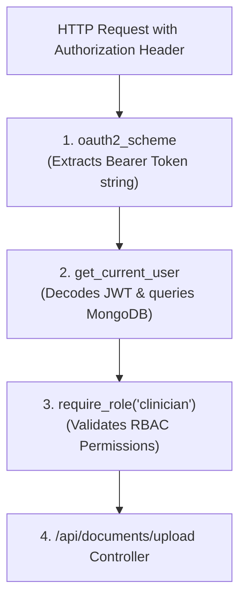

# 04. Dependency Injection & Security Architecture

> *"In Express.js, passing authenticated users or database pools usually means mutating `req.user = user` inside untyped middlewares. In FastAPI, Dependency Injection (`Depends`) creates a type-safe, reusable, and hierarchical execution graph."*

---

## 1. What is Dependency Injection in FastAPI?

**Dependency Injection (DI)** is a design pattern where a function declares what external resources it needs to execute, rather than instantiating them itself.

In FastAPI, the `Depends()` function acts as a contract:
```python
@router.get("/profile")
async def get_user_profile(current_user: User = Depends(get_current_user)):
    return {"email": current_user.email, "role": current_user.role}
```
Before `get_user_profile` executes:
1. FastAPI automatically executes `get_current_user`.
2. If `get_current_user` raises an `HTTPException(401)`, the route handler is **never called**; FastAPI immediately short-circuits and returns an error response.
3. If it succeeds, the returned `User` object is injected directly into `current_user` with full IDE autocomplete and type safety.

---

## 2. Hierarchical Sub-Dependencies (The Dependency Graph)

FastAPI can resolve chains of dependencies (a dependency that itself has dependencies):



### Writing the Sub-Dependency Chain:
```python
# rag-backend/app/core/security.py
from fastapi import Depends, HTTPException, status
from fastapi.security import OAuth2PasswordBearer
import jwt

# Step 1: Extracts token from "Authorization: Bearer <TOKEN>"
oauth2_scheme = OAuth2PasswordBearer(tokenUrl="/api/auth/login")

# Step 2: Validates token and returns user
async def get_current_user(token: str = Depends(oauth2_scheme)) -> dict:
    try:
        payload = jwt.decode(token, settings.jwt_secret, algorithms=["HS256"])
        user_id = payload.get("sub")
        if not user_id:
            raise HTTPException(status_code=401, detail="Invalid token claims")
        
        user = await users_col().find_one({"_id": user_id})
        if not user:
            raise HTTPException(status_code=401, detail="User does not exist")
        return user
    except jwt.PyJWTError:
        raise HTTPException(status_code=401, detail="Could not validate credentials")
```

---

## 3. Higher-Order Dependencies: Role-Based Access Control (RBAC)

How do you protect specific routes so that only users with a role like `"lead_investigator"` or `"admin"` can execute them?

We write a **callable dependency factory**:

```python
# rag-backend/app/core/security.py

def require_role(allowed_roles: list[str]):
    """
    Returns a dependency that verifies the authenticated user possesses an authorized role.
    """
    async def role_checker(current_user: dict = Depends(get_current_user)) -> dict:
        user_role = current_user.get("role")
        if user_role not in allowed_roles:
            raise HTTPException(
                status_code=status.HTTP_403_FORBIDDEN,
                detail=f"Access denied. Requires one of roles: {allowed_roles}"
            )
        return current_user

    return role_checker
```

### Using It on Sensitive Routes:
```python
# rag-backend/app/api/routes/mcp.py

@router.post("/actions/dispatch")
async def dispatch_clinical_action(
    payload: ActionDispatchSchema,
    # ONLY lead investigators or admins can dispatch holds!
    authorized_user: dict = Depends(require_role(["lead_investigator", "admin"]))
):
    result = await execute_action(payload)
    return {"status": "dispatched", "authorized_by": authorized_user["email"]}
```
If a standard user attempts to dispatch a protocol hold, FastAPI immediately returns `403 Forbidden` before running any action dispatch logic.

---

## 4. Injecting Database Pools & Context Resources

In addition to security, `Depends` is ideal for injecting database connections:

```python
# Injects the active MongoDB database instance
async def get_db():
    return get_database()

@router.get("/stats")
async def get_project_stats(db = Depends(get_db)):
    doc_count = await db["documents"].count_documents({})
    return {"total_documents": doc_count}
```

### Key Performance Benefit: `use_cache=True`
By default, if three different dependencies on the same route require `get_current_user`, FastAPI executes `get_current_user` **only once** per request and caches the result for the duration of that HTTP lifecycle. This eliminates redundant database lookups!
