# 01. System Overview & Vision

## 1. Executive Summary
**Nexus VeriDocs** is an autonomous, source-grounded document intelligence platform and multi-project knowledge synthesis engine. It eliminates the fatal flaws of first-generation "toy RAG" architectures—specifically hallucinations, context dilution, memory exhaustion, inference rate-limiting, and response truncation.

---

## 2. Toy RAG vs. Enterprise RAG v2 (Nexus VeriDocs)

| Architectural Dimension | Traditional "Toy RAG" Implementations | Nexus VeriDocs (Enterprise RAG v2) |
| :--- | :--- | :--- |
| **Ingestion** | Blind fixed-size splitting (e.g., 500 chars) | Hierarchical Parent-Child Chunking (300-token child / 1200-token parent) |
| **Retrieval** | Single dense vector search (Cosine / Euclidean) | Hybrid Retrieval: Reciprocal Rank Fusion ($k=60$) fusing Qdrant & Okapi BM25 |
| **Precision** | Passes top-$k$ vector matches directly to prompt | Cross-Encoder Neural Reranking (`ms-marco-MiniLM-L-6-v2`) + CRAG Relevance Grading |
| **Inference** | Single API key with unhandled 429 exceptions | Resilient 10-Key Groq LPU Pool with Leaky Token Buckets & Circuit Breakers |
| **Failover** | Application crashes on LLM rate-limit / outage | Automated key-hopping + Zero-RAM Cloud REST Failover (Gemini 1.5 Flash) |
| **Token Budget** | Small 500–800 token caps causing cut-offs | Expanded 3500-token budget generating exhaustive tabular analyses |
| **Memory Footprint**| Holds multi-megabyte PDFs in heap memory | Cloudinary CDN binary streaming + `ctypes malloc_trim(0)` kernel heap compaction |
| **Frontend Rendering**| Token-by-token streaming causing DOM thrashing | Paced batch-window streaming (3 words at 20ms) reducing re-renders by 65% |

---

## 3. High-Level Master System Mind Map

```mermaid
graph TD
    NEXUS["NEXUS VERIDOCS PLATFORM"]

    %% 5 Strategic Pillars
    NEXUS --> P1["1. Ingestion & Extraction Engine"]
    NEXUS --> P2["2. Hybrid RAG v2 Retrieval"]
    NEXUS --> P3["3. Resilient Multi-Key Inference"]
    NEXUS --> P4["4. Polyglot Persistence Architecture"]
    NEXUS --> P5["5. Client Edge & Interactive UX"]

    %% Sub-nodes P1
    P1 --> P1_A["PyMuPDF Dual-Mode Parser + Cloud OCR"]
    P1 --> P1_B["Autonomous Domain-Locked Spider (crawler.py)"]
    P1 --> P1_C["Hierarchical Parent-Child Segmenter"]
    P1 --> P1_D["Cloudinary CDN Binary Decoupling"]

    %% Sub-nodes P2
    P2 --> P2_A["Semantic Query & Intent Router"]
    P2 --> P2_B["Dense Vector Embeddings (Qdrant Cloud)"]
    P2 --> P2_C["Durable Okapi BM25 Keyword Search"]
    P2 --> P2_D["Reciprocal Rank Fusion (k=60)"]
    P2 --> P2_E["Cross-Encoder Neural Precision Reranker"]
    P2 --> P2_F["Corrective RAG (CRAG) Grader & Query Rewriter"]

    %% Sub-nodes P3
    P3 --> P3_A["10-Key Dynamic Round-Robin Pool"]
    P3 --> P3_B["TokenBucket Rate Limiter (Capacity: 50, Refill: 10/s)"]
    P3 --> P3_C["CircuitBreaker Finite State Automaton"]
    P3 --> P3_D["Model Fallback Chain: Qwen 27B -> GPT 120B -> GPT 20B -> Gemini"]
    P3 --> P3_E["3500-Token Budget & Executive Persona"]

    %% Sub-nodes P4
    P4 --> P4_A["MongoDB Atlas (11 Collections, Non-Blocking Motor)"]
    P4 --> P4_B["Qdrant Cloud (384-d Cosine HNSW Vector Clusters)"]
    P4 --> P4_C["Cloudinary CDN (PDF Binaries & Media Assets)"]
    P4 --> P4_D["Durable Compressed BM25 Binary Storage"]

    %% Sub-nodes P5
    P5 --> P5_A["Next.js 16 App Router on Vercel Edge"]
    P5 --> P5_B["Paced Batch-3 Word Streaming Buffer"]
    P5 --> P5_C["Custom Recursive GFM Markdown Engine"]
    P5 --> P5_D["Canvas Workspace & Code Sandbox"]
```

