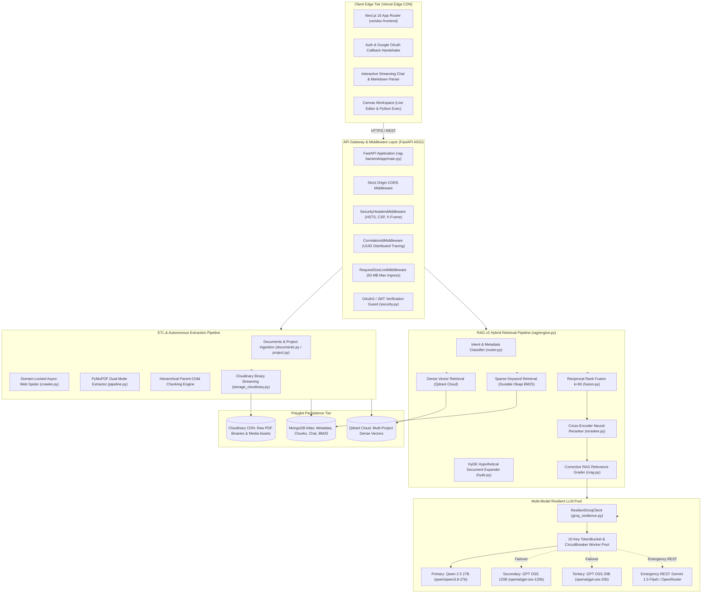

# 02. System Design & Topography

## 1. End-to-End System Topography



---

## 2. Ingress & Middleware Pipeline Execution Order

Every incoming HTTP request processed by `rag-backend/app/main.py` traverses a strict sequential middleware stack:

```
[Incoming HTTP Request from Vercel Edge]
                │
                ▼
1. SecurityHeadersMiddleware (rag-backend/app/core/security_headers.py)
   - Injects X-Content-Type-Options: nosniff
   - Injects X-Frame-Options: DENY
   - Injects Strict-Transport-Security (HSTS)
   - Injects Content-Security-Policy (CSP)
                │
                ▼
2. CorrelationIdMiddleware (rag-backend/app/main.py)
   - Inspects headers for incoming 'X-Correlation-ID'
   - Generates unique UUID4 if absent
   - Binds correlation ID to current task context for distributed log tracing
                │
                ▼
3. RequestSizeLimitMiddleware (rag-backend/app/main.py)
   - Inspects Content-Length header
   - Rejects payloads exceeding 50 MB (HTTP 413 Payload Too Large)
                │
                ▼
4. CORSMiddleware (FastAPI Standard)
   - Enforces origin whitelisting:
     * https://nexus-tawny-seven-50.vercel.app
     * http://localhost:3000 / http://127.0.0.1:3000
   - Configures Access-Control-Allow-Credentials: true
                │
                ▼
5. Route Handler Execution & Global Exception Handler (FastAPI)
   - Dispatches to /api/auth, /api/documents, /api/projects, /api/chat, /api/features
   - Catches unhandled exceptions, returning structured JSON with X-Correlation-ID
```
