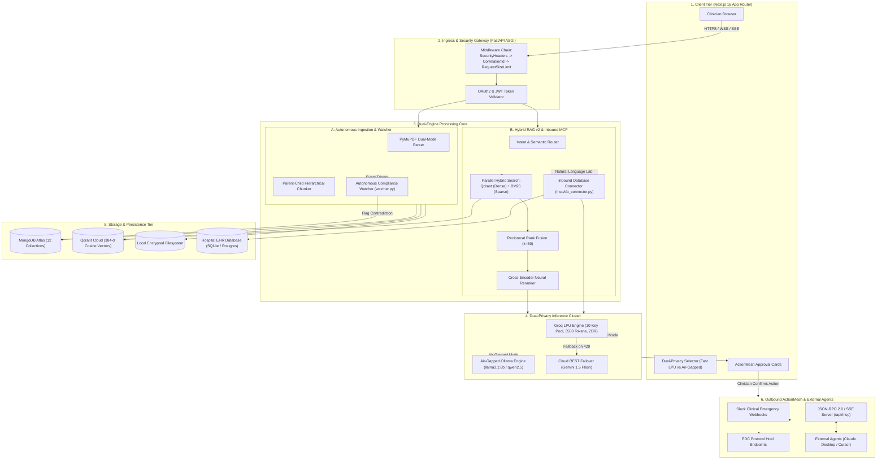

# 02. System Design & Topography: The ActionMesh Architecture

> *"Architecture is not just boxes and arrows. It is how you handle failures, bottlenecks, and the laws of distributed systems when real clinical data is at stake."*

---

## 1. The Architectural Dilemma: Why Standard Microservices Failed

When engineering a modern AI platform, developers often jump to one of two extremes:
1. **The Spaghetti Monolith**: Throwing PDF parsing, vector search, database queries, and OpenAI calls into a single synchronous Flask script. The moment a user uploads a 50MB PDF, the entire server blocks, incoming chat streams timeout, and the server runs out of memory.
2. **The Over-Engineered Microservices Trap**: Splitting the system into 8 separate Docker containers (Auth service, Parser service, Vector service, Ingestion service, Slack service, etc.) connected via Kafka or RabbitMQ. For a high-throughput startup platform, this introduces massive network serialization latency ($\sim 200\text{ms}$ per hop), complex distributed transaction headaches, and huge infrastructure costs.

### Our Solution: The Asynchronous ActionMesh Architecture
We engineered VeriDoc Synapse as an **Asynchronous ActionMesh** built on **FastAPI (ASGI)** and **Next.js 16 (App Router)**. 

```
                               THE ACTIONMESH TOPOGRAPHY
 ┌───────────────────────────────────────────────────────────────────────────────────┐
 │                                 NEXT.JS 16 CLIENT                                 │
 │   • Interactive Chat UI     • Action Confirmation Cards    • Canvas Live Editor   │
 └─────────────────────────────────────────┬─────────────────────────────────────────┘
                                           │ HTTPS / WebSockets / SSE
                                           ▼
 ┌───────────────────────────────────────────────────────────────────────────────────┐
 │                     FASTAPI ASGI INGRESS & MIDDLEWARE STACK                       │
 │   SecurityHeaders  ──►  CorrelationId (UUID)  ──►  RequestSizeLimit  ──►  Auth   │
 └──────┬──────────────────────────────────┬──────────────────────────────────┬──────┘
        │                                  │                                  │
        ▼ (Uploads)                        ▼ (Chat & Retrieval)               ▼ (External Agents)
 ┌───────────────┐                  ┌───────────────┐                  ┌───────────────┐
 │ DOCUMENT      │                  │ HYBRID RAG v2 │                  │ BIDIRECTIONAL │
 │ PIPELINE      │                  │ ENGINE        │                  │ MCP SERVER    │
 ├───────────────┤                  ├───────────────┤                  ├───────────────┤
 │ • PyMuPDF     │                  │ • HyDE Router │                  │ • JSON-RPC 2.0│
 │ • Parent-Child│                  │ • Qdrant /BM25│                  │ • SSE Stream  │
 │ • Local Store │                  │ • Cross-Encod.│                  │ • Claude/Cursor│
 └──────┬────────┘                  └──────┬────────┘                  └───────────────┘
        │ Event Trigger                    │ Tool Call Hook
        ▼                                  ▼
 ┌───────────────┐                  ┌───────────────┐
 │ COMPLIANCE    │                  │ INBOUND EHR   │
 │ WATCHER       │                  │ DATABASE MCP  │
 ├───────────────┤                  ├───────────────┤
 │ • Async Scan  │                  │ • Read-Only   │
 │ • Contradict. │                  │ • AST Guarded │
 │ • DB Flagging │                  │ • Live Labs   │
 └──────┬────────┘                  └──────┬────────┘
        │                                  │
        └──────────────────┬───────────────┘
                           │ Dispatches Action State
                           ▼
 ┌──────────────────────────────────────────────────┐
 │           OUTBOUND ACTIONMESH DISPATCHER         │
 │ • Slack Webhook Alerts   • EDC Protocol Freezes  │
 └──────────────────────────────────────────────────┘
```

Why this architecture wins:
- **FastAPI ASGI Event Loop**: Handles 1,000+ concurrent I/O-bound SSE streaming connections effortlessly without blocking the main thread.
- **In-Process High Performance**: Vector embeddings (FastEmbed ONNX) and BM25 tokenization run directly in-process via C-bindings, avoiding network hops and microservice serialization overhead.
- **Background Worker Threads**: Heavy tasks (PDF OCR, Hierarchical Parent-Child Chunking, and Compliance Auditing) run in non-blocking background workers (`asyncio.create_task` and worker thread pools) with garbage collection guards (`malloc_trim(0)`).

---

## 2. End-to-End System Topography

Here is the exact data topography from the clinician's browser down to the database and outbound third-party integrations:



---

## 3. The Ingress Pipeline & Middleware Stack

Every HTTP request entering the backend is processed through a strict, deterministic middleware pipeline before touching any application logic (`rag-backend/app/main.py`):

```
HTTP Request 
   │
   ▼
[ SecurityHeadersMiddleware ] ──► Injects HSTS, CSP, X-Content-Type-Options, X-Frame-Options
   │
   ▼
[ CorrelationIdMiddleware ]   ──► Generates unique UUID4 `X-Correlation-ID` for distributed tracing
   │
   ▼
[ RequestSizeLimitMiddleware ] ──► Rejects payloads > 100MB immediately to prevent memory-exhaustion DoS
   │
   ▼
[ CORSMiddleware ]            ──► Restricts origins strictly to configured frontend domains
   │
   ▼
[ Auth Guard (security.py) ]  ──► Validates cryptographic RS256/HS256 JWT tokens & OAuth signatures
   │
   ▼
FastAPI Route Handler
```

### Why We Built Custom Middleware Instead of Relying on Defaults:
1. **Correlation IDs for Clinical Audit Trails**: In healthcare, you must know exactly which request triggered an action. Every log line across every thread is tagged with the user's `correlation_id`.
2. **Strict Request Size Bounding**: Unchecked multipart uploads can bring down a container with an Out-Of-Memory (OOM) kill. We reject oversized payloads at the socket layer before they buffer into RAM.
3. **Security Headers by Default**: Meets HIPAA guidelines by strictly forbidding iframe embedding (`X-Frame-Options: DENY`) to eliminate clickjacking attacks against clinical staff.

---

## 4. Inbound Database MCP vs. Outbound ActionMesh

To understand how VeriDoc Synapse closes the loop between reading documents and operational execution, examine the two halves of our ActionMesh:

```
┌────────────────────────────────────────────────────────────────────────┐
│                   INBOUND DATABASE MCP: THE EYES                       │
├────────────────────────────────────────────────────────────────────────┤
│ • Connects to Hospital EHR / Clinical Trial databases (SQLite/Postgres)│
│ • Inspects live tables: `patients`, `lab_results`, `vital_signs`       │
│ • Natural Language to SQL generation with AST AST safety parser:        │
│     - Allows ONLY `SELECT` statements                                  │
│     - Forbids `DROP`, `DELETE`, `UPDATE`, `INSERT`, `ALTER`, `;`       │
│ • Injects live lab data directly into LLM reasoning context            │
└────────────────────────────────────────────────────────────────────────┘
                                    ▲
                                    │
                         [ VERIDOC SYNAPSE CORE ]
                                    │
                                    ▼
┌────────────────────────────────────────────────────────────────────────┐
│                 OUTBOUND ACTIONMESH: THE HANDS                         │
├────────────────────────────────────────────────────────────────────────┤
│ • Generates structured JSON Action Descriptors                         │
│ • Renders interactive "Action Cards" in the clinician's chat UI        │
│ • Enforces Human-in-the-Loop (HITL) approval before execution          │
│ • Dispatches signed webhooks to:                                       │
│     - Slack `#clinical-safety-alerts` (Emergency Investigator Alerts)   │
│     - EDC System APIs (Enforcing temporary patient screening holds)   │
│     - Audit Log Database (21 CFR Part 11 compliant audit trail)        │
└────────────────────────────────────────────────────────────────────────┘
```

### The Concrete Flow in Action:
1. **User asks**: *"Are there any enrolled patients who violate Protocol Amendment 3 exclusion criteria for elevated liver enzymes?"*
2. **RAG v2** retrieves Protocol Amendment 3: *"Patients with Alanine Aminotransferase (ALT) > 55 U/L must be excluded."*
3. **Inbound DB MCP** generates: `SELECT patient_id, name, alt_level, trial_status FROM patients WHERE alt_level > 55 AND trial_status = 'ENROLLED';`
4. **AST Guard** verifies the SQL is strictly read-only.
5. **EHR Database** returns: `Patient #1042 (John Doe) - ALT: 72 U/L`.
6. **Outbound ActionMesh** automatically drafts an Action Card: *"Flag Patient #1042 and notify PI Dr. Chen via Slack?"*
7. **Clinician clicks "Confirm & Dispatch"** in the UI.
8. The webhook fires to Slack and the EDC API puts a temporary hold on Patient #1042's next infusion.

---

## 5. Standard Bidirectional Model Context Protocol (MCP) Server

We didn't just build an internal tool connector; we implemented the **official open Model Context Protocol (MCP)** specification (`rag-backend/app/routers/mcp_server.py`).

VeriDoc Synapse exposes two standard endpoints:
- `POST /api/mcp/rpc`: JSON-RPC 2.0 endpoint for tool discovery and execution.
- `GET /api/mcp/sse`: Server-Sent Events stream for real-time bidirectional agent communication.

### Why This is an Enterprise Moat:
Any external MCP-compliant agent (such as **Claude Desktop**, **Cursor IDE**, or internal hospital AI orchestrators) can connect to VeriDoc Synapse as an external MCP server:
```json
{
  "mcpServers": {
    "veridoc-synapse": {
      "url": "https://veridoc-api.hospital.org/api/mcp/rpc",
      "headers": {
        "Authorization": "Bearer <TOKEN>"
      }
    }
  }
}
```
External agents immediately gain access to three enterprise-grade clinical tools:
1. `audit_protocol_compliance`: Audits any text against active regulatory files.
2. `query_clinical_ehr`: Safely queries hospital patient tables with built-in AST guards.
3. `trigger_compliance_action`: Dispatches validated Slack and EDC notifications.

---

## 6. CTO Interview Talking Points & Whiteboard Walkthrough

When an interviewer hands you a marker and says: *"Draw the system architecture of your platform on the whiteboard"*, follow this 4-step script:

1. **Step 1: The Gateway (Ingress)**
   > *"I started with an async FastAPI gateway sitting behind a strict security middleware stack. Because clinical trials involve heavy document uploads and concurrent streaming chats, ASGI event-loop non-blocking I/O is non-negotiable. I added custom Correlation ID middleware so every single log line across all threads is auditable under FDA 21 CFR Part 11."*

2. **Step 2: The Core Pipeline Split (Dual-Pillar)**
   > *"Downstream from ingress, the architecture splits into two distinct pipelines: Ingestion on the left, and Retrieval on the right. Ingestion uses PyMuPDF with parent-child hierarchical chunking (300-token child for vector search, 1200-token parent for context) and fires an asynchronous event to our Autonomous Compliance Watcher to detect protocol contradictions in the background."*

3. **Step 3: The Hybrid Engine & Inbound MCP**
   > *"On the retrieval side, we run dense Qdrant search and sparse BM25 in parallel, fusing them with Reciprocal Rank Fusion ($k=60$) and cross-encoder reranking. But notice the Inbound Database MCP: our LLM doesn't just read documents. It inspects live EHR SQL databases with AST syntax safety guards to pull real patient lab records into the prompt context."*

4. **Step 4: The Closed Loop (Outbound ActionMesh)**
   > *"Finally, when a contradiction is detected between a document and a patient record, the system doesn't just display text. It generates an Action Card in our Next.js frontend, and upon clinician approval, dispatches signed webhooks to Slack and the hospital's EDC system to pause trial enrollment. That is why we call it an ActionMesh."*
