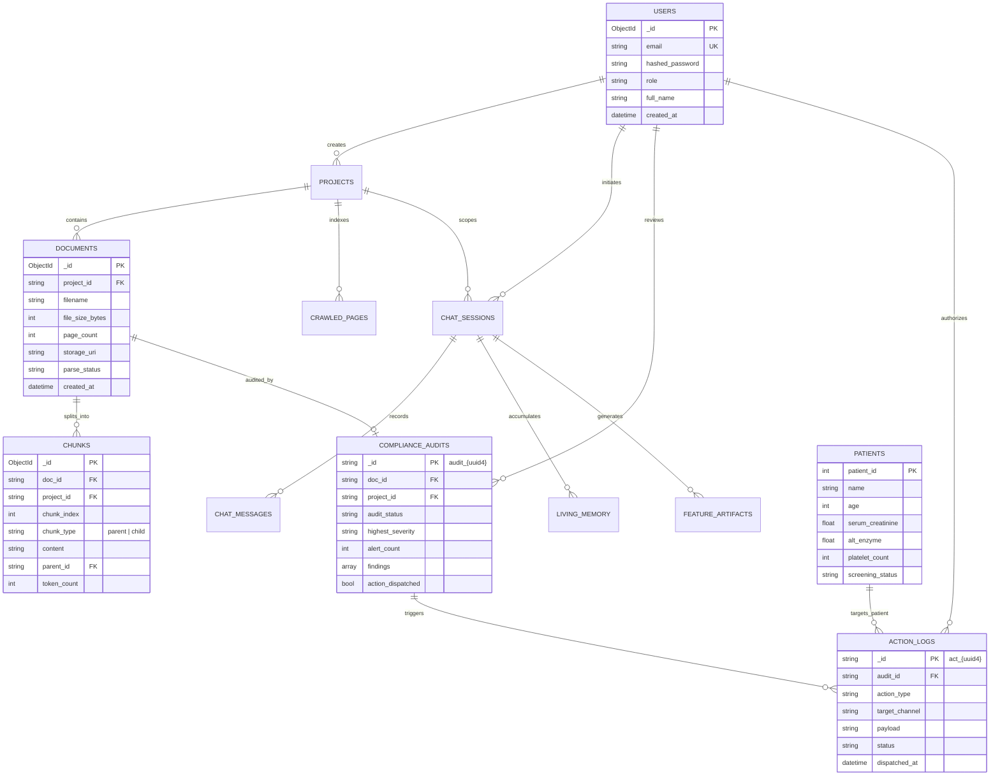

# 04. Database Schemas & Data Dictionary: The Data Engine

> *"In enterprise software, code is transient, but data schemas are forever. If you design your schema poorly, no amount of AI prompting can save your system from falling apart."*

---

## 1. The Polyglot Data Architecture Philosophy

Why didn't we just dump everything into a single database like PostgreSQL or MySQL?

Because clinical AI workloads have three fundamentally conflicting data patterns:
1. **Unstructured & Semi-Structured Metadata** (Document trees, hierarchical chunk boundaries, dynamic LLM audit findings, and living memories): Requires schema flexibility, nested document structures, and blazing fast JSON serialization without running complex SQL migrations on every prompt change.  
   $\rightarrow$ **Engine: MongoDB Atlas (Document Store)**.
2. **High-Dimensional Geometry** (384-dimensional dense vectors and Hierarchical Navigable Small World [HNSW] graphs): Requires specialized memory-mapped vector similarity search with cosine distance indexing.  
   $\rightarrow$ **Engine: Qdrant Cloud (Vector Database)**.
3. **Strict ACID Relational Transactions** (Patient medical records, biomarker lab cutoffs, and regulatory compliance audit trails): Requires strict foreign keys, atomic transactions, and zero tolerance for eventual consistency anomalies.  
   $\rightarrow$ **Engine: SQLite / PostgreSQL (Relational EHR Store)**.

---

## 2. Complete Entity-Relationship Mind Map



---

## 3. The 12 MongoDB Atlas Collections: Field-by-Field Dictionary

### Collection 1: `users`
*Stores user identity, role-based access control (RBAC), and authentication secrets.*
- `_id` (`ObjectId`, PK): Unique user identifier.
- `email` (`String`, Unique, Indexed): User email address.
- `hashed_password` (`String`): BCrypt salted and hashed credential string.
- `role` (`String`): RBAC role: `"admin"`, `"clinician"`, `"auditor"`, `"guest"`.
- `full_name` (`String`): Clinician display name.
- `oauth_provider` (`String`, Nullable): `"google"` or `null` for local auth.
- `oauth_id` (`String`, Nullable): External provider subject identifier.
- `created_at` (`ISODate`): Account creation timestamp.
- **Index**: `{"email": 1}` (Unique).

---

### Collection 2: `projects`
*Multi-tenant workspaces isolating clinical protocols, trial phases, and documents.*
- `_id` (`ObjectId`, PK): Unique project identifier.
- `owner_id` (`String`, Indexed): References `users._id`.
- `name` (`String`): Clinical trial name (e.g., `"Phase-III Oncology Keytruda Bridge"`).
- `description` (`String`): Therapeutic scope, protocol phase, and study goals.
- `default_privacy_mode` (`String`): `"fast_cloud"` or `"air_gapped_local"`.
- `created_at` (`ISODate`): Workspace creation timestamp.
- **Compound Index**: `{"owner_id": 1, "created_at": -1}`.

---

### Collection 3: `documents`
*File metadata, parsing lifecycle states, and physical storage references.*
- `_id` (`ObjectId`, PK): Unique document identifier.
- `project_id` (`String`, Indexed): References `projects._id`.
- `filename` (`String`): Original uploaded file name (`"SOP_2026_Clinical_V2.pdf"`).
- `storage_path` (`String`): Local filesystem absolute path or Cloudinary CDN URI.
- `file_size_bytes` (`Integer`): Exact binary size on disk.
- `mime_type` (`String`): `"application/pdf"`, `"text/plain"`, etc.
- `page_count` (`Integer`): Extracted page count.
- `parse_status` (`String`, Indexed): `"pending"` | `"processing"` | `"completed"` | `"failed"`.
- `compliance_status` (`String`): `"pending"` | `"scanned"` | `"contradictions_found"`.
- `error_message` (`String`, Nullable): Diagnostic error string if parsing aborted.
- `created_at` (`ISODate`): Upload timestamp.
- **Compound Index**: `{"project_id": 1, "parse_status": 1}`.

---

### Collection 4: `chunks`
*Hierarchical text chunks generated during parent-child chunking.*
- `_id` (`ObjectId`, PK): Unique chunk record ID.
- `doc_id` (`String`, Indexed): References `documents._id`.
- `project_id` (`String`, Indexed): References `projects._id`.
- `chunk_type` (`String`): `"child"` (300 tokens, indexed in Qdrant) or `"parent"` (1200 tokens, context retrieval).
- `parent_id` (`String`, Nullable, Indexed): If child chunk, references parent chunk `_id`.
- `content` (`String`): The raw text segment.
- `token_count` (`Integer`): Exact token length calculated via `tiktoken`.
- `page_number` (`Integer`): Page number in the source PDF.
- `qdrant_point_id` (`String`, Nullable): UUID of corresponding vector in Qdrant.
- **Compound Index**: `{"doc_id": 1, "chunk_type": 1, "parent_id": 1}`.

---

### Collection 5: `chat_sessions`
*Conversational sessions and active workspace context.*
- `_id` (`ObjectId`, PK): Session UUID.
- `user_id` (`String`, Indexed): References `users._id`.
- `project_id` (`String`, Indexed): References `projects._id`.
- `title` (`String`): Auto-generated conversational summary title.
- `privacy_mode` (`String`): Current runtime toggle: `"fast_cloud"` or `"air_gapped_local"`.
- `created_at` (`ISODate`): Session initialization timestamp.
- `updated_at` (`ISODate`): Last activity timestamp.
- **Compound Index**: `{"user_id": 1, "updated_at": -1}`.

---

### Collection 6: `chat_messages`
*Individual dialogue turns, citations, and execution telemetry.*
- `_id` (`ObjectId`, PK): Message ID.
- `session_id` (`String`, Indexed): References `chat_sessions._id`.
- `role` (`String`): `"user"` | `"assistant"` | `"system"`.
- `content` (`String`): Complete Markdown response payload.
- `citations` (`Array<Object>`): Ground-truth source citations:
  - `doc_id`: Source document.
  - `filename`: Human-readable file title.
  - `page`: Specific page number.
  - `snippet`: Extracted verification passage.
- `ehr_queries_executed` (`Array<Object>`): SQL statements executed via Inbound MCP during this turn.
- `model_used` (`String`): `"groq/qwen-2.5-32b"`, `"ollama/llama3.1:8b"`, etc.
- `latency_ms` (`Integer`): End-to-end response generation latency in milliseconds.
- `created_at` (`ISODate`): Turn timestamp.
- **Index**: `{"session_id": 1, "created_at": 1}`.

---

### Collection 7: `living_memory`
*Dynamic conversational context and state retained across dialogue turns.*
- `_id` (`ObjectId`, PK): Memory node ID.
- `session_id` (`String`, Indexed): References `chat_sessions._id`.
- `entity_type` (`String`): `"drug_name"`, `"inclusion_cutoff"`, `"investigator_note"`.
- `key` (`String`): Name of the clinical entity.
- `value` (`String`): Extracted fact or rule.
- `confidence` (`Float`): Confidence score from 0.0 to 1.0.
- `created_at` (`ISODate`): Memory timestamp.

---

### Collection 8: `compliance_audits`
*Autonomous background contradiction audit records generated by `watcher.py`.*
- `_id` (`String`, PK): Format `audit_{uuid4}`.
- `doc_id` (`String`, Indexed): References `documents._id`.
- `project_id` (`String`, Indexed): References `projects._id`.
- `filename` (`String`): Audited document title.
- `audit_status` (`String`, Indexed): `"PENDING"` | `"CONTRADICTION_DETECTED"` | `"CLEARED"`.
- `highest_severity` (`String`): `"CRITICAL"` | `"HIGH"` | `"MEDIUM"` | `"LOW"` | `"CLEARED"`.
- `alert_count` (`Integer`): Total violations detected.
- `summary` (`String`): Executive clinical audit overview.
- `findings` (`Array<Object>`):
  - `type`: E.g., `"Dosage Contradiction"`, `"Biomarker Mismatch"`.
  - `severity`: `"CRITICAL"` | `"HIGH"` | `"MEDIUM"`.
  - `section_or_source`: Document section reference.
  - `description`: Human-readable contradiction explanation.
  - `regulatory_risk`: Targeted FDA 21 CFR or ICH GCP guideline.
  - `recommendation`: Recommended clinical remediation.
- `action_dispatched` (`Boolean`): Whether automated Slack/EDC action occurred.
- `created_at` (`ISODate`): Audit timestamp.
- **Index**: `{"project_id": 1, "audit_status": 1, "highest_severity": 1}`.

---

### Collection 9: `crawled_pages`
*Storage for the autonomous web spider crawling regulatory portals (FDA, EMA).*
- `_id` (`ObjectId`, PK): Page record ID.
- `project_id` (`String`, Indexed): References `projects._id`.
- `url` (`String`, Unique): Canonicalized target web URL.
- `content_hash` (`String`): SHA-256 hash of extracted text to eliminate duplicate parsing.
- `title` (`String`): HTML page `<title>`.
- `raw_text` (`String`): Sanitized plain text extracted from DOM.
- `crawled_at` (`ISODate`): Crawl timestamp.

---

### Collection 10: `feature_artifacts`
*Structured artifacts generated by advanced interactive modes.*
- `_id` (`ObjectId`, PK): Artifact ID.
- `session_id` (`String`, Indexed): References `chat_sessions._id`.
- `feature_type` (`String`): `"truth_lattice"` | `"socratic_viva"` | `"what_if_simulator"`.
- `payload` (`Object`): Rich JSON graph structures (e.g., Mermaid trees, quiz questions).
- `created_at` (`ISODate`): Artifact creation timestamp.

---

### Collection 11: `system_metrics`
*Real-time performance and system observability telemetry.*
- `_id` (`ObjectId`, PK): Metric record.
- `timestamp` (`ISODate`): Measurement timestamp.
- `metric_name` (`String`): `"llm_latency"`, `"groq_token_rate"`, `"qdrant_search_ms"`.
- `value` (`Float`): Numerical observation.
- `metadata` (`Object`): Tags, model names, and status codes.
- **TTL Index**: Expire documents automatically after 30 days (`expireAfterSeconds: 2592000`).

---

### Collection 12: `action_logs`
*Immutable audit trail of all Outbound ActionMesh side-effects (21 CFR Part 11 compliant).*
- `_id` (`String`, PK): Format `act_{uuid4}`.
- `audit_id` (`String`, Indexed): References `compliance_audits._id`.
- `action_type` (`String`): `"SLACK_EMERGENCY_ALERT"` | `"EDC_PROTOCOL_HOLD"`.
- `target_system` (`String`): Webhook endpoint or external EDC system identifier.
- `payload` (`Object`): The exact JSON payload dispatched outward.
- `response_status` (`Integer`): HTTP response code (e.g., `200`, `202`).
- `triggered_by_user` (`String`, Indexed): User ID who approved the action.
- `dispatched_at` (`ISODate`): Cryptographic dispatch timestamp.
- **Index**: `{"audit_id": 1, "dispatched_at": -1}`.

---

## 4. The Relational EHR Patient Database (`storage/clinical_sample.db`)

Managed by `rag-backend/app/mcp/db_connector.py`, this relational table holds live electronic health records queried via Inbound MCP:

```sql
CREATE TABLE IF NOT EXISTS patients (
    patient_id INTEGER PRIMARY KEY AUTOINCREMENT,
    name TEXT NOT NULL,
    age INTEGER NOT NULL,
    gender TEXT NOT NULL CHECK(gender IN ('Male', 'Female', 'Other')),
    serum_creatinine REAL NOT NULL,     -- Renal biomarker: mg/dL (Normal: 0.7 - 1.3)
    alt_enzyme REAL NOT NULL,           -- Hepatic enzyme: U/L (Normal: 7 - 56)
    platelet_count INTEGER NOT NULL,    -- Hematology: /uL (Normal: 150,000 - 450,000)
    prior_chemo_days INTEGER NOT NULL,  -- Washout window: Days since cytotoxic therapy
    concurrent_meds TEXT,               -- Comedications (e.g., 'Metformin, Lisinopril')
    trial_status TEXT NOT NULL          -- 'Screening', 'Enrolled', 'Disqualified', 'Completed'
);

-- Optimization Index for rapid biomarker exclusion filtering:
CREATE INDEX IF NOT EXISTS idx_patients_biomarkers 
ON patients (trial_status, alt_enzyme, serum_creatinine);
```

### Typical Live Record Row Example:
| Field | Value | Clinical Significance |
| :--- | :--- | :--- |
| `patient_id` | `104` | Anonymized Subject Screening ID |
| `name` | `"Marcus Vance"` | Patient Name |
| `age` | `58` | Subject Age |
| `serum_creatinine` | `2.1` | **Elevated** (Severe renal exclusion cutoff usually > 1.5) |
| `alt_enzyme` | `74.5` | **Elevated** (Hepatic toxicity cutoff usually > 55) |
| `trial_status` | `"Enrolled"` | **Critical Flag**: Currently active subject violates protocol! |

---

## 5. CTO Interview Defense: Database Design Decisions

When an interviewer asks: *"Why didn't you just use PostgreSQL with pgvector for everything?"*, here is your senior architecture answer:

> *"Consolidating everything into Postgres with `pgvector` sounds simple on paper, but it introduces major architectural compromises in production:
> 
> 1. **Compute vs. I/O Contention**: Vector similarity search (HNSW index traversal) is intensely CPU and RAM bound, while standard application transactional queries are disk I/O bound. If a clinician runs an intensive vector search across 10,000 protocol pages inside the same Postgres instance running transactional EHR reads, the database locks up and patient queries stall.
> 2. **Specialized Vector Features in Qdrant**: Qdrant gives us native payload filtering, scalar quantization, and out-of-the-box snapshot persistence with sub-5ms cosine retrieval at a fraction of the memory footprint.
> 3. **Document Ingestion Schema Drift**: Clinical protocol filings have highly unpredictable JSON metadata (differing table structures, multi-level parent-child chunk hierarchies, and varying compliance audit schemas). MongoDB Atlas allows us to store and query these nested tree structures natively without executing painful SQL schema migrations on every release.
> 
> We chose a polyglot approach: **MongoDB** for flexible document schemas, **Qdrant** for dedicated vector compute, and **PostgreSQL/SQLite** for ACID relational patient records. This gives each workload its ideal storage engine without resource contention."*
