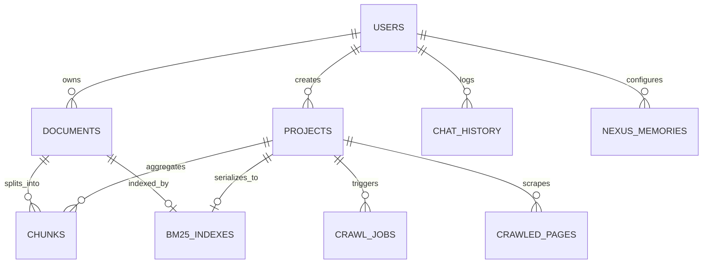

# 04. Database Schemas & Data Dictionary

## 1. MongoDB Atlas Collections Overview

All collections run asynchronously via **Motor (`AsyncIOMotorClient`)** in non-blocking event loops (`rag-backend/app/db/mongodb.py`).

---

## 2. Exhaustive Data Dictionary (11 Collections)

### 1. `users` Collection
- `_id` (`string`, PK): User UUID or MongoDB ObjectId string.
- `email` (`string`, Unique Index): Lowercase RFC 5322 sanitized email.
- `hashed_password` (`string`, Nullable): Passlib Bcrypt hashed string (Cost factor 12).
- `name` (`string`): Full user display name.
- `role` (`string`): Access control scope: `"user"` | `"admin"`.
- `plan` (`string`): Tier quota: `"free"` | `"pro"` | `"enterprise"`.
- `auth_provider` (`string`): `"local"` | `"google"`.
- `google_id` (`string`, Nullable, Sparse Index): Google Identity `sub` claim.
- `created_at` (`datetime`): Timestamp of creation.
- `updated_at` (`datetime`): Timestamp of last profile update.

### 2. `documents` Collection
- `_id` (`string`, PK): Format: `doc_{uuid4}`.
- `user_id` (`string`, FK -> `users._id`, Compound Index): Owner reference.
- `filename` (`string`): Sanitized original filename.
- `file_url` (`string`): Cloudinary HTTPS CDN delivery URL.
- `cloudinary_public_id` (`string`): Asset ID for Cloudinary lifecycle deletions.
- `file_size` (`int`): Size in bytes.
- `page_count` (`int`): Parsed page count from PyMuPDF.
- `status` (`string`, Indexed): `"uploading"` | `"indexing"` | `"ready"` | `"error"`.
- `summary` (`string`): Global LLM-synthesized summary.
- `chunk_count` (`int`): Total child chunks extracted.
- `created_at` (`datetime`): Upload timestamp.
- `updated_at` (`datetime`): Completion timestamp.

### 3. `chunks` Collection
- `_id` (`ObjectId`, PK): Unique chunk ID.
- `doc_id` (`string`, FK -> `documents._id` / `projects._id`, Compound Index): Parent identifier.
- `chunk_id` (`string`, Unique Index): Structured label: `{doc_id}_c{embedding_id}`.
- `page` (`int`): 1-based page number.
- `text` (`string`): 300-token child segment text used for indexing.
- `parent_id` (`string`, Indexed): Identifier pointing to `{doc_id}_p{index}` parent block.
- `parent_text` (`binary` / `string`): 1200-token parent block context (zlib compressed).
- `embedding_id` (`int`, Compound Index with `doc_id`): Integer offset mapped to vector store.
- `source_name` (`string`): Filename or webpage title.
- `url` (`string`, Nullable): Web source URL if crawled.
- `token_count` (`int`): Sub-word token length.
- `created_at` (`datetime`): Generation timestamp.

### 4. `projects` Collection
- `_id` (`string`, PK): 24-character hexadecimal ObjectId string.
- `user_id` (`string`, FK -> `users._id`, Compound Index): Owner user ID.
- `name` (`string`): Workspace label (e.g., `"KITSW Knowledge Base"`).
- `website_url` (`string`): Seed root domain (e.g., `"https://kitsw.ac.in"`).
- `status` (`string`, Indexed): `"crawling"` | `"indexing"` | `"active"` | `"paused"` | `"error"`.
- `pages_crawled` (`int`): Scraped HTML page count.
- `docs_found` (`int`): Discovered and indexed PDF count.
- `use_dynamic_crawl` (`bool`): Playwright dynamic scraping toggle.
- `sitemap_url` (`string`, Nullable): Discovered XML sitemap path.
- `login_url` (`string`, Nullable): Target URL for login spidering.
- `login_username` (`string`, Nullable): Encrypted auth credential.
- `login_password` (`string`, Nullable): Encrypted auth credential.
- `summary` (`string`): Multi-document synthesized project overview.
- `created_at` (`datetime`): Creation timestamp.
- `updated_at` (`datetime`): Status modification timestamp.

### 5. `crawl_jobs` Collection
- `_id` (`string`, PK): Format: `job_{uuid4}`.
- `project_id` (`string`, FK -> `projects._id`, Indexed): Project reference.
- `status` (`string`): `"pending"` | `"running"` | `"completed"` | `"failed"`.
- `urls_found` (`int`): Internal URLs queued.
- `urls_processed` (`int`): URLs evaluated.
- `pages_crawled` (`int`): HTML pages persisted.
- `docs_found` (`int`): PDF documents downloaded.
- `error` (`string`, Nullable): Exception traceback if failed.
- `created_at` (`datetime`): Spawn timestamp.
- `updated_at` (`datetime`): Termination timestamp.

### 6. `crawled_pages` Collection
- `_id` (`ObjectId`, PK): Page record identifier.
- `project_id` (`string`, FK -> `projects._id`, Compound Index): Project reference.
- `url` (`string`, Compound Index with `project_id`): Canonicalized URL.
- `title` (`string`): `<title>` tag content.
- `text_content` (`string`): Boilerplate-stripped body text.
- `html_snippet` (`string`): DOM excerpt.
- `status_code` (`int`): HTTP status code returned (200, etc.).
- `crawled_at` (`datetime`): Extraction timestamp.

### 7. `bm25_indexes` Collection
- `_id` (`string`, PK): Format: `bm25_{doc_id}`.
- `doc_id` (`string`, FK -> `documents._id` / `projects._id`, Unique Index): Scope ID.
- `index_data` (`binary`): Pickle-serialized, zlib-compressed Okapi BM25 term matrices.
- `num_chunks` (`int`): Total chunk count.
- `updated_at` (`datetime`): Compilation timestamp.

### 8. `chat_history` Collection
- `_id` (`ObjectId`, PK): Unique interaction ID.
- `user_id` (`string`, FK -> `users._id`, Compound Index): Querying user.
- `doc_id` (`string`, FK -> `documents._id` / `projects._id`, Compound Index): Workspace scope.
- `question` (`string`): User input query.
- `answer` (`string`): Synthesized Markdown response.
- `sources` (`array` of objects): Cited references: `{ page, chunk_id, snippet, url }`.
- `evidence_trace` (`array` of objects): Neural reranker candidates: `{ chunk_id, score, source }`.
- `retrieval_debug` (`object`, Nullable): Timing metrics for dense, sparse, and reranking stages.
- `mode` (`string`): `"standard"` | `"debate"` | `"decision_tree"` | `"general_ai"`.
- `timestamp` (`datetime`, Indexed): Execution timestamp.

### 9. `nexus_memories` Collection
- `_id` (`ObjectId`, PK): Living memory record ID.
- `user_id` (`string`, FK -> `users._id`, Compound Index): User identity.
- `project_id` (`string`, Compound Index): Scope: Project ID or `"global"`.
- `category` (`string`): `"fact"` | `"directive"` | `"preference"`.
- `key` (`string`): Directive identifier (e.g., `"Tone"`).
- `value` (`string`): Injected instruction string.
- `created_at` (`datetime`): Creation timestamp.
- `updated_at` (`datetime`): Update timestamp.

### 10. `memory` Collection
- `_id` (`ObjectId`, PK): Short-term memory buffer ID.
- `user_id` (`string`, Compound Index with `doc_id`): User identifier.
- `doc_id` (`string`): Document or project identifier.
- `memory_summary` (`string`): Rolling summary string (last 500 characters).
- `updated_at` (`datetime`): Last conversational update timestamp.

### 11. `analytics` Collection
- `_id` (`ObjectId`, PK): Analytics event ID.
- `user_id` (`string`, FK -> `users._id`, Indexed): Querying user.
- `doc_id` (`string`, Indexed): Target workspace identifier.
- `document_filename` (`string`): Display label.
- `question` (`string`): User query string.
- `embedding` (`array` of floats): 384-d query vector for topic clustering.
- `timestamp` (`datetime`, Indexed): Event timestamp.
