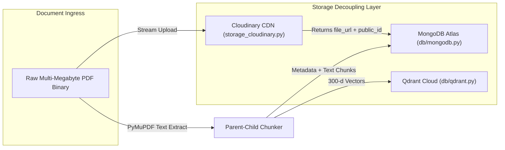

# 05. Polyglot Persistence & Storage Decoupling

## 1. Storage Specialization Architecture



---

## 2. Decoupled Cloudinary Binary Engine (`core/storage_cloudinary.py`)

- **The Problem**: Storing multi-megabyte binary PDFs directly in MongoDB documents causes document size limit violations (16MB BSON limit), ballooning memory usage during database scans.
- **The Solution**: Binary payloads stream directly to Cloudinary over HTTPS. Only the lightweight metadata (`file_url`, `cloudinary_public_id`, `file_size`) is persisted in MongoDB.

```python
# rag-backend/app/core/storage_cloudinary.py
import cloudinary
import cloudinary.uploader

def upload_document_to_cloudinary(file_bytes: bytes, filename: str) -> dict:
    """Streams PDF to Cloudinary without persisting to local container disk."""
    res = cloudinary.uploader.upload(
        file_bytes,
        resource_type="auto",
        folder="nexus_veridocs",
        public_id=f"doc_{uuid.uuid4().hex[:12]}",
        overwrite=True
    )
    return {
        "file_url": res.get("secure_url"),
        "public_id": res.get("public_id"),
        "bytes": res.get("bytes")
    }
```

---

## 3. Durable Compressed BM25 Persistence (`core/bm25.py`)

- **The Problem**: The Okapi BM25 term frequency matrices were stored in ephemeral Python heap memory. Whenever cloud instances restarted, BM25 indices vanished, breaking keyword retrieval.
- **The Solution**: Serializes the inverted term frequency index into a compressed binary blob stored in MongoDB's `bm25_indexes` collection. Hydrates into memory in $< 20\text{ ms}$ upon worker startup.
