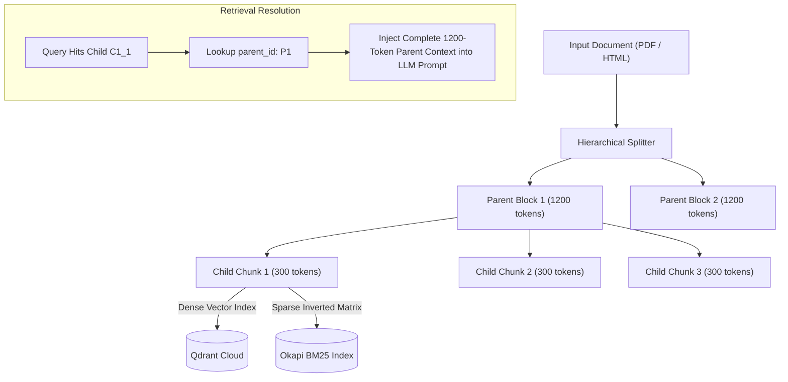

# 07. Ingestion Pipeline & Parent-Child Chunking

## 1. Parent-Child Chunking Architecture

---

## 2. Ingestion Technical Pipeline (`ingestion/pipeline.py`)

1. **Extraction**:
   - Digital Native: PyMuPDF (`fitz`) handles digital PDFs at $> 100\text{ pages/sec}$.
   - Scanned PDF Fallback: If extracted characters per page $< 50$, invokes Cloud Vision / OCR.Space.
2. **Text Sanitization & Normalization (`ingestion/sanitizer.py`)**:
   - Removes repeated headers/footers, form-feed characters, and hyphenated word breaks.
3. **Hierarchical Child Generation**:
   - Rolling token windows: $300\text{ tokens}$ with $50\text{ token}$ overlap.
4. **Parent Block Compression**:
   - Compresses $1200\text{ token}$ parent contexts using `zlib` to reduce MongoDB payload sizes.
