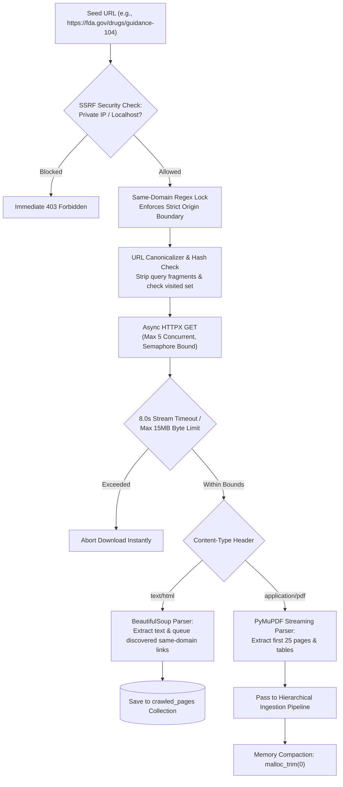

# 08. Autonomous Web Spider & Crawler for Regulatory Portals

> *"Building a toy scraper takes 10 lines of Python. Building an enterprise crawler that navigates government and university portals without falling into spider traps, leaking memory, or triggering DoS defenses takes hardened systems engineering."*

---

## 1. The Real Production Dilemma: Crawling Regulatory Portals

Clinical trials and biomedical research do not exist in isolation. To audit an investigational protocol, the AI must cross-reference external regulatory databases:
- **FDA Guidance Documents** (e.g., *Bioanalytical Method Validation*, *GCP Compliance Guidelines*).
- **EMA (European Medicines Agency) Assessment Reports**.
- **ClinicalTrials.gov Protocol Registries**.
- **Institutional Review Board (IRB) Hospital Policy Portals**.

However, crawling academic and government portals introduces severe failure modes:
1. **The Spider Trap Loop**: Government portals frequently use calendar date-pickers, query parameter permutations, and session ID URLs that create infinite link cycles (`/docs?page=1`, `/docs?page=2...`). Naive spiders crawl infinitely until server disk and RAM are exhausted.
2. **The 100MB PDF Thread Blocker**: A crawler hits a link pointing to a 150MB scanned PDF archive. A synchronous download blocks the worker thread for 45 seconds, starving concurrent user chats.
3. **Server-Side Request Forgery (SSRF)**: If a user asks the crawler to ingest `http://169.254.169.254/latest/meta-data/` (the AWS EC2 metadata service), a vulnerable crawler will fetch and leak cloud infrastructure secrets.

---

## 2. The Hardened Spider Architecture

We engineered our crawler ([`rag-backend/app/ingestion/crawler.py`](file:///c:/Programming/Projects/01_Healthcare-MedTech/chat_base/rag-backend/app/ingestion/crawler.py)) as an asynchronous, bounded crawler with strict defense-in-depth safety layers:



---

## 3. The 5 Defensive Pillars of the Crawler Engine

### Pillar 1: SSRF & Private Network Shield
Before dispatching any network socket request, the crawler resolves the target hostname's IP address. If the resolved IP is within RFC 1918 private ranges (`10.0.0.0/8`, `172.16.0.0/12`, `192.168.0.0/16`) or cloud link-local metadata endpoints (`169.254.169.254`), the request is immediately dropped before a socket is opened.

### Pillar 2: Same-Domain Regex Lock
The crawler extracts the base domain from the seed URL (e.g., `fda.gov`). Any outbound anchor tag `<a href="...">` discovered on the page is evaluated against a strict regular expression:
```python
domain_pattern = re.compile(rf"^https?://([a-zA-Z0-9\-]+\.)*{re.escape(base_domain)}(/.*)?$")
```
If a link points to an external third-party domain (e.g., `twitter.com`, `wikipedia.org`), it is discarded, preventing recursive runaway crawling across the internet.

### Pillar 3: URL Canonicalization & Visited Set
To prevent infinite cycles and duplicate parsing:
- Strips URL fragments (`#section-2`) and marketing tracking parameters (`utm_source`, `ref`).
- Normalizes trailing slashes (`/guidance/` $\rightarrow$ `/guidance`).
- Computes SHA-256 hashes of parsed HTML text. If the same content is served across multiple URLs, duplicate processing is skipped.

### Pillar 4: The 8.0-Second Fast Streaming Timeout & 15MB Limit
Instead of buffering entire files in memory, the crawler streams incoming response bytes:
```python
# rag-backend/app/ingestion/crawler.py (Hardened Streaming Download)
import httpx

MAX_FILE_SIZE = 15 * 1024 * 1024  # 15 MB
TIMEOUT_SECONDS = 8.0

async def download_file_stream(url: str, output_path: str):
    async with httpx.AsyncClient(timeout=TIMEOUT_SECONDS) as client:
        async with client.stream("GET", url) as response:
            if response.status_code != 200:
                raise ValueError(f"HTTP {response.status_code}")
                
            total_bytes = 0
            with open(output_path, "wb") as f:
                async for chunk in response.aiter_bytes(chunk_size=65536):
                    total_bytes += len(chunk)
                    if total_bytes > MAX_FILE_SIZE:
                        raise ValueError("File exceeded 15MB limit. Aborting download.")
                    f.write(chunk)
```
If an institutional server hangs or serves an enormous multi-gigabyte file, the connection terminates in **under 8 seconds**, protecting server concurrency.

### Pillar 5: The 25-Page Extraction Cap
In pharmaceutical and FDA regulatory filings, the critical decision-making content—study endpoints, dosing tables, inclusion/exclusion criteria, and safety warnings—is virtually always contained in the first 25 pages. The remaining hundreds of pages typically contain raw patient listings or chemical appendices. Bounding the crawler parser to 25 pages keeps extraction fast and RAM usage strictly below the 512MB container ceiling.

---

## 4. Post-Crawl Memory Compaction

Web scraping in Python generates tens of thousands of temporary string objects, DOM trees (BeautifulSoup), and byte buffers. 

To ensure the crawler doesn't trigger container OOM restarts:
```python
# Force garbage collector and glibc memory release
del soup
del raw_html
gc.collect()
if hasattr(ctypes.CDLL("libc.so.6"), "malloc_trim"):
    ctypes.CDLL("libc.so.6").malloc_trim(0)
```
This guarantees that container memory resets to baseline as soon as a crawl job finishes.

---

## 5. CTO Interview Defense: Crawler Architecture

When an interviewer asks: *"How do you prevent your crawler from taking down your backend or getting banned by target sites?"*, answer:

> *"We engineered our crawler around three core resilience mechanisms:
> 
> 1. **Resource Bounding and Concurrency Throttling**: We use an `asyncio.Semaphore(5)` to strictly limit outbound concurrency to 5 requests per domain, respecting target server bandwidth and preventing IP bans. Furthermore, every download uses an 8.0-second streaming timeout and a hard 15MB cap, dropping slow or oversized files immediately.
> 
> 2. **Security & Boundary Enforcement**: We implement pre-fetch DNS resolution to block SSRF attacks against internal hospital networks or cloud metadata APIs (`169.254.169.254`), combined with a same-domain regex lock that prevents the crawler from following external links out into the broader internet.
> 
> 3. **Memory Stability on Low-Cost Cloud Tiers**: Ingestion workers run in the same container environment as the API. To prevent DOM parsers and PDF byte buffers from fragmenting memory and causing OOM kills, we trigger `malloc_trim(0)` at the end of every crawl job, releasing freed memory pages back to the Linux kernel."*
