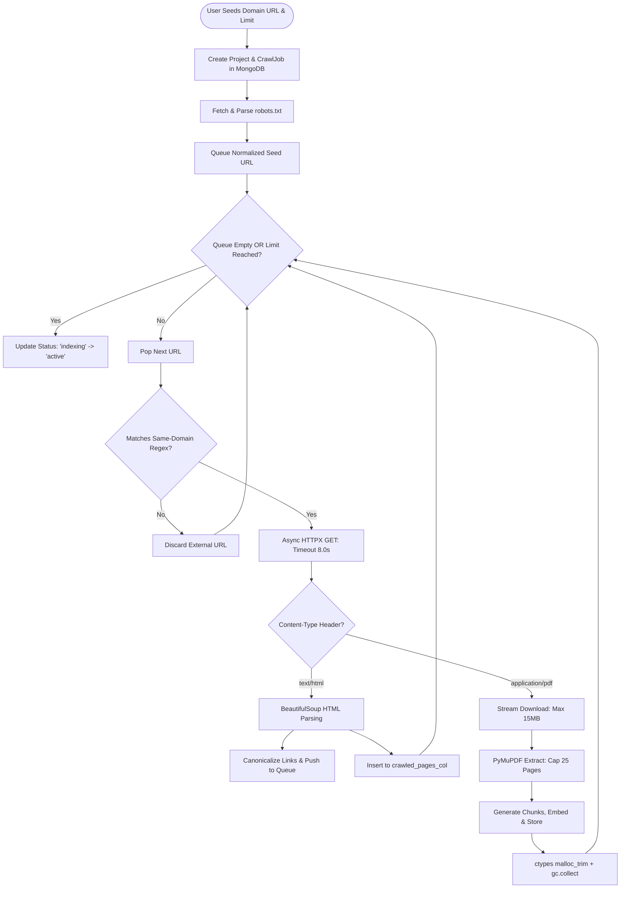

# 08. Autonomous Web Spider & Crawler

## 1. Web Crawler Architecture Flowchart



---

## 2. Crawler Technical Specifications (`ingestion/crawler.py`)

- **Same-Domain Constraint**: Strict regex lock (`^https?:\/\/(www\.)?targetdomain\.com`) ensures the crawler never traverses outbound links.
- **URL Canonicalization Engine**:
  - Strips URL fragments (`#section`), trailing slashes, and tracking query parameters (`?utm_source=...`).
  - Converts protocol and host to lowercase.
- **Fast PDF Stream Timeout**:
  - Sets an **8.0-second HTTPX stream timeout** and a **15 MB size ceiling**.
  - Limits digital extraction to a **maximum of 25 pages**, preventing memory exhaustion on academic portals.
- **Kernel Memory Compaction**:
  - Every batch execution triggers:
    ```python
    import gc, ctypes
    gc.collect()
    try:
        ctypes.CDLL("libc.so.6").malloc_trim(0)
    except Exception:
        pass
    ```
