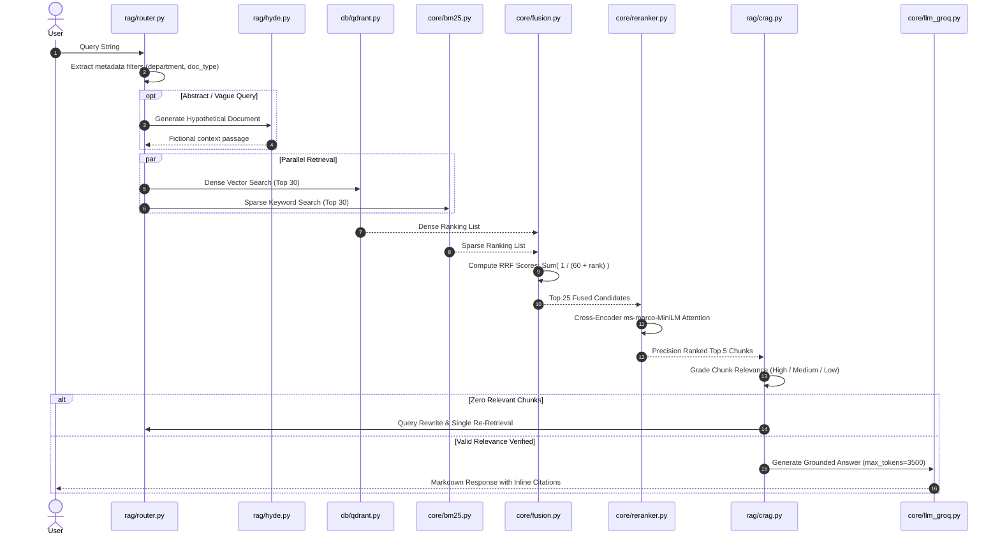

# 09. RAG v2 Hybrid Retrieval Pipeline

## 1. Multi-Stage Retrieval Sequence

---

## 2. Component Directory Reference

- **Query Routing (`rag/router.py`)**: Classifies user query into departments (`cse`, `ece`, `eee`) and categories (`faculty`, `placement`, `syllabus`).
- **HyDE Engine (`rag/hyde.py`)**: For abstract questions (e.g., *"What is this document about?"*), generates a hypothetical paragraph to ground vector search in target terminology.
- **Context String Assembly (`rag/engine.py`)**: Deduplicates chunks by `parent_id` and checks total tokens against the prompt budget.
