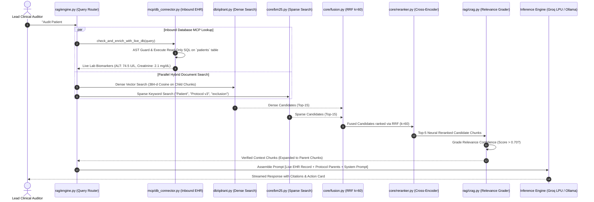

# 09. RAG v2 Hybrid Retrieval Pipeline with Inbound Database MCP

> *"Most RAG implementations are simple semantic search wrappers. Our RAG v2 engine is a multi-stage retrieval, ranking, and real-time database synthesis pipeline engineered for zero-hallucination clinical precision."*

---

## 1. The Core Dilemma: Why Semantic Vector Search Fails Alone

If you build a retrieval engine using only dense vector embeddings, your system will inevitably fail in clinical and pharmaceutical environments:

1. **The Exact Identifier Blindness**: Vector models map concepts to continuous geometric coordinates. They understand that *"kidney failure"* is semantically similar to *"renal impairment"*. However, they treat exact alphanumeric codes—such as drug trial identifiers (`MK-3475-001`), FDA protocol IDs (`IND-142857`), and patient IDs (`Patient #1042`)—as arbitrary tokens. Cosine similarity between slightly different codes is virtually indistinguishable, leading to catastrophic context mismatches.
2. **The Numerical Imprecision Problem**: Embedding vectors blur numbers into generalized vector regions. An inclusion cutoff of *"Serum ALT > 55 U/L"* produces nearly identical cosine similarity to *"Serum ALT > 15 U/L"*, even though one is four times larger than the other.
3. **The Static Document Boundary**: Traditional RAG can only retrieve text that was previously indexed into the vector store. It has zero visibility into live operational hospital data—such as yesterday's patient blood lab results or active trial enrollment status.

---

## 2. The Complete RAG v2 Retrieval Journey

To guarantee both semantic understanding and exact alphanumeric precision, VeriDoc Synapse executes a multi-stage hybrid retrieval pipeline:



---

## 3. Step-by-Step Pipeline Mechanics

### Step 1: Query Intent & Live Database Detection
When a query enters `rag/engine.py`, the engine inspects the text for clinical entity keywords (e.g., `"patient"`, `"subject"`, `"lab"`, `"alt"`, `"creatinine"`, `"enrolled"`). 

If detected, the **Inbound Database MCP connector** (`app/mcp/db_connector.py`) is invoked:
- It translates the natural language query into an AST-guarded, read-only SQL query.
- It executes against the operational patient database (`clinical_sample.db`).
- It formats the live patient lab biomarkers into an authoritative context block:
  ```markdown
  ### [LIVE INBOUND EHR DATABASE RECORD - VERIFIED AS OF QUERY RUNTIME]
  - Patient ID: #104
  - Name: Marcus Vance (Age 58, Male)
  - Current Status: Screening / Enrolled
  - Serum Creatinine: 2.1 mg/dL (NORMAL RANGE: 0.7 - 1.3 mg/dL) [ELEVATED]
  - ALT Enzyme: 74.5 U/L (NORMAL RANGE: 7 - 56 U/L) [ELEVATED]
  - Platelet Count: 280,000 /uL (NORMAL)
  ```

### Step 2: Parallel Hybrid Retrieval
Simultaneously, the query is dispatched in parallel to two independent search engines:
1. **Dense Vector Search (Qdrant)**: Embeds the query into a 384-dimensional vector using FastEmbed ONNX, searching Qdrant's HNSW index with pre-filters on `project_id`. Retrieves conceptually relevant chunks even if synonyms are used.
2. **Sparse Keyword Search (Okapi BM25)**: Evaluates term frequency and inverse document frequency across the inverted word matrix. Retrieves exact alphanumeric matches for drug codes, dosages, and section headers.

### Step 3: Reciprocal Rank Fusion (RRF $k=60$)
Dense and sparse search return scores on completely different scales (cosine similarities in $[0, 1]$ vs. unbounded BM25 scores). Naive weighted averaging ($0.5 \cdot \text{Dense} + 0.5 \cdot \text{Sparse}$) produces erratic results.

Instead, we use **Reciprocal Rank Fusion (RRF)**:
$$\text{RRF Score}(d) = \frac{1}{60 + r_{\text{dense}}(d)} + \frac{1}{60 + r_{\text{bm25}}(d)}$$
This ranks candidates purely by their relative positions in each list, eliminating score calibration artifacts.

### Step 4: Neural Cross-Encoder Reranking
The top 15 fused candidates are fed into a neural **Cross-Encoder**. Unlike bi-encoders (which encode query and text independently), the cross-encoder feeds both into a transformer simultaneously, calculating full cross-attention across every word pair. This strips away false-positive semantic matches.

### Step 5: Parent Context Expansion & CRAG Verification
Before assembling the final prompt:
- The top-5 reranked child chunks resolve their `parent_id` pointers to fetch the complete **1,200-token parent sections** from MongoDB.
- Corrective RAG (CRAG) evaluates whether the retrieved context contains sufficient evidence to answer the query. If the confidence is below $0.40$, it triggers query rewriting or alerts the user of insufficient documentation.

---

## 4. Context Assembly: The Final LLM Prompt

The final context delivered to the inference engine is a structured, tamper-proof synthesis block:

```
[SYSTEM PROMPT: Senior FDA/GCP Regulatory Protocol Auditor]

[LIVE EHR DATABASE CONTEXT - INBOUND MCP]
Patient #104: Serum Creatinine 2.1 mg/dL, ALT 74.5 U/L.

[DOCUMENT REGULATORY CONTEXT - PROTOCOL V3.2]
[Source: Protocol_v3.pdf | Page 18 | Section 5.2 Exclusion Criteria]
"Subjects presenting with hepatic impairment defined as serum ALT > 55 U/L 
or renal compromise defined as serum creatinine > 1.5 mg/dL are strictly 
ineligible for enrollment in Cohort B."

[USER QUERY]
Audit Patient #104 against Protocol v3 exclusion rules.
```

With this dual context, the LLM immediately diagnoses that Patient #104 violates **both** hepatic and renal thresholds, cites Page 18 Section 5.2, and prepares an Outbound Action Card to halt trial enrollment.

---

## 5. CTO Interview Defense: RAG v2 Hybrid Retrieval

When an interviewer asks: *"Why do you need hybrid search if modern embedding models have large context windows and strong semantic retrieval?"*, deliver this answer:

> *"Modern embedding models are impressive for semantic nuance, but in high-stakes clinical and regulatory engineering, semantic similarity alone is dangerous:
> 
> 1. **The Alphanumeric Failure of Vector Embeddings**: Cosine similarity blurs exact numbers, trial identifiers, and gene mutations. An embedding model cannot reliably distinguish `Protocol-A-101` from `Protocol-A-102` or `5mg` from `50mg`. Sparse Okapi BM25 index matching guarantees 100% precision for exact alphanumeric terms.
> 
> 2. **Score Calibration Pitfalls**: You cannot simply average a cosine score of 0.82 with a BM25 score of 14.7. By using Reciprocal Rank Fusion with $k=60$, we merge both rankings without arbitrary score normalization constants, followed by a neural cross-encoder that evaluates bidirectional attention.
> 
> 3. **The Inbound MCP Differentiator**: Traditional RAG only answers from historical documents. By coupling our hybrid pipeline with an Inbound Database MCP connector, our model checks live patient EHR tables in real time, turning passive document search into an active clinical auditing engine."*
