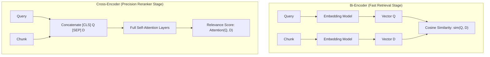

# 11. Cross-Encoder Reranking & CRAG

## 1. Bi-Encoder vs. Cross-Encoder Comparison

---

## 2. Corrective RAG (CRAG) Workflow (`rag/crag.py`)

1. **Relevance Grading**: Evaluates the top reranked chunks using an LLM or small classifier (`High`, `Medium`, `Low`).
2. **Confidence Thresholding**:
   - If $\ge 1$ chunk has `High` or `Medium` relevance $\rightarrow$ proceeds directly to LLM prompt assembly.
   - If **all** chunks are `Low` relevance $\rightarrow$ triggers query rewrite loop.
3. **Query Rewriting Loop**: Strips extraneous filler words and queries Qdrant with an expanded query variation.
4. **Abstention**: If re-retrieval also yields zero relevant chunks, the engine returns a grounded abstention message rather than hallucinating an answer.
