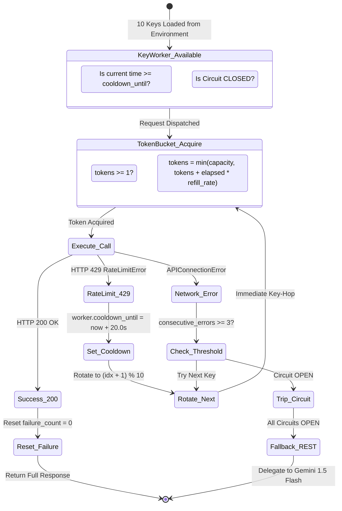

# 12. Multi-Key Groq LPU Cluster Resilience

## 1. Resilience State Machine

---

## 2. Technical Implementation Specifications (`core/groq_resilience.py`)

- **`TokenBucket`**: Capacity: $50$, Refill Rate: $10.0\text{ tokens/sec}$. Prevents burst spikes.
- **`CircuitBreaker`**: Failure threshold: $3$, Recovery timeout: $20.0\text{ s}$. Protects against hanging TCP sockets.
- **`KeyWorker`**: Wraps individual Groq client instances, their private token bucket, and circuit breaker.
- **`ResilientGroqClient`**: Implements round-robin key acquisition across all parsed keys in `GROQ_API_KEYS`.
