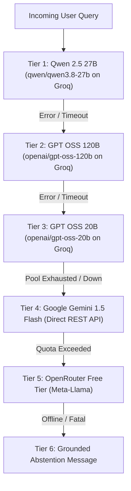

# 14. Cloud Multi-Provider Failover

## 1. Multi-Tier Failover Hierarchy

---

## 2. Zero-RAM REST Fallback Implementation (`core/llm_cloud_fallback.py`)

- **Google Gemini 1.5 Flash**: Invoked directly via lightweight `httpx.Client(timeout=20.0)` calls to `https://generativelanguage.googleapis.com/v1beta/models/gemini-1.5-flash:generateContent`.
- **Zero Local Footprint**: Requires no local GPU, PyTorch, or CTransformers model weights, preserving the strict 512MB RAM container ceiling.
