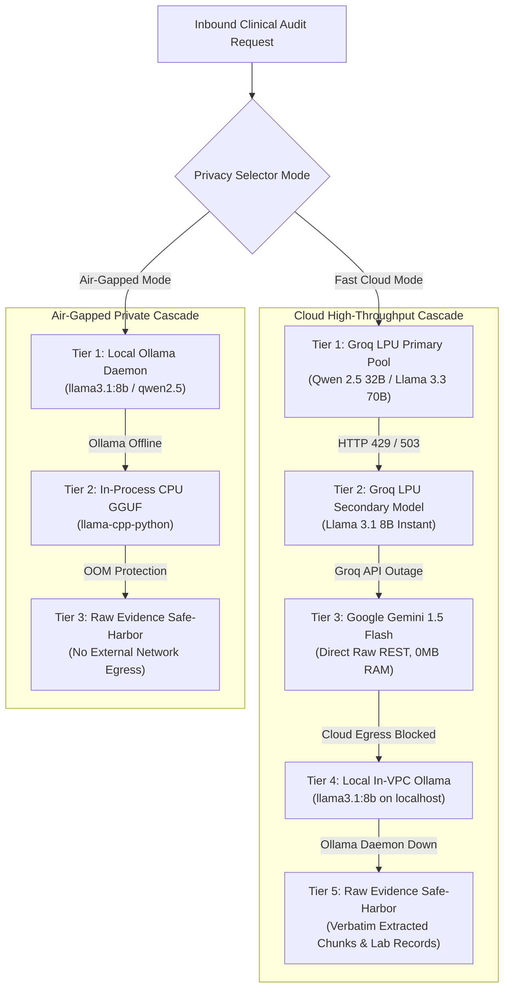

# 14. Cloud Multi-Provider Failover & Air-Gapped Fallback

> *"High availability is not an accident. It is the result of planning for every third-party vendor to fail at 2:00 AM and engineering a deterministic cascade that keeps the application alive."*

---

## 1. The Real Production Dilemma: Third-Party AI Fragility

Relying exclusively on a single AI cloud provider (whether OpenAI, Anthropic, or Groq) in mission-critical healthcare software is an operational liability:
- **Cloud Outages & DNS Glitches**: Cloudflare edge errors, data center network partitions, and API outages happen regularly.
- **Provider Rate-Limit Blackouts**: If an enterprise customer runs a massive batch audit, their primary provider account may be throttled for minutes.
- **The Clinical Consequence**: If a surgical team or clinical research associate (CRA) is validating patient biomarker eligibility before a morning infusion, an error message (`"502 Bad Gateway"`) halts clinical trials and risks patient safety.

---

## 2. The 5-Tier High-Availability Failover Cascade

We engineered a resilient 5-tier failover ladder in [`rag-backend/app/core/llm_cloud_fallback.py`](file:///c:/Programming/Projects/01_Healthcare-MedTech/chat_base/rag-backend/app/core/llm_cloud_fallback.py) and [`rag/engine.py`](file:///c:/Programming/Projects/01_Healthcare-MedTech/chat_base/rag-backend/app/rag/engine.py):



---

## 3. Tier 3: Zero-RAM Direct Cloud REST (Google Gemini 1.5 Flash)

When Groq is down or exhausted, the system steps down to **Tier 3: Google Gemini 1.5 Flash**.

Many developers make the mistake of importing large vendor SDKs (`google-generativeai` or `langchain-google-genai`). These SDKs drag in hundreds of transitive dependencies, bloat memory, and introduce concurrency locks.

We implemented Gemini fallback via **direct, lightweight asynchronous HTTP REST** ([`rag-backend/app/core/llm_cloud_fallback.py`](file:///c:/Programming/Projects/01_Healthcare-MedTech/chat_base/rag-backend/app/core/llm_cloud_fallback.py)):

```python
# rag-backend/app/core/llm_cloud_fallback.py
import httpx
import json

GEMINI_API_URL = "https://generativelanguage.googleapis.com/v1beta/models/gemini-1.5-flash:generateContent"

async def generate_gemini_fallback(prompt: str, system_prompt: str, api_key: str) -> str:
    """
    Direct asynchronous REST call to Gemini 1.5 Flash.
    Zero SDK overhead, consumes 0MB extra RAM, sub-second execution.
    """
    headers = {"Content-Type": "application/json"}
    payload = {
        "contents": [{"parts": [{"text": f"{system_prompt}\n\nUser Question:\n{prompt}"}]}],
        "generationConfig": {
            "temperature": 0.1,
            "maxOutputTokens": 3000,
            "topP": 0.95
        }
    }
    
    async with httpx.AsyncClient(timeout=15.0) as client:
        response = await client.post(
            f"{GEMINI_API_URL}?key={api_key}",
            headers=headers,
            json=payload
        )
        if response.status_code == 200:
            data = response.json()
            return data["candidates"][0]["content"]["parts"][0]["text"]
        else:
            raise RuntimeError(f"Gemini API returned HTTP {response.status_code}: {response.text}")
```

### Why this design excels:
- **Zero SDK Memory Footprint**: Uses the existing `httpx` connection pool; zero new libraries loaded into memory.
- **Massive Token Window (1 Million Tokens)**: If a query contains exceptionally large protocol comparison contexts, Gemini 1.5 Flash ingests the context effortlessly.

---

## 4. Tier 5: The "Safe-Harbor" Deterministic Fallback

What happens if the worst-case scenario occurs: Groq is down, the internet is severed, and local Ollama is offline?

A consumer chatbot crashes with an ugly error trace.

In VeriDoc Synapse, the system executes the **Tier 5 Safe-Harbor Protocol**:
1. The engine catches all upstream inference exceptions.
2. It bypasses generative synthesis entirely.
3. It formats the raw, verified ground truth data into an executive clinical bulletin:
   ```markdown
   ### [EMERGENCY SAFE-HARBOR AUDIT NOTICE: OFFLINE DIRECT CONTEXT]
   *Automated generative synthesis is temporarily offline. Displaying raw verified ground-truth records:*

   #### 1. Live EHR Patient Record (Inbound Database):
   - Patient ID: #104 | Status: Enrolled
   - Serum Creatinine: 2.1 mg/dL (Normal: 0.7 - 1.3) [FLAGGED ELEVATED]
   - Serum ALT: 74.5 U/L (Normal: 7 - 56) [FLAGGED ELEVATED]

   #### 2. Matched Regulatory Protocol Chunks (RAG v2 Verified):
   - [Protocol_v3.pdf | Page 18 | Section 5.2]:
     "Patients with serum ALT > 55 U/L or creatinine > 1.5 mg/dL are excluded from Cohort B."
   ```
4. The clinician receives the exact numerical facts required to make a life-critical decision without relying on generative LLM availability.

---

## 5. CTO Interview Defense: Multi-Provider Redundancy

When an interviewer asks: *"What is your disaster recovery and redundancy plan if your primary AI provider goes down?"*, deliver this senior architecture answer:

> *"We treat third-party AI APIs as inherently untrusted, volatile network dependencies. We designed a 5-tier failover ladder:
> 
> 1. Our primary tier is an in-process pool of 10 Groq LPU keys running open-weights Qwen 2.5 32B and Llama 3.3 70B with sub-second latency.
> 2. If Groq experiences rate limits or regional blips, our Circuit Breaker automatically shifts traffic across models and keys in under 10 milliseconds.
> 3. If the Groq infrastructure is down, the engine steps down to Google Gemini 1.5 Flash via direct asynchronous REST calls without heavy SDKs, keeping RAM footprint near zero.
> 4. If cloud egress is blocked, traffic cascades to an on-premise Ollama instance running locally inside the VPC.
> 5. Finally, if all LLM engines are offline, our system falls back to a deterministic Safe-Harbor mode: it serves the raw, verified Inbound EHR database records and retrieved protocol chunks with zero generative synthesis. In clinical trials, raw ground truth is always better than a crashed screen."*
