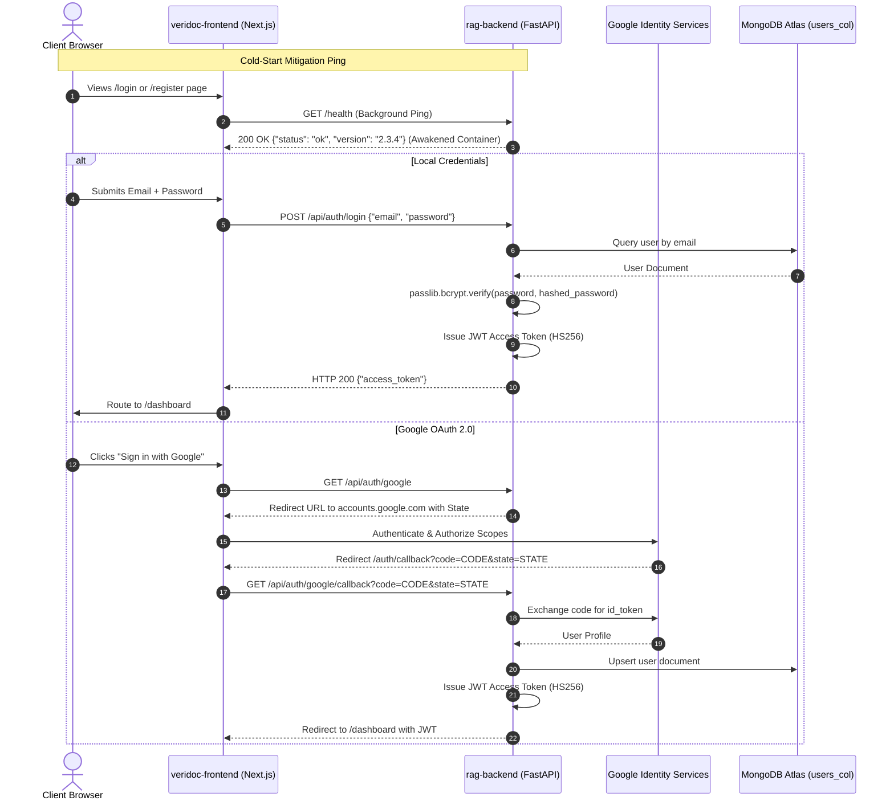

# 15. Authentication, OAuth & Security Gateway

## 1. Authentication Handshake & Cold-Start Warmup Sequence

---

## 2. Security Middleware Specifications (`core/security_headers.py`)

- `X-Content-Type-Options`: `nosniff` (Prevents MIME-sniffing).
- `X-Frame-Options`: `DENY` (Prevents clickjacking attacks).
- `Strict-Transport-Security`: `max-age=31536000; includeSubDomains` (Enforces HTTPS).
- `Content-Security-Policy`: Restricts scripts, styles, and frames to trusted origins.
