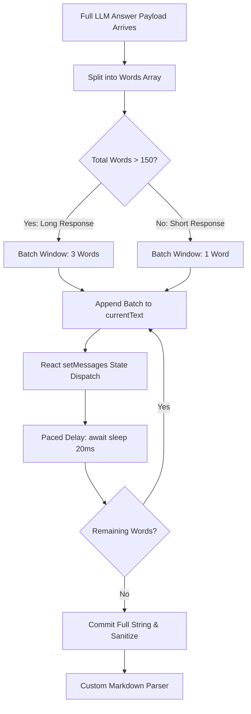

# 17. Frontend Architecture, Streaming & UX

## 1. Paced Word Streaming Buffer (`components/chat/chat-interface.tsx`)

---

## 2. Custom Markdown Parser (`MarkdownText`)

Avoids heavy external markdown libraries, parsing directly in React:
- **GFM Tables**: Detects lines starting with `|`, accumulates rows, and renders inside responsive, horizontally-scrollable `<table>` wrappers.
- **Hierarchical Lists**: Dynamically aggregates unordered bullet points (`- `) and numbered lists (`1. `).
- **Blockquotes**: Parses lines starting with `> `, rendering an italic block with an indigo accent border.
