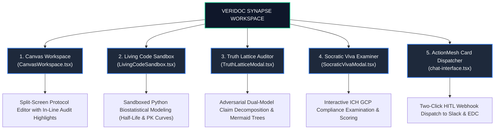

# 18. Interactive Features & Canvas Workspace: Beyond the Chatbox

> *"A chatbot is a conversational toy. An enterprise workspace is where real clinical research gets done: drafting protocol amendments, executing biostatistical formulas, and stress-testing regulatory submissions."*

---

## 1. The Real Production Dilemma: Why Chat Is Not Enough

In clinical trial design and regulatory compliance, a conversational chat window is insufficient for real-world workflows:
- **The Protocol Drafting Bottleneck**: A clinician cannot draft a 40-page FDA 510(k) filing or protocol amendment inside a chat input box. They need a split-screen workspace where they can edit markdown documents while querying the AI for live references.
- **Biostatistical Math Verification**: Medical protocols involve pharmacokinetic (PK/PD) calculations, clearance rate equations, and dosage escalation formulas. An LLM should not guess mathematical results; it must execute deterministic Python code in a sandbox.
- **Audit Readiness Testing**: Research staff need to be trained and tested on protocol procedures before FDA and Institutional Review Board (IRB) inspections.

---

## 2. Master Interactive Architecture Map

---

## 3. Deep Dive into the 5 Interactive Features

### 1. Canvas Workspace (`CanvasWorkspace.tsx`)
A split-screen, rich-text protocol drafting environment:
- **Left Pane**: Interactive chat connected to the RAG v2 engine and Inbound EHR database.
- **Right Pane**: Persistent document canvas with debounced auto-save to MongoDB.
- **"Audit Canvas" Button**: With one click, the clinician can command the system to audit their drafted text against active FDA guidance documents and historical protocols. Any dosage discrepancy or ambiguous criteria is highlighted in-line with red/amber badges.

---

### 2. Living Code Sandbox (`LivingCodeSandbox.tsx`)
In high-stakes medicine, LLMs cannot be trusted to perform complex mathematical calculations mentally.

The **Living Code Sandbox** provides a safe execution environment for biostatistical calculations:
- **Capabilities**: Pharmacokinetic clearance rate modeling, half-life decay curves, and body surface area (BSA) dosage titration formulas.
- **Security Sandboxing**: Code executes in a restricted Python environment with AST validation:
  - Forbids `import os`, `import sys`, `import subprocess`, and network socket calls.
  - Limits execution time to **2.0 seconds** and memory to **64MB** to prevent infinite loops.
- **Visualization**: Automatically renders Matplotlib curves directly inside the canvas.

---

### 3. Truth Lattice Modal (`TruthLatticeModal.tsx`)
When a clinician needs absolute certainty on a complex regulatory claim:
- The user clicks *"Deconstruct with Truth Lattice"*.
- The backend breaks the synthesized answer down into atomic medical claims.
- Each claim is cross-checked independently against retrieved chunks using an adversarial "Red-Team" prompt.
- Renders an interactive **Mermaid dependency tree** in the modal:
  - **Green nodes**: 100% verified by indexed trial protocols with page citations.
  - **Amber nodes**: Inferred or extrapolated guidelines requiring investigator review.
  - **Red nodes**: Contradicted by FDA baseline guidance or operational EHR databases.

---

### 4. Socratic Viva Examiner (`SocraticVivaModal.tsx`)
Designed for site coordinators, principal investigators, and clinical research associates (CRAs):
- Simulates an aggressive FDA regulatory audit or ICH GCP inspection.
- The AI plays the role of a Senior Regulatory Inspector, grilling the user on protocol procedures:
  > *"Inspector: If Patient #104 presents with elevated ALT of 74.5 U/L at Week 4, what is the protocol-mandated titration hold time before dose resumption?"*
- The clinician types their response, and the system grades their answer against the primary Trial Master File, providing a readiness score from 1 to 100.

---

### 5. ActionMesh Card Dispatcher (`chat-interface.tsx`)
The operational hand of VeriDoc Synapse:
- Dispatches emergency notifications to Slack (`#clinical-safety-alerts`).
- Sets temporary freeze holds in Electronic Data Capture (EDC) systems.
- Every dispatched action is signed, cryptographically timestamped, and stored in the `action_logs` collection for FDA 21 CFR Part 11 compliance.

---

## 4. CTO Interview Defense: Workspace vs. Chat

When an interviewer asks: *"Why did you invest time building Canvas and Code Sandbox features instead of just focusing on the chatbot?"*, deliver this product-architecture pitch:

> *"In enterprise healthcare, a pure chatbot has almost zero workflow retention. Clinicians and regulatory associates don't want to chat; they have specific work to accomplish—such as drafting protocol amendments, verifying pharmacokinetic calculations, and preparing for FDA audits.
> 
> By engineering a split-screen **Canvas Workspace** paired with a sandboxed **Living Code Sandbox**:
> 1. We allow researchers to draft regulatory documents with real-time in-line contradiction highlighting.
> 2. We eliminate mathematical hallucinations by delegating pharmacokinetic calculations to deterministic, AST-sandboxed Python execution.
> 3. We create an active operational tool with high enterprise switching costs, moving our platform from a commodity chatbot into an indispensable clinical operating system."*
