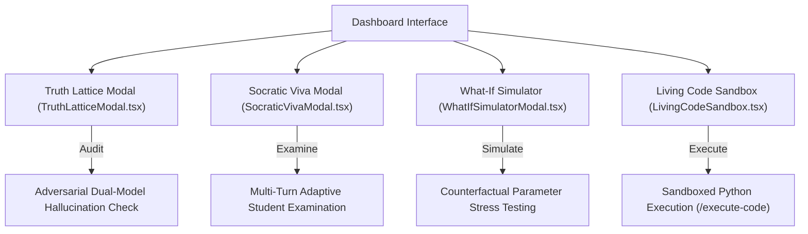

# 18. Interactive Features & Canvas Workspace

## 1. Canvas Workspace Architecture (`components/canvas/CanvasWorkspace.tsx`)

- **Split Screen Layout**: Renders side-by-side with chat and document previews.
- **Editable Markdown Canvas**: Allows live document editing, notes aggregation, and one-click export to `.md` or `.pdf`.
- **Integrated Python Runner**: Sends code blocks directly to `/api/features/execute-code` for execution in an isolated sandbox.

---

## 2. Advanced AI Intelligence Modals (`components/features/`)

