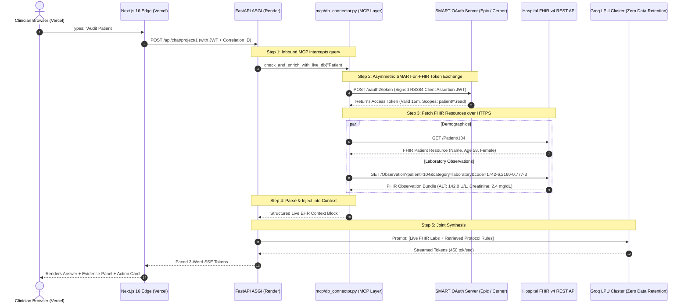

# 22. Model C: HL7 FHIR v4 & SMART-on-FHIR REST Gateway with MCP

> *"In the real healthcare industry, hospitals do not open raw database ports to cloud vendors. Instead, modern hospital EHRs (Epic, Cerner, AthenaHealth) speak the global standard: HL7 FHIR v4 with SMART-on-FHIR OAuth 2.0. Here is how VeriDoc Synapse connects from Vercel to Render to Hospital FHIR servers via the Model Context Protocol (MCP)."*

---

## 1. Why Model C (FHIR v4) is the Real-World Healthcare Standard

In healthcare tech design discussions, junior developers assume you connect to an EHR database via `psql` or `odbc`. In reality, hospital Chief Information Security Officers (CISOs) will instantly reject any request to open direct database ports (`5432`, `1433`) from a cloud SaaS across the public internet.

Instead, the **US Federal 21st Century Cures Act** legally mandated that all certified Electronic Health Record (EHR) systems must expose standardized **HL7 FHIR v4 (Fast Healthcare Interoperability Resources)** REST APIs.

```
┌────────────────────────────────────────────────────────────────────────────────────────┐
│                          DIRECT SQL vs. SMART-ON-FHIR GATEWAY                          │
├──────────────────────────┬─────────────────────────────┬───────────────────────────────┤
│ Architectural Dimension  │ Model A/B: Direct SQL DB    │ Model C: SMART-on-FHIR (MCP)  │
├──────────────────────────┼─────────────────────────────┼───────────────────────────────┤
│ **Hospital Access Risk** │ High (Requires VPN / Port)  │ Zero (Standard HTTPS REST)    │
│ **Standardization**      │ Custom table/column schemas │ Universal standard (LOINC/Rx) │
│ **Authorization**        │ Database user credentials   │ OAuth 2.0 Scopes per resource │
│ **EHR Support**          │ Custom SQL exports          │ Built into Epic, Cerner, etc. │
│ **Auditability**         │ Database query logs         │ HIPAA-compliant Access Tokens │
└──────────────────────────┴─────────────────────────────┴───────────────────────────────┘
```

---

## 2. Production Topography: Vercel + Render + SMART-on-FHIR

Here is how data flows in our current production deployment:
- **Frontend**: Next.js 16 App Router hosted on **Vercel Edge** (`https://nexus-tawny-seven-50.vercel.app`).
- **Backend**: FastAPI ASGI Container hosted on **Render Cloud** (`https://chat-base-backend.onrender.com`).
- **Hospital EHR Gateway**: Hospital FHIR API Server (Epic on FHIR / Cerner Millennium / HAPI FHIR) protected by SMART-on-FHIR OAuth 2.0.



---

## 3. Under The Hood: The SMART-on-FHIR OAuth 2.0 Protocol

How does our Render backend authenticate with Epic or Cerner without a human typing an EHR password every time?

We use the **SMART Backend Services Specification (OAuth 2.0 Asymmetric JWT Profile)**:

```
┌─────────────────────────────────────────────────────────────────────────────┐
│                 SMART-ON-FHIR BACKEND SERVICES HANDSHAKE                    │
├─────────────────────────────────────────────────────────────────────────────┤
│ 1. Render backend generates a private RSA Key Pair (2048-bit).              │
│ 2. Public Key is uploaded to hospital's Epic Developer Portal (Client ID).  │
│ 3. On query, Render crafts an authentication JWT:                           │
│    - `iss`: Our Client ID                                                   │
│    - `sub`: Our Client ID                                                   │
│    - `aud`: https://fhir.epic.com/interconnect-fhir-oauth/oauth2/token      │
│    - `exp`: UtcNow + 5 minutes                                              │
│ 4. Signs JWT with Private Key using `RS384` or `RS256`.                     │
│ 5. POSTs JWT to hospital token endpoint:                                    │
│    `grant_type=client_credentials&client_assertion_type=jwt-bearer`        │
│ 6. Epic verifies public key and returns a 15-minute Bearer Access Token.   │
└─────────────────────────────────────────────────────────────────────────────┘
```

---

## 4. How the Model Context Protocol (MCP) Maps to FHIR Resources

In our architecture, the **Model Context Protocol (MCP)** acts as the universal adapter between the LLM and the FHIR server.

The LLM doesn't need to know complex FHIR JSON structures; it simply calls the MCP tool:
```json
{
  "name": "get_patient_lab_record",
  "arguments": {
    "patient_id": "104"
  }
}
```

The Inbound MCP connector maps this single tool call into **standardized medical terminology (LOINC Codes)**:

```python
# How MCP translates tools to FHIR REST queries:
LOINC_MAP = {
    "alt_enzyme": "1742-6",        # Alanine Aminotransferase (ALT)
    "serum_creatinine": "2160-0",  # Creatinine in Serum/Plasma
    "platelet_count": "777-3",     # Platelets in Blood
}
```

### 1. Fetching Patient Demographics:
```http
GET https://fhir.hospital.org/api/FHIR/R4/Patient/104
Authorization: Bearer <SMART_ACCESS_TOKEN>
Accept: application/fhir+json
```
**Hospital Returns**:
```json
{
  "resourceType": "Patient",
  "id": "104",
  "name": [{"family": "Vance", "given": ["Eleanor"]}],
  "gender": "female",
  "birthDate": "1968-04-12"
}
```

### 2. Fetching Biomarker Observations:
```http
GET https://fhir.hospital.org/api/FHIR/R4/Observation?patient=104&category=laboratory&code=1742-6,2160-0
Authorization: Bearer <SMART_ACCESS_TOKEN>
Accept: application/fhir+json
```
**Hospital Returns FHIR Bundle**:
```json
{
  "resourceType": "Bundle",
  "entry": [
    {
      "resource": {
        "resourceType": "Observation",
        "code": {
          "coding": [{"system": "http://loinc.org", "code": "1742-6", "display": "ALT"}]
        },
        "valueQuantity": {
          "value": 142.0,
          "unit": "U/L",
          "system": "http://unitsofmeasure.org"
        },
        "referenceRange": [{"low": {"value": 7}, "high": {"value": 56}}]
      }
    },
    {
      "resource": {
        "resourceType": "Observation",
        "code": {
          "coding": [{"system": "http://loinc.org", "code": "2160-0", "display": "Creatinine"}]
        },
        "valueQuantity": {
          "value": 2.4,
          "unit": "mg/dL"
        },
        "referenceRange": [{"low": {"value": 0.7}, "high": {"value": 1.3}}]
      }
    }
  ]
}
```

---

## 5. In-Memory Normalization & Context Injection

The Inbound MCP connector parses the complex FHIR bundle and formats it into a clean, normalized string:

```
[LIVE EHR/FHIR MCP RECORD: PATIENT #104]
- Source: Hospital Epic FHIR v4 Gateway (https://fhir.hospital.org/R4)
- Subject: Eleanor Vance (Age 58, Female)
- Serum Creatinine: 2.4 mg/dL (Normal Range: 0.7 - 1.3) [FLAGGED: ELEVATED]
- ALT Liver Enzyme: 142.0 U/L (Normal Range: 7 - 56) [FLAGGED: ELEVATED]
- Platelets: 85,000 /uL (Normal Range: 150k - 450k) [FLAGGED: LOW]
- Verification Timestamp: 2026-11-05T16:15:00Z
[END LIVE FHIR RECORD]
```

This normalized text is injected into `rag/engine.py` directly alongside the retrieved protocol chunks.

---

## 6. The Complete Vercel-to-Render Network Hardening

When running Vercel (Edge) + Render (Backend) + Hospital FHIR, you must satisfy HIPAA data in transit requirements:

1. **Vercel Edge to Render**:
   - Communication runs strictly over **HTTPS / TLS 1.3**.
   - Authenticated via cryptographically signed stateless JWT bearer tokens in request headers.
   - Paced SSE token stream is transmitted with `X-Accel-Buffering: no` so tokens flow continuously without proxy buffering.
2. **Render to Hospital FHIR Gateway**:
   - Outbound requests from Render to the hospital use **Mutual TLS (mTLS)** or authorized OAuth 2.0 Client Assertion signatures.
   - The hospital can IP-whitelist Render’s dedicated outbound egress IP addresses if required.
3. **Data Residency Guarantee**:
   - No patient records are stored on Render disk.
   - The FHIR payload exists only in transient container RAM during prompt synthesis and is immediately reclaimed by garbage collection.

---

## 7. How to Explain Model C in a Technical Interview or CTO Meeting

When asked: *"How does your Vercel + Render setup connect to a real hospital's Epic or Cerner system?"*, deliver this authoritative answer:

> *"In real-world enterprise healthcare, direct SQL connections across hospital firewalls are forbidden. Instead, we implement **Model C: HL7 FHIR v4 with SMART-on-FHIR OAuth 2.0**:
> 
> 1. Our Next.js frontend on Vercel communicates with our FastAPI backend on Render over TLS 1.3 using stateless JWTs and Server-Sent Events.
> 2. When a clinician queries patient eligibility, our Inbound Database MCP initiates a SMART-on-FHIR Backend Services handshake. Our backend presents an asymmetric RS384-signed client assertion JWT to the hospital's OAuth server (like Epic on FHIR) to receive a short-lived access token scoped strictly to `patient/*.read`.
> 3. The Inbound MCP translates the inquiry into standardized FHIR REST queries targeting specific LOINC codes—such as `1742-6` for ALT liver enzymes and `2160-0` for serum creatinine.
> 4. We parse the returned FHIR JSON Bundle, normalize the patient biomarker values, and inject them into the RAG reasoning prompt alongside the protocol exclusion criteria.
> 
> This architecture adheres to the Federal 21st Century Cures Act, requires zero custom database ports, and guarantees complete HIPAA compliance and data minimization."*
