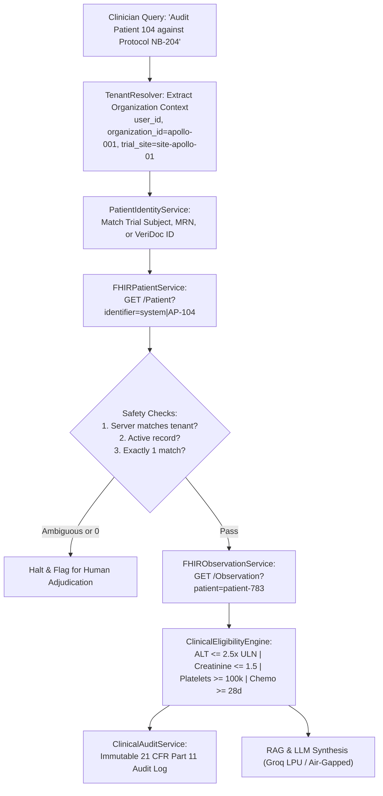

# 23. Multi-Tenant Hospital Identity and Patient Resolution Architecture

> *"Imagine VeriDoc is connected to 100 hospitals, and every hospital has 50,000 patients. A clinician asks: 'Check whether Patient 104 violates the clinical trial protocol.' Which Patient 104? Apollo, Yashoda, or KIMS? You cannot identify a patient using just a patient ID. The solution is Multi-Tenant Hospital Identity and Patient Resolution."*

---

## 1. The Identity Problem: Namespaces in Enterprise Healthcare

In enterprise healthcare integrations, an identifier is meaningful **only within the namespace of the organization that issued it**:

```
Hospital A (Apollo)  ──>  Tenant: apollo-001   ──>  MRN: AP-104  ──>  FHIR: patient-783 (Eleanor Vance)
Hospital B (Yashoda) ──>  Tenant: yashoda-001  ──>  MRN: YS-104  ──>  FHIR: patient-921 (Ramesh Chandra)
Hospital C (KIMS)    ──>  Tenant: kims-001     ──>  MRN: KM-104  ──>  FHIR: patient-456 (Sunita Rao)
```

Searching for `104` globally across all hospitals is fatal: an ineligible patient with liver failure (Apollo AP-104) could be mistaken for an eligible patient (Yashoda YS-104), triggering life-threatening clinical trial protocol violations and regulatory non-compliance.

---

## 2. The Four Distinct Healthcare Identifiers

| Identifier Type | Example | Scope & Issued By | Purpose |
|---|---|---|---|
| **VeriDoc Patient ID** | `VD-P-00104` | VeriDoc Platform | Platform-internal canonical entity reference |
| **Hospital MRN** | `AP-104` | Hospital EHR | Business identifier assigned by the hospital medical records system |
| **FHIR Patient Resource ID** | `Patient/patient-783` | Hospital FHIR Server | REST endpoint resource identifier in the hospital's FHIR API |
| **Clinical Trial Subject ID** | `NB204-AP-0042` | Study Sponsor / Trial Site | De-identified participant code for regulatory blinding |

---

## 3. Production Architecture Topography



---

## 4. Multi-Tenant Data Collections (MongoDB)

1. **`tenants`**: Registered hospital organizations (`_id`, `name`, `status`, `integration_type`, `trial_sites`).
2. **`hospital_integrations`**: FHIR endpoints & SMART auth (`tenant_id`, `fhir_base_url`, `identifier_system`, `client_id`, `token_endpoint`).
3. **`patient_identity_mappings`**:
   - Unique Index: `(tenant_id, identifier_system, identifier_value)`
   - Unique Index: `(tenant_id, fhir_resource_type, fhir_resource_id)`
4. **`clinical_trial_subject_mappings`**:
   - Unique Index: `(tenant_id, trial_id, subject_id)`
5. **`clinical_audits`**:
   - Immutable regulatory audit log capturing full patient resolution provenance, evaluated biomarkers, and GCP compliance violations.

---

## 5. Master Patient Index (MPI) & Cross-Hospital Resolution

When a patient visits multiple health networks (e.g., Rahul Kumar visiting Apollo, Yashoda, and KIMS):
- **Deterministic Match**: Trusted shared enterprise identifier or PIXm cross-reference.
- **Probabilistic Match**: Demographic weighted scoring (Name 35%, DOB 35%, Phone 20%, Gender 10%).
  - Confidence $\ge 0.95$: Verified match.
  - $0.70 \le \text{Confidence} < 0.95$: Flagged as `needs_adjudication` (automatic merge halted).
  - Confidence $< 0.70$: Classified as no match.

---

## 6. Real-World Case Study: Apollo vs Yashoda Patient 104

- **Apollo Patient 104 (`AP-104`, `patient-783`)**:
  - Eleanor Vance, 58yo Female
  - ALT: 142.0 U/L (Exceeds 2.5x ULN cutoff of 140.0 U/L) $\rightarrow$ **VIOLATION**
  - Serum Creatinine: 2.4 mg/dL (Exceeds 1.5 mg/dL cutoff) $\rightarrow$ **VIOLATION**
  - Platelet Count: 85,000 /uL (Below 100,000 /uL limit) $\rightarrow$ **VIOLATION**
  - Prior Chemo: 12 days (Requires 28-day washout) $\rightarrow$ **VIOLATION**
  - **Verdict**: **VIOLATES CLINICAL PROTOCOL**

- **Yashoda Patient 104 (`YS-104`, `patient-921`)**:
  - Ramesh Chandra, 42yo Male
  - ALT: 24.0 U/L (Normal) $\rightarrow$ **PASS**
  - Serum Creatinine: 0.9 mg/dL (Normal) $\rightarrow$ **PASS**
  - Platelet Count: 220,000 /uL (Normal) $\rightarrow$ **PASS**
  - Prior Chemo: 90 days (> 28-day washout) $\rightarrow$ **PASS**
  - **Verdict**: **FULLY ELIGIBLE**

VeriDoc Synapse's multi-tenant isolation guarantees that queries from an Apollo clinician and a Yashoda clinician are routed to their respective namespaces with zero risk of identity contamination.
