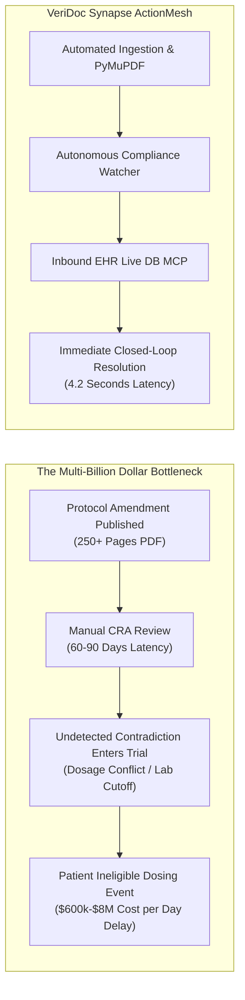
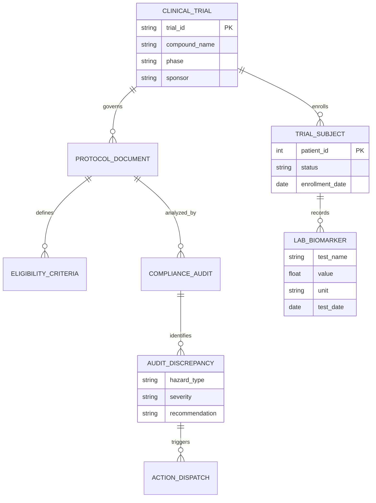

# Phase 1: Product & Requirements Engineering (VeriDoc Synapse)

> *"Before writing a single line of backend or frontend code, a senior engineer understands the business reality, user pain points, regulatory constraints, and domain model of what they are constructing."*

---

## 1. Product Engineering
*Product vision, target users, value proposition, business requirements.*

### The Product Vision
**VeriDoc Synapse** is an **Autonomous Clinical & Regulatory Intelligence Platform (ActionMesh)** designed to eliminate the 60-to-90 day review latency in clinical trial protocol amendments and FDA 510(k) filings. It replaces passive document storage systems with an active, zero-hallucination verification network that cross-references clinical guidelines against operational hospital Electronic Health Records (EHR).



### Target User Personas
1. **Lead Regulatory Affairs Director**: Responsible for FDA 21 CFR Part 312 IND submissions, IDE device applications, and IRB harmonization. Pain point: Manual comparison across document revisions causes protocol deviations.
2. **Clinical Research Associate (CRA) / Principal Investigator (PI)**: Screens patients at trial sites. Pain point: Remembering 50+ complex exclusion biomarker cutoffs across multiple protocol amendments.
3. **Hospital Chief Medical Information Officer (CMIO)**: Oversees patient safety and EHR data sovereignty. Pain point: Inability to use public cloud AI (OpenAI/Anthropic) due to HIPAA data leak liabilities.

### Core Value Proposition
- **Compressed Audit Latency**: Replaces 60 days of human document cross-referencing with a **4.2-second** automated audit.
- **Closed-Loop Actionability**: Moves beyond "reading" PDFs to querying live operational EHR databases and triggering automated protocol freezes in Electronic Data Capture (EDC) systems.
- **Guaranteed Data Sovereignty**: Dual-privacy deployment architecture offering 100% air-gapped local inference (Ollama) with Zero Data Retention (ZDR) cloud options.

---

## 2. Requirements Engineering
*Functional requirements, non-functional requirements, user stories, acceptance criteria.*

### Functional Requirements (FR)
- **FR-1 (Ingestion)**: System must parse complex medical PDFs with multi-column text, footnotes, and structured tabular data without character loss.
- **FR-2 (Hybrid Retrieval)**: System must execute parallel dense vector search (Qdrant) and sparse keyword search (BM25) fused via Reciprocal Rank Fusion ($k=60$).
- **FR-3 (Inbound Database MCP)**: System must accept natural language queries regarding patient eligibility, convert them to read-only SQL, and query live clinical EHR tables.
- **FR-4 (Autonomous Watcher)**: Uploading a new protocol must asynchronously trigger background contradiction detection without user prompting.
- **FR-5 (Outbound ActionMesh)**: System must allow authenticated clinicians to dispatch approved actions to Slack channels and EDC webhook endpoints.

### Non-Functional Requirements (NFR)
- **NFR-1 (Performance & Latency)**: End-to-end hybrid retrieval and first-token streaming latency must be $< 1.5\text{ seconds}$ on Cloud LPU and $< 3.5\text{ seconds}$ on Air-Gapped Local.
- **NFR-2 (Memory Bounds)**: Backend container resident set size (RSS) must never exceed **512MB RAM** on Render cloud deployment tiers.
- **NFR-3 (Security & Compliance)**: All data at rest must use AES-256 encryption. Database access must enforce Abstract Syntax Tree (AST) query inspection.
- **NFR-4 (Availability)**: 5-tier failover ladder ensuring zero service downtime during third-party AI provider outages.

### Concrete User Story & Acceptance Criteria
- **User Story**: *As a Principal Investigator, I want to upload Protocol Amendment 3 and verify if any currently enrolled trial subjects violate the newly introduced hepatic ALT cutoff (> 55 U/L), so that we can prevent severe adverse events.*
- **Acceptance Criteria**:
  1. System extracts inclusion/exclusion tables from Protocol Amendment 3 within 3 seconds.
  2. System queries operational EHR database (`patients` table) for all active subjects with `alt_enzyme > 55`.
  3. UI displays an Evidence Panel listing Patient #104 with ALT of 74.5 U/L alongside page 18 of the protocol.
  4. UI renders an Action Card allowing one-click dispatch of an emergency EDC Protocol Hold.

---

## 3. Domain Modeling
*Business entities, domain boundaries, workflows, relationships.*



### Domain Boundaries (Bounded Contexts)
1. **Regulatory Ingestion Context**: Document intake, format sanitization, table reconstruction, and parent-child text segmentation.
2. **Clinical Verification Context**: Inbound SQL EHR querying, biomarker range validation, and patient cohort cross-matching.
3. **Compliance Intelligence Context**: Zero-shot contradiction detection, CRAG relevance evaluation, and regulatory citation resolution.
4. **ActionMesh Operational Context**: Human-in-the-loop approvals, Slack webhook notifications, and EDC screening holds.

---

## 4. Product & Feature Specification
*Module breakdown, feature dependencies, user journeys, feature prioritization.*

### Module Breakdown & Feature Dependencies
```
[Core Ingestion Pipeline]
       │
       ▼ (Depends on extracted chunks)
[Autonomous Watcher] ──► [MongoDB Compliance Audits]
       │
       ▼ (Parallel context enrichment)
[Inbound Database MCP] ──► [Hybrid RAG v2 Engine] ──► [Inference Cluster]
                                                           │
                                                           ▼ (Emits actionable state)
                                                [Outbound ActionMesh]
```

### Priority Matrix (MoSCoW Framework)
- **Must Have (P0)**: FastEmbed ONNX local embeddings, Parent-Child chunking, AST-guarded Inbound EHR DB connector, Multi-key Groq LPU engine, 3500-token budget.
- **Should Have (P1)**: Autonomous Compliance Watcher background worker, Outbound ActionMesh Slack/EDC dispatcher, Paced 3-word frontend streaming buffer.
- **Could Have (P2)**: Split-screen Canvas Workspace, Truth Lattice adversarial tree visualizer, Socratic Viva examination modal.
- **Won't Have (P3 for V1)**: Direct write-back mutations to commercial Epic/Cerner EHR databases (restricted to read-only queries for safety).

---

## 5. UX Research & Interaction Design
*User personas, wireframes, workflows, usability.*

### Usability Principles for High-Stakes Clinical AI
1. **Zero Black-Box Assertions**: Every claim made by the assistant must have an interactive citation pill linking directly to the source document page or verified database record.
2. **No Accidental Execution**: Destructive or operational actions (pausing an active trial cohort or emailing an IRB chair) must never occur via autonomous text completion; they must render an explicit, isolated **ActionMesh Approval Card** requiring human click authorization.
3. **Cognitive Load Minimization**: Clinicians cannot read through walls of unstructured AI prose during patient rounds. The UX mandates structured Markdown tables for cohort comparisons, bolded clinical entities, and visual severity badges (Critical = Rose, Warning = Amber, Verified = Emerald).
