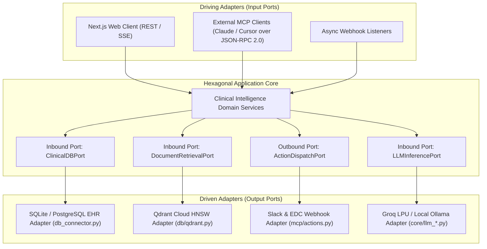
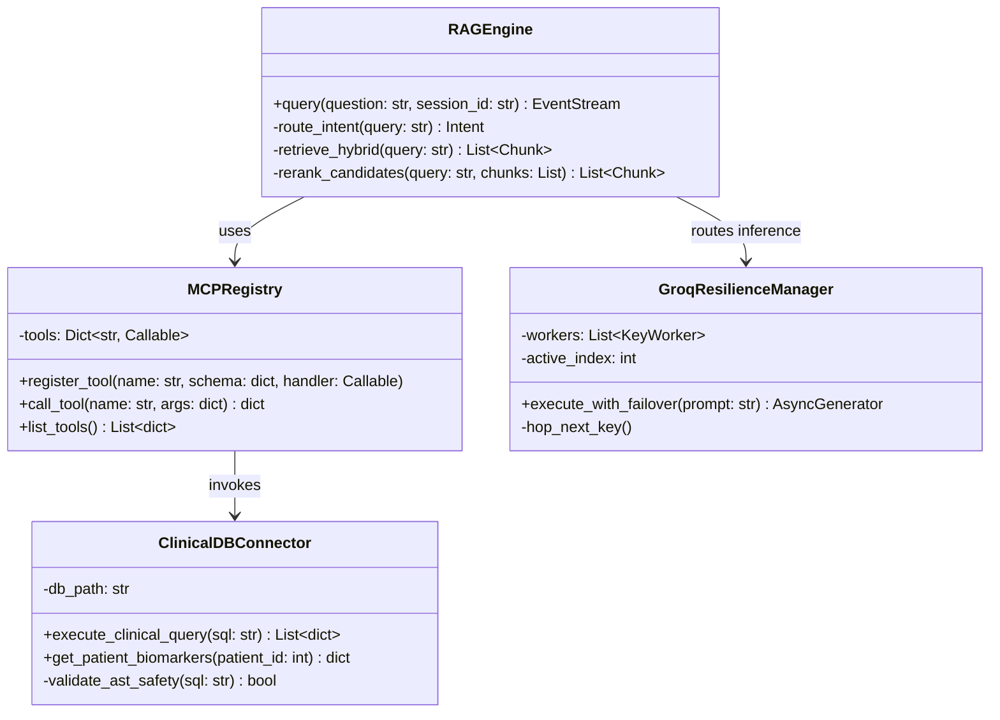
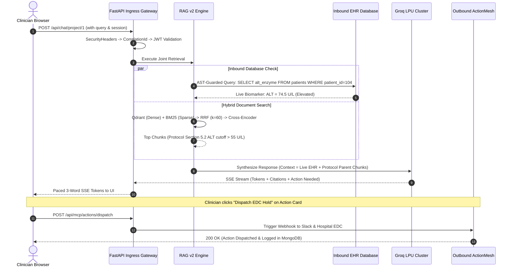

# Phase 2: Architecture & System Design (VeriDoc Synapse)

> *"System architecture is the set of decisions you make that are hard to change later. In VeriDoc Synapse, architecture balances low latency, extreme memory constraints, regulatory auditability, and data privacy."*

---

## 6. Software Architecture
*Monolith, modular monolith, microservices, layered architecture, clean architecture, hexagonal architecture.*

### Architectural Pattern: The Hexagonal Modular Core
Instead of an over-engineered distributed microservice cluster (which adds network latency and operational overhead) or an unmaintainable monolithic script, VeriDoc Synapse uses an **Asynchronous Hexagonal Architecture (Ports and Adapters)** inside a modular FastAPI ASGI core:



### Why Hexagonal Architecture Wins for Healthcare AI:
- **Testability**: We can test our entire clinical contradiction reasoning domain by mocking the `ClinicalDBPort` and `LLMInferencePort` without needing live hospital databases or active cloud credits.
- **Provider Agnosticism**: Switching from Groq LPU to local Ollama or Anthropic Claude requires zero changes to core domain logic—only swapping the adapter behind `LLMInferencePort`.

---

## 7. System Design (HLD & LLD)
*High-level design, low-level design, scalability, availability, reliability.*

### High-Level Design (HLD)
The platform is organized into 5 tiers:
1. **Edge & Client Tier**: Next.js 16 App Router on Vercel Edge with client-side token buffering.
2. **Ingress Security Gateway**: FastAPI ASGI with custom middlewares (HSTS, Correlation ID, RequestSizeLimit).
3. **Dual Execution Engine**:
   - *Ingestion Engine*: PyMuPDF extractor, Hierarchical Chunker, Autonomous Compliance Watcher.
   - *Retrieval Engine*: HyDE intent router, parallel Qdrant/BM25 search, Reciprocal Rank Fusion, Cross-Encoder reranker.
4. **Model Context Protocol (MCP) Hub**: Bidirectional server exposing AST-guarded Inbound EHR tools and Outbound ActionMesh dispatchers.
5. **Polyglot Persistence**: MongoDB Atlas (metadata/audits), Qdrant Cloud (dense vectors), and Encrypted Local NVMe / Cloudinary (binary PDFs).

### Low-Level Design (LLD): Component Class Diagram



---

## 8. Component & Module Architecture
*Module boundaries, dependencies, interfaces, separation of concerns.*

```
rag-backend/app/
├── main.py                     # ASGI App Factory, Lifespan Hooks & Global Ingress
├── api/
│   └── routes/                 # HTTP Transport Layer (No business logic)
│       ├── chat.py             # Chat Controller (Validates DTOs, initiates SSE)
│       ├── documents.py        # Ingestion Controller (Receives multipart uploads)
│       └── mcp.py              # MCP Controller (Exposes JSON-RPC 2.0 & SSE)
├── core/                       # Cross-Cutting Technical Infrastructure
│   ├── groq_resilience.py      # Rate-limiting, token buckets, circuit breakers
│   ├── embeddings.py           # FastEmbed ONNX local embedding engine
│   ├── fusion.py               # Reciprocal Rank Fusion algorithm
│   └── security.py             # Cryptographic JWT & BCrypt functions
├── db/                         # Data Access Adapters
│   ├── mongodb.py              # Motor Async Mongo Client
│   └── qdrant.py               # Qdrant Vector Client
├── ingestion/                  # Document Processing Domain
│   ├── pipeline.py             # PyMuPDF parser & parent-child chunker
│   └── crawler.py              # Bounded asynchronous regulatory web crawler
├── mcp/                        # Operational ActionMesh Domain
│   ├── db_connector.py         # Inbound EHR SQL connector with AST guards
│   ├── watcher.py              # Autonomous post-ingestion contradiction detector
│   ├── actions.py              # Outbound Slack / EDC action dispatcher
│   └── registry.py             # Open MCP tool specification catalog
└── rag/                        # Search & Retrieval Domain
    ├── engine.py               # RAG v2 orchestrator
    └── crag.py                 # Corrective RAG evaluator
```

---

## 9. Distributed Systems Design
*Service communication, consistency, fault tolerance, distributed transactions.*

### Distributed Communication Modes
- **Synchronous Ingress (HTTP REST)**: Used for stateless operations (file upload start, auth login, project creation).
- **Asynchronous Event-Driven Ingestion**: The moment document chunks are committed, `pipeline.py` dispatches `asyncio.create_task(compliance_watcher.analyze_document_async(...))`. Ingestion completes in $< 1.2\text{s}$, while auditing runs in the background.
- **Persistent Streaming (SSE)**: Unidirectional event stream delivering tokens, citations, and action cards to the browser over standard HTTP/2.

### Consistency Model
- **Document Metadata**: Strong consistency within MongoDB Atlas replica sets (`w: "majority"`).
- **Vector Indexing**: Eventual consistency in Qdrant Cloud (HNSW graph construction converges within 200ms of upsert).
- **Relational EHR Records**: Strict ACID consistency in SQLite / PostgreSQL, ensuring lab cutoffs and screening records never exhibit dirty reads.

---

## 10. Data Flow Architecture
*Request lifecycle, event flows, state transitions, inter-service communication.*



---

## 11. Infrastructure Architecture
*Cloud architecture, networking, compute, storage, environments.*

```
┌─────────────────────────────────────────────────────────────────────────────┐
│                           INFRASTRUCTURE TOPOGRAPHY                         │
├─────────────────────────────────────────────────────────────────────────────┤
│ 1. Client Edge: Next.js 16 App Router hosted on Vercel Global Edge CDN.     │
│ 2. Backend Compute: Dockerized FastAPI container on Render (Linux 512MB RAM)│
│ 3. Managed Document Store: MongoDB Atlas M0/M10 Cluster (Virginia, us-east-1)│
│ 4. Managed Vector Store: Qdrant Cloud Managed Cluster (Frankfurt / US-East) │
│ 5. Inference Compute: Multi-Key Groq LPU Cloud (Ultra-Fast) + Local Host    │
│    Ollama Runtime (Air-Gapped Private Hospital Perimeter)                   │
│ 6. Binary PDF Storage: Encrypted NVMe local volume mount + Cloudinary CDN   │
└─────────────────────────────────────────────────────────────────────────────┘
```
