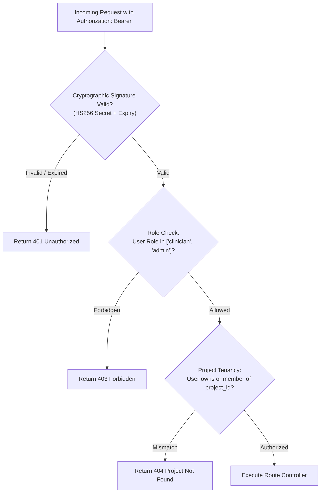
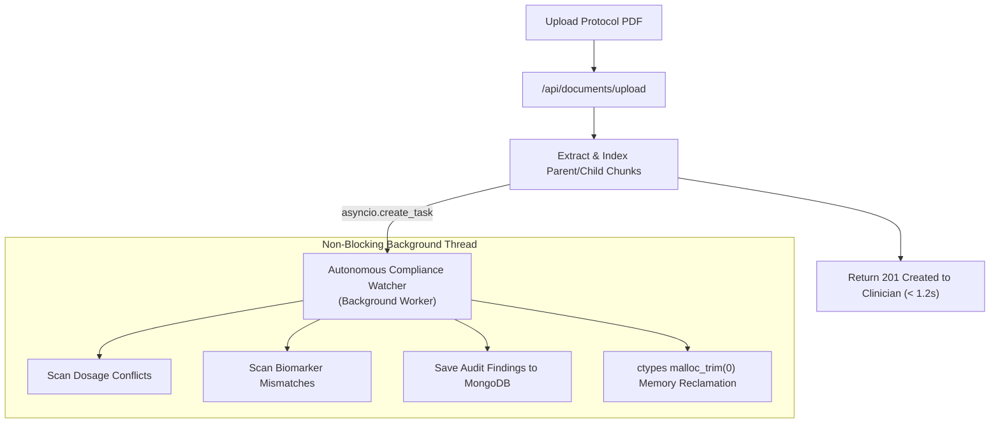

# Phase 4: Backend Engineering (VeriDoc Synapse)

> *"Backend engineering is where the application guarantees correctness, enforces security boundaries, orchestrates asynchronous workloads, and scales under load."*

---

## 18. Backend Architecture
*Controllers, services, repositories, middleware, dependency injection.*

### The Layered Execution Architecture
VeriDoc Synapse follows a strict separation of concerns across 5 backend layers:

```
[HTTP Request]
       │
       ▼
[Layer 1: ASGI Middleware Stack] ──► SecurityHeaders, CorrelationId, RequestSizeLimit
       │
       ▼
[Layer 2: API Route Controllers] ──► rag-backend/app/api/routes/ (HTTP DTOs & status codes)
       │
       ▼
[Layer 3: Domain Service Layer]  ──► rag/engine.py, mcp/watcher.py, ingestion/pipeline.py
       │
       ▼
[Layer 4: Data Repository Layer] ──► db/mongodb.py, db/qdrant.py, mcp/db_connector.py
       │
       ▼
[Layer 5: Hardware & Drivers]    ──► FastEmbed ONNX C++, PyMuPDF C engine, LibC malloc_trim
```

### Dependency Injection with FastAPI `Depends`
We use FastAPI's native dependency injection system for request authentication, database connection retrieval, and role enforcement:
```python
# rag-backend/app/api/routes/chat.py
@router.post("/project/{project_id}")
async def chat_with_project(
    project_id: str,
    payload: ChatRequestSchema,
    current_user: User = Depends(get_current_active_user), # Injected auth
    mongo_db: AsyncIOMotorDatabase = Depends(get_database) # Injected pool
):
    ...
```

---

## 19. Business Logic Engineering
*Domain rules, workflows, calculations, business validations.*

### Core Domain Rules Enforced:
1. **Zero-Execution Rule**: The LLM cannot execute destructive SQL statements (`DROP`, `DELETE`, `UPDATE`, `ALTER`). Only `SELECT` statements are permitted via AST parsing.
2. **Biomarker Deviation Validation**: When evaluating patient inclusion against protocol criteria, the system applies strict numerical boundaries (e.g., ALT > 55 U/L is an immediate disqualification).
3. **Regulatory Audit Generation**: A document cannot be marked "Cleared" if the Autonomous Watcher discovers unaddressed CRITICAL dosage contradictions.

---

## 20. API Engineering
*REST, RPC, endpoint design, HTTP methods, status codes.*

### The Poly-Protocol API Design
- **RESTful Endpoints**: Used for standard CRUD operations:
  - `POST /api/documents/upload` $\rightarrow$ `201 Created`
  - `GET /api/documents` $\rightarrow$ `200 OK`
  - `DELETE /api/documents/{id}` $\rightarrow$ `204 No Content`
- **JSON-RPC 2.0 (MCP)**: Implemented at `/api/mcp/rpc` for standardized tool invocation:
  - Request: `{"jsonrpc": "2.0", "id": 1, "method": "tools/call", "params": {...}}`
  - Response: `{"jsonrpc": "2.0", "id": 1, "result": {...}}`
- **Status Code Precision**: Strict HTTP status codes (`401 Unauthorized` for expired JWTs, `403 Forbidden` for role violations, `422 Unprocessable Entity` for Pydantic schema validation failures, `429 Too Many Requests` for rate limit trips).

---

## 21. API Contract Design
*OpenAPI/Swagger, request/response schemas, versioning, API documentation.*

FastAPI automatically generates an interactive **OpenAPI 3.1.0** specification at `/docs` and `/redoc`. 
- **Request/Response Schemas**: Governed by strict Pydantic v2 models in [`rag-backend/app/models/schemas.py`](file:///c:/Programming/Projects/01_Healthcare-MedTech/chat_base/rag-backend/app/models/schemas.py).
- **API Versioning**: Prefixing `/api/v1` (with seamless backward-compatibility aliases) ensures future schema migrations do not break deployed frontend builds or third-party MCP agents.

---

## 22. Authentication & Authorization
*JWT, OAuth 2.0, sessions, RBAC, permissions, multi-factor authentication.*



---

## 23. Integration Engineering
*Third-party APIs, webhooks, external services, payment gateways.*

- **Slack Clinical Safety Webhook**: Dispatches formatted Block Kit payloads to `#clinical-safety-alerts` with severity badges and direct document citation links.
- **Electronic Data Capture (EDC) API**: Integrates with clinical trial EDC systems (Medidata Rave / Veeva EDC simulation) to flag active patient screening holds.
- **Model Context Protocol (MCP)**: Bi-directional Anthropic 2024-11-05 implementation allowing Claude Desktop and Cursor agents to use our clinical database tools.

---

## 24. Asynchronous Processing
*Background jobs, queues, workers, scheduled tasks, event-driven processing.*



---

## 25. Real-Time Engineering
*WebSockets, Server-Sent Events, notifications, live updates.*

We chose **Server-Sent Events (SSE)** over WebSockets for inference streaming:
- Passes natively through enterprise hospital proxies without WebSocket handshake rejection.
- Supports native browser auto-reconnection via `EventSource`.
- Direct integration with FastAPI's `StreamingResponse(generator(), media_type="text/event-stream")`.
