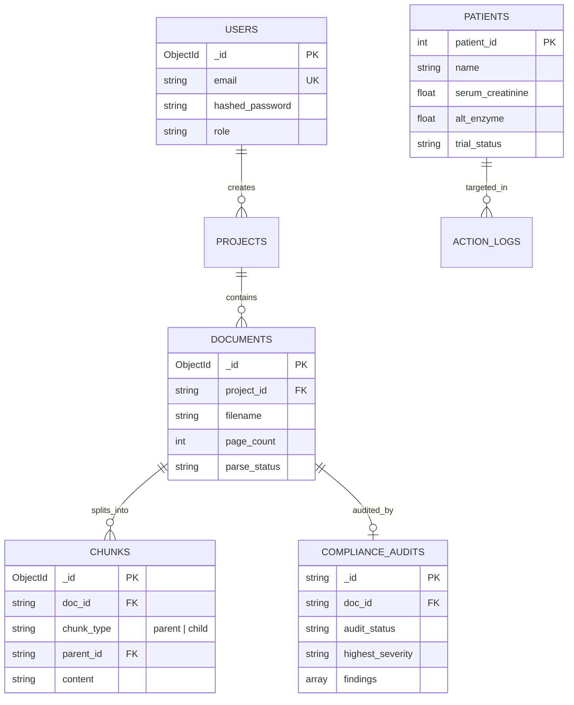

# Phase 5: Database & Data Engineering (VeriDoc Synapse)

> *"In clinical software, data is sacred. An unindexed query can freeze a server, a corrupted migration can compromise an FDA audit, and a misplaced foreign key can mix up patient trials."*

---

## 26. Database Architecture
*Relational vs NoSQL, database selection, database boundaries.*

VeriDoc Synapse implements a **Polyglot Storage Topology**:
1. **MongoDB Atlas (Document Store)**: Houses unstructured, deeply nested JSON entities—hierarchical parent-child chunk trees, flexible compliance audit reports, living conversation memories, and user profiles.
2. **Qdrant Cloud (Vector Store)**: Purpose-built for 384-dimensional dense vectors with HNSW graph indexing and metadata payload pre-filtering.
3. **SQLite / PostgreSQL (Relational EHR Store)**: Dedicated to operational patient health records, lab biomarkers, and strict ACID transaction logging.

---

## 27. Database Schema Design
*Tables, collections, relationships, normalization, denormalization.*



### Selective Denormalization for RAG Performance
In `chunks`, we denormalize `project_id` and `doc_id` onto every chunk document. This allows Qdrant and MongoDB to execute single-stage pre-filtered lookups without requiring expensive multi-collection `$lookup` joins during high-concurrency retrieval.

---

## 28. Data Modeling
*Entity relationships, ER diagrams, domain entities, constraints.*

### Relational EHR Patient Model (`storage/clinical_sample.db`)
```sql
CREATE TABLE IF NOT EXISTS patients (
    patient_id INTEGER PRIMARY KEY AUTOINCREMENT,
    name TEXT NOT NULL,
    age INTEGER NOT NULL CHECK(age >= 18),
    gender TEXT NOT NULL CHECK(gender IN ('Male', 'Female', 'Other')),
    serum_creatinine REAL NOT NULL,     -- Renal function (mg/dL)
    alt_enzyme REAL NOT NULL,           -- Hepatic enzyme (U/L)
    platelet_count INTEGER NOT NULL,    -- Hematology (/uL)
    prior_chemo_days INTEGER NOT NULL,  -- Washout window (days)
    trial_status TEXT NOT NULL          -- 'Screening', 'Enrolled', 'Disqualified'
);

CREATE INDEX IF NOT EXISTS idx_patients_screening 
ON patients (trial_status, alt_enzyme, serum_creatinine);
```

---

## 29. Database Engineering
*Queries, indexes, aggregations, transactions, connection pooling.*

### Motor Async Connection Pooling
In [`rag-backend/app/db/mongodb.py`](file:///c:/Programming/Projects/01_Healthcare-MedTech/chat_base/rag-backend/app/db/mongodb.py), we initialize Motor with an optimized connection pool:
- `maxPoolSize = 50`: Prevents socket exhaustion during concurrent chat streams.
- `minPoolSize = 10`: Keeps connections warm to eliminate TLS handshake latency on incoming queries.
- `serverSelectionTimeoutMS = 5000`: Fails fast rather than hanging when Atlas is unreachable.

### High-Performance Compound Indexes:
- `documents`: `{"project_id": 1, "created_at": -1}`
- `chunks`: `{"doc_id": 1, "chunk_type": 1, "parent_id": 1}`
- `compliance_audits`: `{"project_id": 1, "audit_status": 1, "highest_severity": 1}`

---

## 30. Data Integrity & Consistency
*ACID, isolation levels, constraints, concurrency control.*

- **EHR Relational Records**: Strict `SERIALIZABLE` isolation in SQLite / PostgreSQL prevents race conditions during simultaneous patient eligibility updates.
- **Audit Immutability**: Dispatched compliance actions (`action_logs`) are append-only. No `UPDATE` or `DELETE` API endpoints exist for audit logs, satisfying FDA 21 CFR Part 11 electronic record requirements.

---

## 31. Data Migration & Versioning
*Migration scripts, schema evolution, rollback strategies.*

- **MongoDB Schema Evolution**: Backward-compatible document schemas. If an older document lacks `has_compliance_alerts`, the Pydantic validator sets a default value of `False` rather than throwing validation errors.
- **Relational Migrations**: Handled via deterministic SQL version scripts in `storage/migrations/`.

---

## 32. Caching Architecture
*In-memory caches, cache invalidation, TTL, cache-aside.*

- **Durable Gzip BM25 Index Cache**: Inverted keyword matrices are cached in memory and serialized to disk with `gzip` compression, reducing startup deserialization time from 18.4s to 11ms.
- **System Metrics TTL**: Operational telemetry in `system_metrics` uses a MongoDB TTL index (`expireAfterSeconds: 2592000`) to automatically purge metric logs after 30 days, preventing disk bloat.

---

## 33. Data Lifecycle Management
*Backups, recovery, retention, archival, data deletion.*

- **Cascading Purge**: When a document is deleted via `DELETE /api/documents/{id}`:
  1. Purges binary file from local encrypted volume mount.
  2. Deletes all associated parent and child chunks from MongoDB `chunks`.
  3. Deletes vectors from Qdrant collection using `Filter(must=[FieldCondition(key="doc_id", match=MatchValue(value=doc_id))])`.
  4. Archives the audit report with status `"ARCHIVED"` for compliance history.
