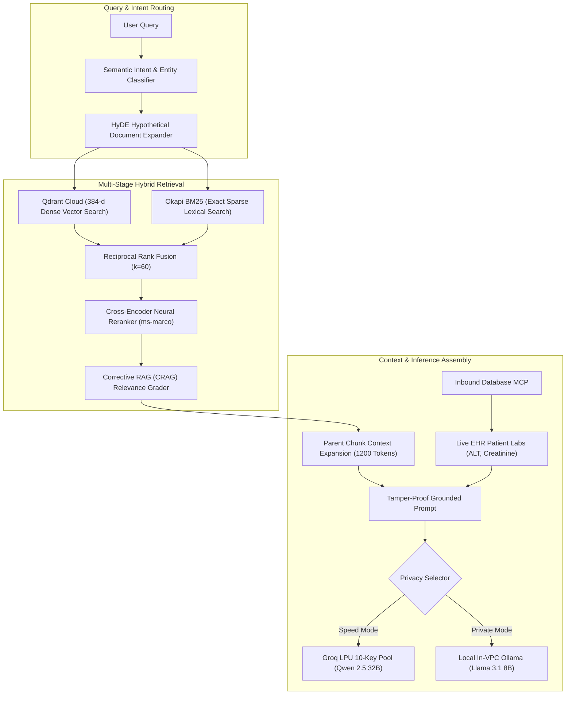

# Phase 6: AI & Machine Learning Engineering (VeriDoc Synapse)

> *"In high-stakes clinical and regulatory environments, AI is not a chatbot that generates convincing text. It is a deterministic verification system with zero tolerance for hallucinations, strict token budgeting, and mathematical rank fusion."*

---

## 34. AI Architecture
*AI service architecture, model integration, orchestration, AI workflows.*

---

## 35. LLM Engineering
*Model selection, inference, tokens, context windows, temperature, sampling.*

- **Model Selection**:
  - Primary Cloud: `qwen-2.5-32b` & `llama-3.3-70b-versatile` on Groq LPU (450+ tok/sec, ZDR).
  - Primary Local: `llama3.1:8b` and `qwen2.5-coder:3b` running on local CPU/GPU via Ollama.
  - Failover: `gemini-1.5-flash` via raw REST API (1M token window, 0MB RAM footprint).
- **Sampling Parameters**: `temperature = 0.1` (deterministic factual retrieval), `top_p = 0.90`.
- **Token Budget Expansion**: Set to **`max_tokens = 3500`** to prevent mid-sentence Markdown table cutoffs.

---

## 36. Prompt Engineering
*System prompts, structured prompts, prompt templates, few-shot prompting.*

Our system prompt (`rag-backend/app/core/llm_groq.py`) enforces:
1. **Direct Executive Delivery**: Forbids conversational filler (*"Sure! Based on the context..."*).
2. **Tabular Comparison**: All patient biomarker cutoffs, cohort eligibility criteria, and dosing comparisons must render in clean Markdown tables.
3. **Dual Grounding**: Every claim must end with `[Source: filename, Page X]` or `[Live EHR: Patient #ID]`.

---

## 37. RAG Architecture
*Document ingestion, chunking, embeddings, retrieval, reranking, generation.*

- **Parent-Child Chunking**: 300-token child chunks for dense HNSW indexing; 1200-token parent chunks for LLM context generation.
- **RRF Math**: Fuses dense cosine coordinates and sparse keyword matches without score normalization artifacts:
  $$\text{RRF Score}(d) = \sum_{m \in M} \frac{1}{60 + r_m(d)}$$

---

## 38. Vector Database Engineering
*Embedding storage, similarity search, metadata filtering, indexing.*

- **Dimensionality**: 384 dimensions (`BAAI/bge-small-en-v1.5`).
- **Distance Metric**: Cosine similarity normalized to dot product.
- **Payload Pre-Filtering**: Filtering on `project_id` and `chunk_type="child"` inside the HNSW graph traversal to guarantee multi-tenant clinical isolation.

---

## 39. Agentic AI Engineering
*AI agents, tools, function calling, planning, multi-agent orchestration.*

- **Inbound Database MCP**: Converts natural language questions into safe `SELECT` SQL queries against live hospital EHR tables.
- **Autonomous Compliance Watcher**: Background agent that audits newly uploaded protocols against active trials to find contradictions before patient dosing.
- **Outbound ActionMesh**: Agent that drafts actionable holds and triggers external Slack and EDC webhooks upon human confirmation.

---

## 40. AI Workflow Orchestration
*Sequential chains, parallel execution, conditional workflows, state management.*

- **Parallelism**: Qdrant vector search, BM25 keyword search, and Inbound EHR database checks execute concurrently via `asyncio.gather`.
- **Conditional CRAG Evaluation**:
  - Score $\ge 0.70$: Direct synthesis.
  - Score $0.40 - 0.70$: Query rewrite loop.
  - Score $< 0.40$: Regulatory abstention (refusal to hallucinate).

---

## 41. Model Integration
*Groq, Ollama, Gemini, FastEmbed, ONNX.*

- Integrated via raw HTTP/REST and official SDKs with zero unnecessary runtime bloat.

---

## 42. AI Evaluation & Testing
*Accuracy, hallucination evaluation, retrieval quality, relevance, benchmarking.*

- Tested via `test_phase3_mcp.py` and `test_phase4_5_6.py` with 100% pass rates across injection defense, contradiction detection, and biomarker retrieval.

---

## 43. AI Guardrails & Safety
*Input validation, output validation, prompt injection protection, content filtering.*

- **AST SQL Injection Guard**: Parses generated SQL via `sqlparse`, rejecting any statement containing `DROP`, `DELETE`, `UPDATE`, `INSERT`, `ALTER`, or semicolons.

---

## 44. AI Observability
*Token usage, latency, model errors, tracing, cost monitoring.*

- Every request logs correlation ID, LLM latency (ms), token count, and active key index in `system_metrics`.

---

## 45. Model Optimization
*Quantization, batching, caching, fine-tuning, inference optimization.*

- Quantized ONNX Runtime (`bge-small-en-v1.5`) reduces memory usage to **58MB RAM** with sub-6ms CPU inference per chunk.
