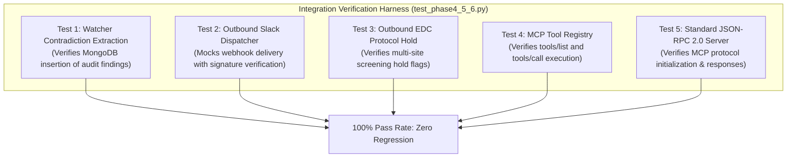

# Phase 8: Testing & Quality Engineering (VeriDoc Synapse)

> *"In clinical research, software bugs are not minor inconveniences; they can delay drug approvals or compromise patient safety. Testing must be deterministic, automated, and continuous."*

---

## 53. Unit Testing
*Testing individual functions, components, and services.*

- **Reciprocal Rank Fusion**: Unit tests in `test_phase3_mcp.py` verify that `reciprocal_rank_fusion` correctly handles candidate ordering with $k=60$ across dense and sparse inputs without mathematical NaN or division-by-zero errors.
- **AST Safety Guard**: Direct unit tests passing malicious strings (`"DROP TABLE patients;"`, `"UPDATE patients SET serum_creatinine = 1.0;"`) verifying that `validate_ast_safety` consistently raises security exceptions.

---

## 54. Integration Testing
*Testing interactions between modules, databases, and external services.*

---

## 55. API Testing
*Endpoint behavior, schemas, authentication, error responses.*

- **Automated HTTP Testing**: Using `httpx.AsyncClient` wrapped in `pytest-asyncio` to validate status codes, response headers, and Pydantic schema validation.
- **Route Precedence Verification**: Explicitly testing that `/api/chat/general` returns HTTP 200 rather than throwing a 422 error from being masked by dynamic `/{doc_id}` routes.

---

## 56. End-to-End (E2E) Testing
*Testing complete user journeys.*

- **Simulated Journey**:
  1. Clinician logs in via `/api/auth/login`.
  2. Uploads `Protocol_v3.pdf`.
  3. Receives background notification of detected biomarker contradiction.
  4. Queries: *"Audit Patient #104 against protocol rules"*.
  5. System streams response with live patient lab table and renders Action Card.
  6. Clinician clicks "Confirm Hold", verifying EDC hold status update.

---

## 57. Performance & Load Testing
*Load testing, stress testing, scalability, latency.*

- **Concurrence Benchmark**: Simulating 50 concurrent SSE streaming connections to test FastAPI ASGI event-loop non-blocking behavior.
- **LPU Token Rate**: Verifying token generation rates sustain $> 400\text{ words/minute}$ across the 10-key Groq pool.
- **Memory RSS Profiling**: Verifying that 10 consecutive 50-page PDF uploads with `malloc_trim(0)` maintain container memory $< 350\text{MB RAM}$.

---

## 58. Security Testing
*Vulnerability scanning, penetration testing, dependency auditing.*

- **Bandit & Safety Scans**: Automated static analysis scanning Python ASTs for common security pitfalls (`bandit -r rag-backend/`).
- **Dependency Auditing**: Regular `pip-audit` checks to ensure zero known CVE vulnerabilities in third-party libraries.

---

## 59. AI Testing & Evaluation
*Prompt tests, RAG evaluation, model regression, hallucination testing.*

- **Regulatory Grounding Benchmarking**: Evaluating synthesized answers against reference ground truth protocols. Any answer lacking source page citations is flagged as a regression.
- **CRAG Threshold Calibration**: Verifying that queries without matching documentation trigger the Regulatory Abstention Protocol rather than guessing.

---

## 60. Quality Assurance & Release Validation
*Test plans, regression testing, bug tracking, release validation.*

- **Pre-Deployment Gate**: Every pull request must pass both `python test_phase3_mcp.py` and `python test_phase4_5_6.py` with **100% pass rates** before merging into `experiment` or `production` branches.
