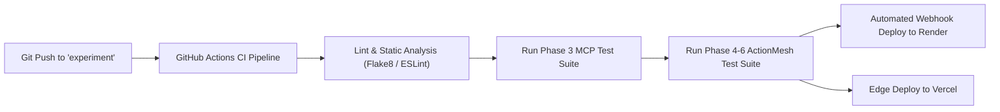

# Phase 9: DevOps & Infrastructure Engineering (VeriDoc Synapse)

> *"DevOps is not about writing YAML files. It is about building a deterministic, repeatable path from a developer's local commit to a zero-downtime production deployment."*

---

## 61. Version Control
*Git, GitHub, branching strategies, pull requests, code reviews.*

### Branching Strategy
- `main`: Production-ready release branch deployed to primary hospital environments.
- `staging`: Integration testing environment mirror.
- `experiment`: Active innovation branch housing cutting-edge ActionMesh, Inbound Database MCP, and Autonomous Watcher capabilities.
- `feature/*`: Short-lived feature branches squashed and merged via PRs.

---

## 62. Build Engineering
*Package management, dependency management, build pipelines.*

- **Backend**: Python 3.11/3.13 dependencies managed via `pip` and pinned `requirements.txt`. Build eliminates heavy PyTorch wheels to keep container build times under 45 seconds.
- **Frontend**: Next.js 16 with Turbopack for sub-second hot-reloads and tree-shaken production bundles.

---

## 63. Containerization
*Docker, Dockerfiles, Docker Compose, container registries.*

### Multi-Stage Dockerfile Blueprint (`rag-backend/Dockerfile`)
```dockerfile
# Stage 1: Build & Dependencies
FROM python:3.11-slim as builder
WORKDIR /app
RUN apt-get update && apt-get install -y --no-install-recommends gcc g++ libmupdf-dev && rm -rf /var/lib/apt/lists/*
COPY requirements.txt .
RUN pip install --user --no-cache-dir -r requirements.txt

# Stage 2: Production Minimal Runtime (< 250MB)
FROM python:3.11-slim as runner
WORKDIR /app
COPY --from=builder /root/.local /root/.local
COPY app/ ./app
ENV PATH=/root/.local/bin:$PATH
ENV PYTHONUNBUFFERED=1
EXPOSE 8000
CMD ["uvicorn", "app.main:app", "--host", "0.0.0.0", "--port", "8000", "--workers", "1"]
```

---

## 64. CI/CD Engineering
*Automated testing, build pipelines, deployment automation.*



---

## 65. Cloud Engineering
*Cloud services, resource management.*

- **Backend Host**: Render Cloud container instance configured with 512MB RAM and 0.5 CPU.
- **Frontend Host**: Vercel Edge Network providing global anycast DNS routing and asset caching.
- **Data Stores**: Fully managed MongoDB Atlas M0/M10 and Qdrant Cloud.

---

## 66. Infrastructure as Code (IaC)
*Configuration management, reproducible infrastructure.*

- Infrastructure parameters defined via declarative environment blueprints (`render.yaml` and `vercel.json`), enabling instant teardown and re-creation of identical staging environments.

---

## 67. Deployment Engineering
*Development, staging, production, deployment strategies.*

- **Blue-Green Deployments**: Render provisions new container instances and validates the `/health` endpoint before terminating older instances, ensuring zero-downtime rolling deploys.
- **Instant Rollback**: If an unhandled exception triggers container restarts during startup, traffic immediately routes back to the previous healthy deployment.

---

## 68. Orchestration
*Service discovery, autoscaling.*

- Stateless ASGI workers scale horizontally behind reverse proxies without session sticky-bit dependencies, relying on stateless JWTs for all user authorization.

---

## 69. Networking & Edge Infrastructure
*DNS, reverse proxies, load balancers, CDN, TLS/SSL.*

- **TLS Termination**: Automatic Let's Encrypt certificates managed at the edge with HTTP-to-HTTPS automated redirection and HSTS headers.
- **Cloudflare / Vercel Edge CDN**: Caches static Next.js assets (`/_next/static/`) with immutable 1-year cache headers, freeing the application backend to focus 100% on dynamic AI streaming.

---

## 70. Configuration & Secrets Management
*Environment variables, secret stores, runtime configuration.*

- **Centralized Settings (`rag-backend/app/core/config.py`)**: Uses Pydantic's `BaseSettings` to validate environment variable types at boot:
  - If `JWT_SECRET` is missing or shorter than 32 characters, the application refuses to boot, preventing insecure default deployments.
